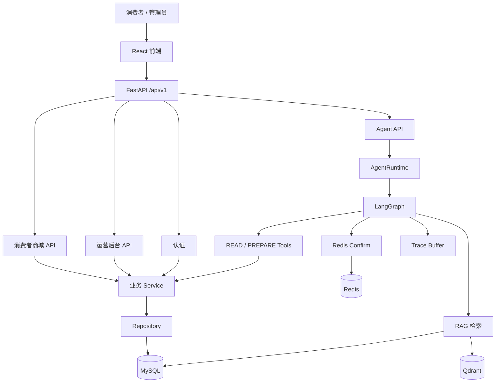

# 清风数码 · E-Commerce Agent

一个本地可运行的三端电商智能体项目：

```text
消费者商城 + AI 导购/客服
运营管理后台 + Agent 审批中心
Agent 调试观察台
```

项目重点不是做一个完整商业电商平台，而是验证：

- 真实商品、SKU、库存、订单、售后如何建模；
- LangGraph Agent 如何安全调用真实业务能力；
- 高风险操作如何通过 Prepare / Admin Approval 受控执行；
- RAG 如何做到 ACL、Chunk 回查和可解释的拒答；
- 消费者、运营和调试三类角色如何在同一套后端之上分工。

> 本项目是本地开发/求职演示项目，不是生产系统。
> 不包含真实支付、购物车、云部署、HTTPS 和正式运维体系。

---

## 功能总览

### 消费者商城

| 功能 | 状态 |
|---|---|
| 商品浏览、分类、搜索 | 已完成 |
| 商品详情、SKU、库存 | 已完成 |
| 立即购买 | 已完成 |
| 我的订单、订单详情 | 已完成 |
| 取消未发货订单 | 已完成 |
| 我的售后、售后详情 | 已完成 |
| 申请换货 | 已完成 |
| 填写退货物流 | 已完成 |
| 我的审批 / 审批进度 | 已完成 |
| AI 导购/客服 | 已完成 |
| 购物车 | 未实现 |
| 支付/结算 | 未实现 |

### 运营后台

| 功能 | 状态 |
|---|---|
| 商品管理、图片、SKU | 已完成 |
| 库存初始化、入库、调整、流水 | 已完成 |
| 订单发货、送达、完成 | 已完成 |
| 售后审核、拒绝、收货、完成换货 | 已完成 |
| 知识库管理 | 已完成 |
| AI 助手 | 已完成 |
| Agent 审批中心（库存调整 HITL） | 已完成 |
| 分类管理独立页面 | 已移除，分类数据保留 |
| 购物车/支付管理 | 不在范围 |

### Agent 调试观察端

| 功能 | 状态 |
|---|---|
| Agent Trace 执行轨迹 | 已完成 |
| Agent 调试对话 | 已完成 |
| RAG 检索诊断 | 已完成 |
| 业务审批 | 默认禁止 |

### 角色

```text
游客      浏览商城、查看商品
普通用户  商城、立即购买、我的订单、我的售后、我的审批、AI 导购
管理员    运营后台、Agent 审批中心、Agent Trace
调试人员  只读 Agent Trace 和调试对话，不能审批业务
```

只有一个登录页，登录后按后端返回的角色自动跳转：

```text
普通用户 → /shop
管理员   → /dashboard
调试人员 → /agent/debug
```

---

## 项目地址

本地默认运行地址：

```text
商城       http://127.0.0.1:5173/shop
我的审批    http://127.0.0.1:5173/shop/approvals
登录       http://127.0.0.1:5173/login
运营后台    http://127.0.0.1:5173/dashboard
Agent 审批  http://127.0.0.1:5173/agent/approvals
调试观察台  http://127.0.0.1:5173/agent/debug
后端 API   http://127.0.0.1:8000/api/v1
Swagger    http://127.0.0.1:8000/docs
```

---

## 技术栈

```text
后端       Python 3.12, FastAPI, Pydantic v2, 异步 SQLAlchemy
数据库     MySQL 8, Redis 7, Qdrant
Agent      LangGraph, LangChain Core, langchain-openai, DeepSeek
RAG        BAAI/bge-m3, sentence-transformers, Qdrant
认证       Argon2id, PyJWT, Access Token
前端       React 18, TypeScript, Vite, Ant Design, TanStack Query
测试       Pytest, Vitest, Playwright
工程       Alembic, Ruff, Mypy, Docker Compose
```

---

## 整体架构



核心边界：

- Agent 不直接访问数据库；
- LLM 不决定权限；
- READ Tool 只读；
- PREPARE 只写 Redis pending；
- 真正执行走独立 Confirm API；
- RAG 先做 ACL 和版本过滤；
- MySQL 是 Chunk、权限和版本权威源；
- Source 由后端构造，不信任模型输出。

---

## 核心业务流程

```text
普通用户浏览商城
→ 商品详情
→ 立即购买
→ 生成 CREATED 订单
→ 管理员发货
→ 管理员标记送达
→ 普通用户申请换货
→ 管理员审核通过
→ 普通用户填写退货物流
→ 管理员确认收货
→ 管理员完成换货补发
→ 售后 COMPLETED
```

订单取消：

```text
普通用户取消未发货订单
→ 订单 CANCELLED
→ 库存预占释放
```

订单状态：

```text
CREATED → CANCELLED
CREATED → SHIPPED → DELIVERED → COMPLETED
```

售后类型：

```text
EXCHANGE
```

支付和资金退款已从当前运行时移除。

---

## Agent 执行流程

```text
POST /api/v1/agent/chat
→ AgentRuntime
→ Safety / Rate Limit / Conversation Lock
→ LangGraph StateGraph
→ classify_intent
→ GENERAL / RAG / TOOL / WORKFLOW / UNSUPPORTED
→ 业务查询或 Prepare
→ validate_output
→ save_conversation
```

当前工具：

```text
READ:
  search_products
  get_product_detail
  get_sku_detail
  check_sku_inventory
  list_my_orders
  get_my_order
  list_my_after_sales
  get_my_after_sales

PREPARE:
  prepare_cancel_order
  prepare_create_after_sales
```

Prepare / Confirm：

```text
PREPARE Tool
→ Redis pending
→ 前端展示确认卡片
→ POST /agent/actions/{id}/confirm
→ nonce / user / conversation / params hash 校验
→ Lua 原子消费
→ 调用订单或售后 Service
```

---

## RAG 流程

```text
上传文档
→ 文档解析 PDF/DOCX/Markdown/HTML/TXT
→ 清洗
→ 结构感知 Chunk
→ BGE-M3 Embedding
→ MySQL Chunk + Qdrant Vector
→ 发布版本
→ 检索
```

检索边界：

```text
MySQL 允许版本 ACL
→ Qdrant 限定 version_id 检索
→ 用 chunk_id 回查 MySQL
→ 丢弃 stale point
→ 构造 Source
→ Agent 无答案判断
```

当前无答案阈值：

```text
top_score < 0.60 → LOW_SCORE
0.60 <= score < 0.625 且 evidence coverage < 0.50 → LOW_EVIDENCE
其他 → ACCEPTED
```

---

## 项目结构

```text
backend/
  app/
    api/             API 路由
    core/            配置、安全、异常、日志
    db/              MySQL / Redis
    infrastructure/  Qdrant、文件存储
    models/          ORM 模型
    repositories/    SQL 查询
    schemas/         Pydantic Schema
    services/        业务逻辑
  alembic/           数据库迁移
  tests/             后端测试

agent/
  graph.py           LangGraph
  state.py           AgentState
  context.py         RuntimeContext
  runtime.py         AgentRuntime
  tools/             READ/ PREPARE/ Confirm
  safety/            Guardrail
  observability/     Trace

frontend/
  src/
    api/
    components/
    layouts/         AdminLayout / ShopLayout
    pages/
      shop/          消费者商城
      products/
      inventory/
      orders/
      after-sales/
      agent/
      knowledge/
    router/          ProtectedRoute / AdminRoute
    stores/          Auth Store
    types/

docs/                项目文档和历史交付报告
```

---

## 本地启动

### 1. 准备环境变量

```powershell
Copy-Item .env.example .env
```

本机通过 Docker 映射的端口是：

```text
MySQL   127.0.0.1:3307
Redis   127.0.0.1:6380
Qdrant  127.0.0.1:6333
```

`.env` 至少需要配置：

```dotenv
MYSQL_HOST=127.0.0.1
MYSQL_PORT=3307
REDIS_HOST=127.0.0.1
REDIS_PORT=6380
RAG_QDRANT_URL=http://127.0.0.1:6333
DEEPSEEK_API_KEY=你的 Key
JWT_SECRET_KEY=至少 32 字节随机值
```

不要把真实 `.env` 提交到 Git。

### 2. 启动基础设施

```powershell
docker compose up -d mysql redis qdrant
```

### 3. 后端

```powershell
$env:PYTHONPATH="$PWD\backend;$PWD"
$env:MYSQL_HOST="127.0.0.1"
$env:MYSQL_PORT="3307"
$env:REDIS_HOST="127.0.0.1"
$env:REDIS_PORT="6380"
$env:RAG_QDRANT_URL="http://127.0.0.1:6333"

.venv\Scripts\alembic.exe -c backend\alembic.ini upgrade head
.venv\Scripts\python.exe -m uvicorn app.main:app --host 127.0.0.1 --port 8000
```

### 4. 前端

```powershell
cd frontend
npm install
npm run dev -- --host 127.0.0.1 --port 5173
```

### 5. 创建管理员

先通过 `/register` 注册普通用户，再在本地 MySQL 中提升为管理员：

```sql
UPDATE users SET is_admin = 1 WHERE email = 'your-admin@example.com';
```

重新登录后进入 `/dashboard`。

创建调试人员：

```sql
UPDATE users SET is_debugger = 1 WHERE email = 'your-debugger@example.com';
```

重新登录后进入 `/agent/debug`；调试人员不能访问 `/agent/approvals`。

---

## 演示账号与会话

Token 保存在 `sessionStorage`，因此**同一浏览器不同标签页可以分别登录不同身份**：

```text
标签页 A：管理员
标签页 B：普通用户
标签页 C：调试人员
```

每个标签页独立登录，互不覆盖。

注意：

```text
关闭标签页后该标签页需要重新登录
刷新当前标签页仍会保留登录状态
复制标签页可能复制当前登录状态
```

普通用户可以通过商城右上角：

```text
登录 / 注册
```

注册后默认是普通用户。

---

## 测试

### 后端

```powershell
.venv\Scripts\ruff.exe check backend/app agent
.venv\Scripts\mypy.exe backend/app agent --exclude 'agent/tests' --exclude 'backend/tests'
.venv\Scripts\python.exe -m alembic -c backend/alembic.ini check
.venv\Scripts\python.exe -m pytest -q
```

当前基线：

```text
Backend/Agent pytest: 361 passed
```

### 前端

```powershell
cd frontend
npm run typecheck
npm run lint
npm test
npm run build
```

当前基线：

```text
TypeScript: 通过
ESLint: 通过
Vite build: 通过
Vitest: 6 passed
```

Playwright 测试：

```powershell
npm run e2e
```

部分 E2E 依赖 `frontend/.tmp/task014-e2e.json` fixture；先运行：

```powershell
$env:PYTHONPATH="$PWD\backend;$PWD"
.venv\Scripts\python.exe backend/scripts/task014_e2e_seed.py
```

---

## API 概览

```text
/api/v1/auth/*              认证
/api/v1/catalog/*           公开商品目录
/api/v1/orders/*            普通用户订单
/api/v1/orders/*/after-sales 用户售后
/api/v1/after-sales/*       用户售后详情
/api/v1/agent/*             Agent 聊天/确认/Trace
/api/v1/admin/products     商品管理
/api/v1/admin/inventory    库存管理
/api/v1/admin/orders       订单履约
/api/v1/admin/after-sales  售后审核
/api/v1/knowledge/*        知识库
```

Swagger：

```text
http://127.0.0.1:8000/docs
```

---

## 当前限制

### 产品范围

```text
购物车未实现
支付/结算未实现
普通用户地址簿未实现
优惠券、会员、多商家未实现
```

### 工程范围

```text
没有云部署、HTTPS、域名拆分
没有 CI/CD 和生产监控
Trace 是进程内 Buffer，不是持久化审计
Agent 审批的 Checkpointer 是进程内实现，重启后依赖重建中断状态
RAG 评测是小样本，无答案阈值不是生产认证
新订单编号由 OrderService 生成，格式与早期演示订单不同
```

### 已知行为

```text
普通用户只有在订单 DELIVERED / COMPLETED 后才会看到“申请换货”
Token 使用 `sessionStorage`，每个标签页独立；关闭标签页后需重新登录
```

---

## 文档

- [面试文档索引](docs/README.md)
- [项目总览](docs/01-project-overview.md)
- [整体架构](docs/02-architecture.md)
- [核心业务流程](docs/03-business-flows.md)
- [Agent 与 RAG](docs/04-agent-and-rag.md)
- [数据模型与 API](docs/05-data-and-api.md)
- [测试与质量](docs/06-testing-and-quality.md)
- [面试问答](docs/07-interview-qa.md)
- [现场演示脚本](docs/08-demo-script.md)
- [面试学习规划](docs/09-study-plan.md)
- [Agent 架构升级分析（阶段 0 快照）](docs/10-agent-upgrade-analysis.md)

---

## 用途

用于本地学习、面试演示和工程实践。
不包含真实支付能力，不作为生产系统交付。
