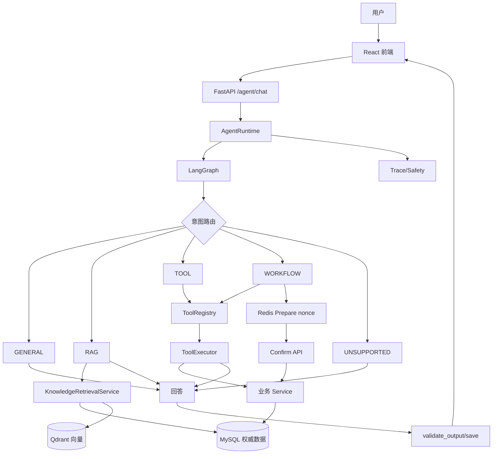

# 00 项目总览

> 这是项目的最高层入口。详细设计与历史证据见 `02-backend`、`03-agent`、`06-testing`、`09-archive`。

## 1. 项目是什么

E-Commerce Agent 是一个本地全栈电商项目, 目标是把真实电商业务与 LangGraph Agent、RAG、Tool Calling、Prepare/Confirm 和 Trace/Safety 结合起来。

它不是已上线生产系统。当前重点是:

- 本地业务可运行;
- Agent 能安全访问业务;
- RAG 能给出可追溯来源;
- 高风险操作必须确认;
- 核心链路可测试、可解释、可演示。

## 2. 技术栈

| 层 | 技术 |
|---|---|
| 前端 | React 18, TypeScript, Vite, Ant Design, TanStack Query |
| 后端 | Python 3.12, FastAPI, Pydantic v2, 异步 SQLAlchemy |
| 数据 | MySQL 8, Redis 7, Qdrant |
| Agent | LangGraph, LangChain Core/ChatOpenAI |
| Embedding | BAAI/bge-m3 |
| 测试 | Pytest, Vitest, Playwright, Ruff, Mypy, Alembic |

## 3. 核心架构



## 4. 模块地图

| 模块 | 路径 | 说明 |
|---|---|---|
| 前端 | `frontend/src` | 管理后台、Agent 聊天 |
| 后端 API | `backend/app/api` | 认证、业务、知识库、Agent API |
| 后端业务 | `backend/app/services` | 事务、状态机、库存、订单、售后 |
| 数据层 | `backend/app/models`, `repositories` | ORM 和 SQL |
| RAG | `backend/app/services/rag` | 解析、切分、Embedding、检索 |
| Agent | `agent/` | Runtime、Graph、Tools、Safety、Trace |
| 基础设施 | `backend/app/db`, `infrastructure` | MySQL/Redis/Qdrant/文件 |

## 5. 核心安全原则

1. Agent 不直接访问数据库。
2. LLM 只能选择 Tool, 不能决定权限。
3. READ Tool 与 PREPARE Tool 分离。
4. PREPARE 只写 Redis pending, 不执行业务写操作。
5. Confirm 是独立 API, 不在 LangGraph 内。
6. Source 由服务端从 MySQL Chunk 构造。
7. RAG 内容属于 untrusted content。
8. ACL 在检索前过滤, MySQL 再做权威校验。
9. Trace 中不输出 Prompt、密钥、密码和完整敏感数据。

## 6. 当前边界

### 已完成

- 认证、商品/SKU/库存、订单、简化售后(EXCHANGE);
- 知识库上传/发布/检索;
- Agent Runtime/Graph/Tool/Prepare/Confirm/RAG/Safety/Trace;
- Debug Console 和 10 项 Playwright E2E。

### 已下线

- 支付、支付宝、支付回调、资金退款;
- REFUND_ONLY/RETURN_REFUND 新申请;
- 历史支付表和字段保留, 仅用于兼容读取。

### 暂缓/未完成

- TASK-017/018: 云部署、域名、HTTPS、生产备份;
- TASK-021.2: 待人工最终验收;
- TASK-021.3/022: 未开始/范围待定义;
- HITL、Trace 持久化。

## 7. 阅读顺序

```text
项目总览
→ 02-backend 架构
→ 03-agent 架构
→ 05-integration
→ 06-testing
→ 07-project-management
→ 09-archive
```
