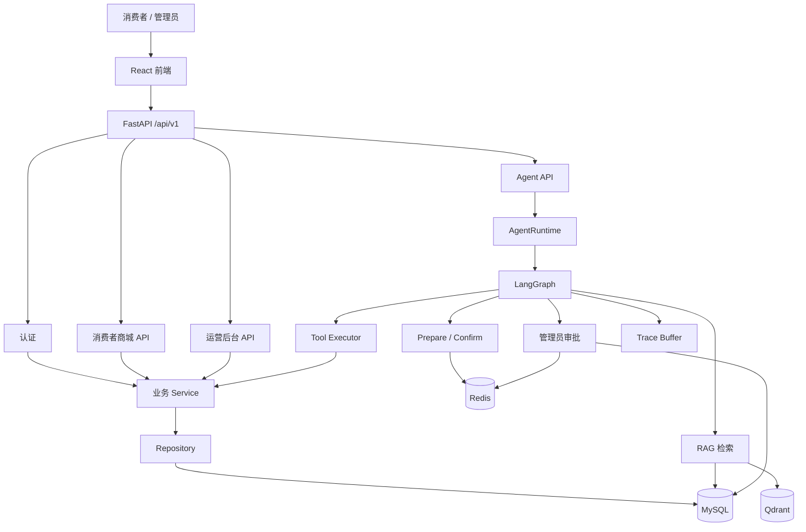

# 02 整体架构

## 1. 总体架构



## 2. 前端架构

```text
React
→ React Router
→ ShopLayout / AdminLayout
→ TanStack Query
→ Axios
→ FastAPI
```

两套布局：

```text
ShopLayout    消费者商城
AdminLayout   运营后台
```

路由守卫：

- `ProtectedRoute`：要求登录；
- `AdminRoute`：要求已登录且 `is_admin=true`；
- 普通用户访问管理路由会被重定向到 `/shop`。

认证状态：

- 单一登录页；
- Access Token；
- 当前 Token 存在 `sessionStorage`，每个标签页独立；
- 同一浏览器的不同标签页可以分别登录消费者、管理员和调试人员；
- 关闭标签页后该标签页需要重新登录。

## 3. 后端分层

```text
API Router
→ Pydantic Schema
→ Service
→ Repository
→ SQLAlchemy Model
→ MySQL
```

职责：

| 层 | 职责 |
|---|---|
| Router | HTTP、依赖、状态码、响应模型 |
| Schema | 输入校验、输出结构 |
| Service | 事务、状态机、业务规则 |
| Repository | SQL、过滤、行锁 |
| Model | 表、关系、约束 |
| Infrastructure | Qdrant、文件存储、Redis |

关键原则：

- Router 不写 SQL；
- Repository 不做业务状态判断；
- Service 持有事务边界；
- 库存、订单、售后状态只能由 Service 推进。

## 4. 数据存储

### MySQL

权威业务数据：

```text
users
categories
products
skus
inventory
inventory_transactions
orders
order_items
after_sales
agent_approvals
knowledge_documents
knowledge_document_versions
knowledge_chunks
```

`payments`、`refunds`、`refresh_sessions` 已删除，不再是当前数据库的一部分。

### Redis

- Agent 会话历史；
- 会话锁；
- Rate Limit；
- Prepare/Confirm pending；
- 管理员审批 pending；
- 审批子图中断状态依赖进程内 checkpointer。

### Qdrant

- 只存知识 Chunk 向量和元数据；
- Chunk 正文、版本、权限在 MySQL；
- Qdrant 不是权威源。

## 5. Agent 架构

```text
AgentRuntime
→ Safety / Rate Limit / Conversation Lock
→ LangGraph StateGraph
→ AgentState + AgentRuntimeContext
→ 路由
→ RAG / Tool / Prepare
→ validate_output
→ save_conversation
```

设计重点：

- `AgentState` 可序列化；
- 数据库 Session、User、LLM 不进入 State；
- `AgentRuntimeContext` 保存可信依赖；
- Tool 只能通过 Registry/Executor；
- 用户写操作必须 Confirm；
- 管理员高风险库存调整必须走审批；
- 审批通过后重新校验库存再执行。

## 6. 架构决策

### 为什么 MySQL 是 RAG 权威源

Qdrant 适合召回，但不适合保存业务权限和完整正文。检索必须回查 MySQL，避免 stale point、越权版本和错误 Chunk。

### 为什么 PREPARE 不直接执行

LLM 不应决定订单取消或售后申请是否立即生效。PREPARE 只生成 Redis pending，用户确认后再由 Service 重新校验状态。管理员库存调整则写入 `agent_approvals` 和 Redis pending，由管理员审批后恢复执行。

### 为什么保留运营后台

消费者端负责交易和 AI 导购；运营后台负责商品、库存、订单和售后。运营后台是业务管理面，不是消费者首页。

## 7. 当前架构边界

- 单体 FastAPI，不是微服务；
- 单体 MySQL；
- 本地 Qdrant；
- 本地文件存储；
- Trace 进程内；
- 没有消息队列；
- 没有生产部署。
