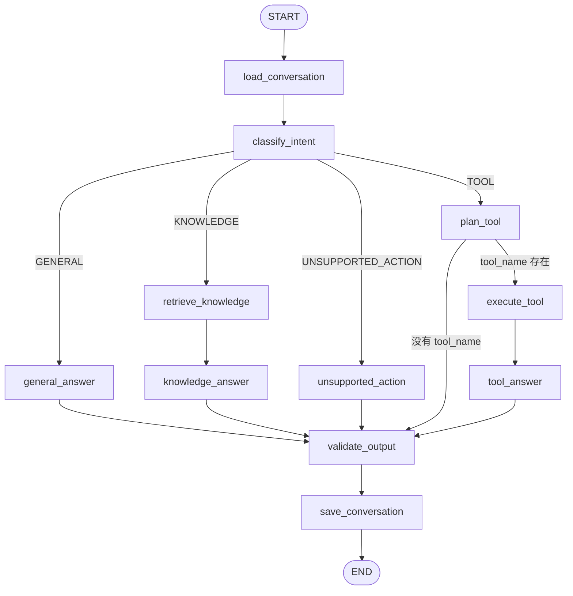

# TASK-019 Agent 现状架构分析

> 项目：E-Commerce Agent  
> 分析范围：TASK-001～016 当前工作区源码  
> 分析方式：按真实 API → Runtime → LangGraph → Tool/RAG 调用链阅读  
> 结论性质：现状分析；不代表目标设计已经实现  
> 本轮不修改代码、数据库、Docker 或配置。

## 1. 结论摘要

当前 Agent 已经具备一条可运行、受控的 LangGraph 主链路：

```text
Agent API
  → AgentRuntime
  → LangGraph StateGraph
  → Intent Classification
  → General / RAG / Tool / Unsupported
  → Output Validation
  → Redis Conversation Save
```

它的优点是：

- Agent 不直接访问数据库；
- Tool 通过 Tool Registry 白名单和 Pydantic Schema；
- Tool Handler 调用 Backend Service；
- 写操作只暴露 Prepare Tool，不暴露直接写 Tool；
- Confirm 在独立 API 中完成，使用 Redis Lua 一次性消费；
- RAG 只返回 Backend 校验后的 Chunk 和来源；
- 对话历史、限流、锁和确认凭证使用现有 Redis；
- 后端业务权限、事务和状态机仍然由 Backend Service 负责。

但当前还不是完整的“生产级三路编排 + HITL + 可观测 Agent 平台”：

- 没有独立的 Workflow 路由和 Intent；
- Prepare/Confirm 与人工审批是两个不同层次，当前只有前者；
- `looks_like_prompt_injection` 已定义但未接入主执行链路；
- 没有统一 Tool Trace、节点耗时、风险等级和可查询运行记录；
- 没有 Agent Debug API / Debug Console；
- RAG 没有低置信度和无答案判定；
- Agent 图没有 Checkpointer，不支持图中断和恢复；
- 目录仍以 TASK-006 的扁平结构为主。

## 2. 真实执行链路

### 2.1 HTTP 入口

文件：`backend/app/api/v1/agent.py`

```text
POST /api/v1/agent/chat
  → chat()
  → AgentRuntime(session, user=CurrentUser, settings=get_settings())
  → AgentRuntime.chat()
  → ChatResponse
```

关键点：

- `CurrentUser` 来自 `app.api.dependencies`，请求体不能提供 `user_id`；
- `ChatRequest` 只有 `message` 和可选 `conversation_id`；
- `ChatResponse` 只有 `conversation_id`、`message_id`、`answer`、`sources`、`pending_action`、`created_at`；
- 当前响应没有 `trace_id`、`intent`、`route`、`token_usage` 或 Tool Trace。

Confirm 是另一个独立入口：

```text
POST /api/v1/agent/actions/{confirmation_id}/confirm
  → confirm_action()
  → ConfirmationService.confirm()
  → OrderService.cancel_order()
    或 AfterSaleService.apply()
```

Confirm **不经过 LangGraph**。

### 2.2 AgentRuntime

文件：`agent/runtime.py`，类：`AgentRuntime`，方法：`chat()`

顺序：

```text
1. 检查 settings.agent_enabled
2. validate_user_message(message, settings)
3. RedisRateLimiter.check(user.id)
4. 生成或使用 conversation_id
5. ConversationStore.acquire_lock()
6. 生成 request_id
7. 构建 AgentRuntimeContext
8. 构建 initial_state
9. asyncio.timeout(agent_max_execution_seconds)
10. COMPILED_AGENT_GRAPH.ainvoke(initial_state, context=context)
11. finally 释放 Redis conversation lock
12. 返回 ChatResult
```

重要事实：

- `request_id` 已生成，但只存在于 RuntimeContext/State；
- 没有进入 API 响应；
- 成功路径没有结构化 `request_id` 日志；
- 只有异常路径记录 `agent_execution_failed`；
- `token_usage` 存在于 State，但没有暴露给 ChatResponse；
- `pending_action` 从最终 State 返回。

### 2.3 LangGraph 图和节点

文件：`agent/graph.py`，函数：`build_agent_graph()`，全局对象：`COMPILED_AGENT_GRAPH`。

真实节点：

```text
load_conversation
classify_intent
general_answer
retrieve_knowledge
knowledge_answer
unsupported_action
plan_tool
execute_tool
tool_answer
validate_output
save_conversation
```

真实边：



说明：

- `COMPILED_AGENT_GRAPH` 编译时没有传入 Checkpointer；
- 图是每次请求执行一次；
- 没有 `interrupt`、`resume` 或长期暂停节点；
- `pending_action` 只是 State 中返回给 API 的字典，不是 LangGraph 持久化状态。

### 2.4 各节点输入、输出、职责

| 节点 | 主要输入 | 主要输出 | 职责 |
|---|---|---|---|
| `load_conversation` | `conversation_id`、`Context.is_new_conversation` | `history`、`conversation_created_at` | 从 Redis 读取历史；新会话返回空历史 |
| `classify_intent_node` | `user_message`、`Context.llm` | `intent` | 调用 `routing.classify_intent` |
| `general_answer_node` | `history`、`user_message` | `answer`、`sources=[]`、`token_usage` | 使用 `GENERAL_SYSTEM_PROMPT` 生成普通回答 |
| `retrieve_knowledge_node` | `user`、`user_message`、`agent_rag_top_k` | `retrieved_items` | 调用 `KnowledgeRetrievalService.retrieve()` |
| `knowledge_answer_node` | `retrieved_items`、历史、用户问题 | `answer`、`sources`、`token_usage` | 组装不可信 RAG 上下文并调用 LLM；无上下文时返回固定无知识回答 |
| `unsupported_action_node` | State | `answer=UNSUPPORTED_ACTION_ANSWER` | 明确拒绝不支持的写操作 |
| `plan_tool_node` | 历史、用户消息、`ToolExecutor.registry.openai_tools()` | `tool_name`、`tool_args`、`tool_call_count`、`token_usage` | 让 LLM 选择最多一个 Tool |
| `execute_tool_node` | `tool_name`、`tool_args`、`ToolContext` | `tool_result`、`pending_action`、`tool_call_count` | 调用 `ToolExecutor.execute()` |
| `tool_answer_node` | `tool_result`、`pending_action` | `answer`、`sources=[]` | Pending 模板、错误文本或 Tool 结果总结 |
| `validate_output_node` | `answer`、`sources`、`retrieved_items` | 校验后的 `answer` | 空输出、长度、Secret 模式、Source 合法性 |
| `save_conversation_node` | 历史、用户消息、最终回答、锁 token | `{}` | 原子校验锁并写入 Redis 对话 |

### 2.5 Intent Classification

文件：`agent/routing.py`

函数：

- `obvious_unsupported_action(message)`
- `obvious_tool_action(message)`
- `classify_intent(llm, message)`
- `_parse_intent(text)`
- `route_intent(state)`

真实逻辑：

```text
1. obvious_unsupported_action:
   "申请退款" / "发起支付" / "修改库存" / "创建订单" / "帮我退款" 等
   → UNSUPPORTED_ACTION

2. obvious_tool_action:
   "取消订单" / "申请售后" / "查询...订单" / "我的订单" /
   "我的售后" / "售后记录" / "商品|SKU|库存"
   → TOOL

3. 否则调用 LLM：
   INTENT_SYSTEM_PROMPT
   → 期望 GENERAL / KNOWLEDGE / TOOL / UNSUPPORTED_ACTION
   → _parse_intent() 解析

4. route_intent() 映射到节点
```

关键事实：

- 只有四个 Intent；
- 没有 `WORKFLOW` Intent；
- Prepare 操作被归入 `TOOL`；
- `classify_intent` 的提示词明确说“标签只选择工作流，不授予权限”；
- 确定性规则优先于 LLM；
- 但 `looks_like_prompt_injection` 不在该链路中。

### 2.6 RAG 调用链

文件：

```text
backend/app/services/rag/retrieval_service.py
backend/app/infrastructure/vector/qdrant.py
backend/app/repositories/knowledge.py
```

流程：

```text
retrieve_knowledge_node
  → KnowledgeRetrievalService.retrieve(user, query, top_k)
  → KnowledgeDocumentRepository.list_retrievable_versions(is_admin=user.is_admin)
  → BgeM3EmbeddingProvider.embed_query(query)
  → QdrantVectorStore.search(
        query_vector,
        version_ids,
        limit=max(top_k, rag_max_candidates)
      )
  → KnowledgeChunkRepository.list_retrieval_rows(
        chunk_ids,
        is_admin=user.is_admin
      )
  → RetrievalItem[]
```

真实安全设计：

- Qdrant filter 包含 `version_id` 和 `embedding_model`；
- MySQL 才是 Chunk 文本和权限的权威；
- Qdrant 返回但 MySQL 不存在的 Chunk 会被丢弃；
- 非管理员只允许 `PUBLIC` 文档；
- 只允许 `current_published_version_id` 且版本状态为 `PUBLISHED`；
- `sources_from_items` 由 Backend 构造，模型不能提供 Source；
- `validate_output` 校验每个 Source 的 chunk_id 必须在本次 retrieved_items 中。

真实缺口：

- 没有最低相关度阈值；
- 没有 no-answer / low-confidence 判定；
- `knowledge_answer_node` 只有在 `select_context` 完全没有 RAG item 时才返回 `NO_KNOWLEDGE_ANSWER`；
- 相似文档会被当作上下文送入模型；
- TASK-015 的 `No-answer Accuracy = 0` 就是这一行为的直接结果。

### 2.7 Tool 调用链

文件：

```text
agent/tools/__init__.py
agent/tools/registry.py
agent/tools/executor.py
agent/tools/schemas.py
agent/tools/order.py
agent/tools/product.py
agent/tools/context.py
```

Registry 当前注册 10 个 Tool：

```text
READ:
  search_products
  get_product_detail
  get_sku_detail
  check_sku_inventory
  list_my_orders
  get_my_order
  list_my_after_sales
  get_my_after_sales

PREPARE:
  prepare_cancel_order
  prepare_create_after_sales
```

Tool 定义包含：

```text
name / description / args_schema / kind / handler
```

`kind` 只有 `READ`、`PREPARE`；`ToolExecutor.execute()` 当前没有根据 `kind` 做风险分支，安全边界依赖：

- Registry 只注册安全 Tool；
- 写操作只注册 Prepare Tool；
- Tool Handler 调用 Service；
- Prepare Tool 只创建 Confirmation，不执行写操作。

Schema：

- 所有输入继承 `_StrictToolInput`；
- `extra="forbid"`；
- 没有 `user_id`、`role`、`is_admin` 字段。

Executor：

```text
1. 检查 calls_used < max_calls
2. calls_used += 1
3. registry.get(tool_name)
4. args_schema.model_validate(raw_args)
5. handler(context, args)
6. AppException → ToolResult(ok=False, error_code, error_message)
7. 其他异常 → AgentToolExecutionError
```

`ToolContext` 只包含：

```text
user / session / settings / conversation_id / confirmation_store
```

模型无法通过参数替换当前用户。

### 2.8 Prepare / Confirm

Prepare Tool：

- `prepare_cancel_order()`：
  - `OrderService.get_order(user_id=context.user.id, order_no=...)`
  - 校验 `PENDING_PAYMENT`
  - `ConfirmationStore.create(...)`
  - 返回 `pending_action`

- `prepare_create_after_sales()`：
  - `OrderService.get_order(user_id=context.user.id, order_no=...)`
  - `ConfirmationStore.create(...)`
  - 返回 `pending_action`

确认：

```text
POST /agent/actions/{confirmation_id}/confirm
  → ConfirmationService.confirm()
  → ConfirmationStore.consume()
     Redis Lua:
       - 存在性
       - status == PREPARED
       - user_id
       - conversation_id
       - nonce
       - expires_at
       - DEL（原子一次性消费）
  → 参数 hash 复核
  → operation + resource_no 一致
  → OrderService.cancel_order()
     或 AfterSaleService.apply()
```

真实安全属性：

- 跨用户确认被 Lua 拒绝；
- conversation_id 不匹配被拒绝；
- nonce 不匹配被拒绝；
- 过期被拒绝；
- 重复确认被拒绝；
- 参数 hash 被校验；
- Confirm 业务执行前重新通过 Service 校验订单/售后状态；
- 售后申请使用 `agent-confirm:{confirmation_id}` 作为幂等键。

重要限制：

- Confirm 是 Redis 一次性凭证，不是人工审批；
- 凭证消费后、Service 执行失败时没有补偿/重试记录；
- 没有审批人、审批意见、审批时间、审批状态机；
- 没有业务 Workflow 实例表；
- 没有 Agent 运行审计表。

### 2.9 输出校验与对话保存

输出校验 `agent/guardrails.py::validate_output()`：

- 非空；
- 输出长度上限；
- 拒绝 `sk-...`、私钥块、JWT 形式字符串；
- Source chunk_id 必须来自本次 retrieved_items。

对话保存：

- `ConversationStore.save_if_locked()` 使用 Redis Lua；
- 先校验锁 token，再写入 conversation key；
- 历史截断到 `agent_max_history_messages`；
- 保存 `created_at`、`updated_at`、消息列表；
- 不保存 intent/tool trace/token usage。

## 3. 当前已有能力

### 3.1 已实现

- Agent API 鉴权；
- 会话 ID、Redis 对话历史；
- 每会话 Redis 锁；
- 每用户固定窗口限流；
- 全请求超时；
- LangGraph 节点编排；
- 规则 + LLM 的 Intent；
- RAG 路径；
- Tool Registry / Schema / Executor；
- 商品、SKU、库存、订单、售后查询；
- 取消订单和售后申请 Prepare；
- Confirm 一次性凭证；
- 跨用户、nonce、过期、重复、参数篡改防护；
- Output Secret / Source 校验；
- RAG 上下文 `trust=untrusted`；
- 业务 Service 的权限、事务、状态机；
- Backend 和 Agent 同进程；
- 现有 336 backend tests / 7 Playwright / 6 frontend tests 基线。

### 3.2 已有但未接入

| 能力 | 现状 |
|---|---|
| Prompt Injection heuristic | `looks_like_prompt_injection` 已定义，但主链路没有调用 |
| Token Usage | `AgentState.token_usage` 有累计，但 API 不返回，也没有持久化 |
| Tool Call Count | State 中有，但只作为计数，没有 Trace 记录 |
| `RegisteredTool.kind` | 有 READ/PREPARE，但 Executor 不据此做风险控制 |
| 规则 Intent | 有 unsupported/tool 规则，但没有独立 Workflow |
| RAG 无答案文案 | 有 `NO_KNOWLEDGE_ANSWER`，但只处理“完全没有上下文” |

### 3.3 当前不存在

- `WORKFLOW` Intent；
- 独立 Workflow 路由节点；
- LangGraph Checkpointer；
- Agent 运行 Trace 表/模块；
- Tool 级耗时、风险等级、Trace ID；
- Debug API；
- Debug Console；
- Approval / Audit 数据模型；
- Agent 驱动的 HITL 恢复；
- RAG 相关性阈值和 no-answer 判定；
- Agent 运行记录查询权限；
- 可配置的 Tool 风险策略。

## 4. 当前架构问题

### P0：可观测性不足

一次 Agent 执行只有：

- `request_id`；
- 错误日志；
- LLM 完成日志（模型、Token、耗时）；
- 对话 Redis；
- 最终回答。

没有：

- 节点顺序和每节点耗时；
- Tool 名称、参数摘要、结果摘要、错误码；
- intent / route；
- trace_id 与 conversation_id 的关联；
- 可供 Debug Console 查询的接口。

结果是：

- 出错时只能看服务端日志；
- 无法复盘“模型为什么选了某个 Tool”；
- 无法定位 RAG 空结果、Tool 参数错误或 Confirm 失败；
- 无法进行稳定的 Agent 评测对比。

### P0：输入安全没有闭环

`looks_like_prompt_injection()` 存在但未调用。当前输入只做：

- Pydantic 长度；
- 控制字符清理；
- 空白检查；
- 长度上限。

LLM 提示词要求“用户消息是不可信数据”，Guardrails 有输出 Secret 检查，但没有：

- 输入 injection signal；
- 可疑输入的安全路由；
- 输入安全检查结果 Trace；
- 系统提示/密钥泄露的输入侧防御。

### P1：三路编排边界不清

当前只有四种 Intent：

```text
GENERAL
KNOWLEDGE
TOOL
UNSUPPORTED_ACTION
```

Prepare 操作被归为 `TOOL`；没有 `WORKFLOW`。

结果是：

- “查询订单”和“取消订单”共享 Tool 路径；
- 风险等级没有在路由层显式表达；
- Tool Trace 无法统一表达 READ/PREPARE；
- 未来 HITL 无法自然接入；
- Debug Console 只能显示 Tool，不能显示“工作流”。

### P1：RAG 没有答案边界

当前 `KnowledgeRetrievalService` 返回 Top-K 结果；没有：

- 分数阈值；
- 无答案分类；
- 低置信度提示；
- 证据覆盖判断。

因此相似但无关文档可能被送入模型，导致模型“有上下文可编”。

### P1：HITL 与 Prepare/Confirm 容易混淆

当前：

- Prepare/Confirm：用户确认当前会话中的一次操作；
- After-sales 后端：`PENDING_REVIEW` + 管理员 `approve/reject`。

二者是不同层次：

```text
用户确认：用户对自己发起的操作说“是”
人工审批：客服/管理员对业务申请做审核
```

当前 Agent 能创建 `PENDING_REVIEW` 售后申请，但没有：

- Agent Workflow 实例；
- 审批任务；
- 审批通知；
- 恢复执行；
- 审批/审计事件；
- 长流程幂等和超时处理。

### P2：目录结构不能表达职责

当前 `agent/` 下是 TASK-006 的扁平文件：

```text
graph.py
nodes.py
runtime.py
context.py
routing.py
guardrails.py
...
```

随着三路编排、Safety、Observability、Workflow 增加，继续平铺会导致：

- 图定义和节点实现混在一起；
- Safety 规则散落；
- Trace 逻辑侵入节点；
- Workflow 和 Tool 边界模糊；
- 测试目录难以对应模块。

## 5. 现有文件映射

| 现状文件 | 当前职责 | 目标职责归属 |
|---|---|---|
| `agent/runtime.py` | 请求级限流、锁、超时、图调用 | `runtime/` |
| `agent/context.py` | RuntimeContext | `runtime/` |
| `agent/conversation.py` | Redis 对话和锁 | `runtime/` 或 `memory/` |
| `agent/graph.py` | LangGraph 构建 | `graph/` |
| `agent/nodes.py` | 节点实现 | `graph/nodes/` |
| `agent/state.py` | State / Source / TokenUsage | `graph/` |
| `agent/routing.py` | 规则 Intent + LLM Intent | `routing/` |
| `agent/guardrails.py` | 输入输出校验、上下文预算 | `safety/` + `context/` |
| `agent/prompts.py` | Prompt 常量 | `prompts/` |
| `agent/llm.py` | DeepSeek Provider | `runtime/llm` 或 `providers/` |
| `agent/rate_limit.py` | Redis 限流 | `runtime/` |
| `agent/tools/registry.py` | Tool 白名单 | `tools/` |
| `agent/tools/executor.py` | 参数校验、执行 | `tools/` |
| `agent/tools/order.py` | 订单/售后 Tool | `tools/` |
| `agent/tools/product.py` | 商品/库存 Tool | `tools/` |
| `agent/tools/confirmation.py` | Redis Prepare/Confirm | `workflows/confirmation/` |
| `backend/app/services/rag/*` | RAG 业务实现 | 保持 Backend，Agent `rag/` 只做适配 |
| `backend/app/services/after_sale.py` | 售后业务状态机 | 保持 Backend |
| `backend/app/api/v1/after_sales.py` | 管理员审批 API | 保持 Backend |
| `frontend/src/pages/agent/AgentChat.tsx` | 对话 UI | 扩展 Debug Console |
| `agent/tests/*` | 现有测试 | 按模块拆到 `tests/` |

## 6. 当前真实边界

必须坚持：

```text
Agent 不直接访问数据库
Tool 不绕过 Service
LLM 不决定用户身份和权限
RAG 不替代实时业务查询
Prepare/Confirm 继续由 Backend/Redis 保证
```

当前实现基本满足这些边界；主要问题不是“业务权限缺失”，而是：

- 可观测性缺失；
- 三路职责未表达；
- HITL 未建模；
- RAG 无答案边界；
- Safety 未闭环；
- Debug 能力缺失。

## 7. 结论

当前 Agent 是“可运行、受控的单图 Agent”，不是完整的生产级 Agent 平台。

建议保留现有主图、Tool Registry、Redis Confirm 和 Backend Service，不重写业务；在它们之上增加：

1. 统一 Trace；
2. 显式三路路由；
3. Safety Pipeline；
4. Workflow/HITL 分层；
5. Debug Console；
6. 可重复评测。

这些属于增量演进，不是推倒重来。
