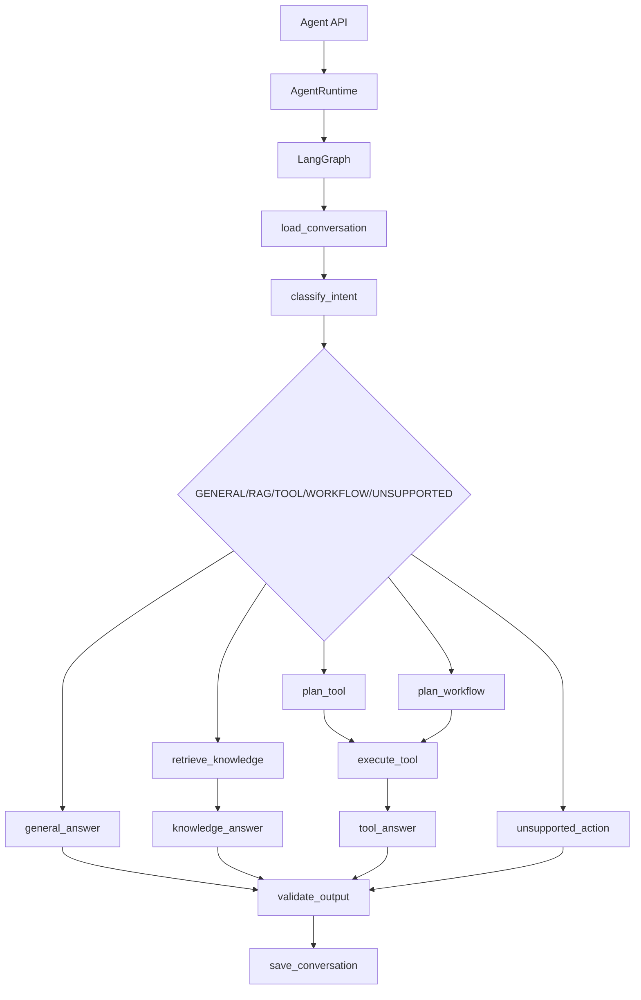

# 03 Agent

## 目标

让 LLM 在严格安全边界内使用电商业务能力: 查询可读数据, 对高风险操作只生成 Prepare pending, 由用户通过独立 Confirm 执行。

## 总体架构



## 核心文件

| 文件 | 作用 |
|---|---|
| `agent/runtime.py` | 限流、会话锁、超时、Graph 调用、Trace |
| `agent/graph.py` | StateGraph 节点/边/条件路由 |
| `agent/state.py` | 图内可序列化状态 |
| `agent/context.py` | User/DB/LLM/RAG 等可信依赖 |
| `agent/routing.py` | 意图预判、LLM 分类、route_intent |
| `agent/nodes.py` | 全部 Node 实现 |
| `agent/llm.py` | DeepSeek/ChatOpenAI、工具调用 |
| `agent/prompts.py` | Intent/RAG/Tool/Workflow Prompt |
| `agent/tools/registry.py` | ToolRegistry/READ/PREPARE |
| `agent/tools/executor.py` | 参数校验、执行、错误、Trace |
| `agent/tools/confirmation.py` | Redis Prepare/Confirm |
| `agent/rag_evidence.py` | RAG 无答案策略 |
| `agent/safety/pipeline.py` | 输入/输出安全 |
| `agent/guardrails.py` | 输入、上下文、Source、输出 |
| `agent/observability/` | Trace/脱敏/Debug API |

## 五路路由

```text
GENERAL:  普通对话
RAG:     知识库问答
TOOL:    只读业务查询
WORKFLOW:未发货订单取消 / EXCHANGE 售后 Prepare
UNSUPPORTED: 不支持的写操作
```

`KNOWLEDGE` 是旧的 RAG 兼容别名。

## Tool 安全

- TOOL 路径只有 READ Tool;
- WORKFLOW 路径只有 PREPARE Tool;
- 工具参数使用 Pydantic;
- 不接受客户端提供的 user_id;
- 工具最大调用次数有上限;
- Backend Service 再做业务校验。

## Prepare/Confirm

```text
plan_workflow
→ prepare_cancel_order / prepare_create_after_sales
→ ConfirmationStore.create
→ Redis PREPARED + nonce + params_hash + TTL
→ 返回 pending_action
→ 用户确认
→ ConfirmationService.confirm
→ Redis Lua 原子 consume
→ OrderService.cancel_order / AfterSaleService.apply
```

Confirm 不在 LangGraph 内。

## RAG

```text
retrieve_knowledge_node
→ KnowledgeRetrievalService.retrieve_with_diagnostics
→ MySQL ACL 允许版本
→ Qdrant
→ MySQL 权威 Chunk
→ evaluate_rag_evidence
→ knowledge_answer_node
```

当前策略:

```text
score < 0.60          → LOW_SCORE
0.60 <= score < 0.625 → 需要 evidence coverage >= 0.50
score >= 0.625        → ACCEPTED
```

该策略是离线候选, 不是生产认证。

## Safety/Trace

- Prompt Injection 是 signal, 不是权限边界;
- ACL/Tool/Schema/Confirm/Service 才是安全边界;
- Trace 记录请求、节点、路由、RAG、Tool、输出;
- 统一脱敏;
- Debug API 只允许本人或管理员。

## 未实现/暂缓

- HITL 审批系统;
- 持久化 Trace;
- Tool 单次超时;
- RAG 生产级阈值认证。

支付、支付宝和资金退款 Tool 已从当前范围移除。
