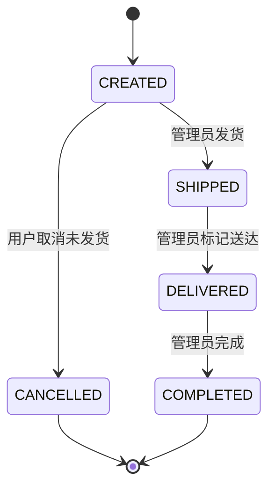
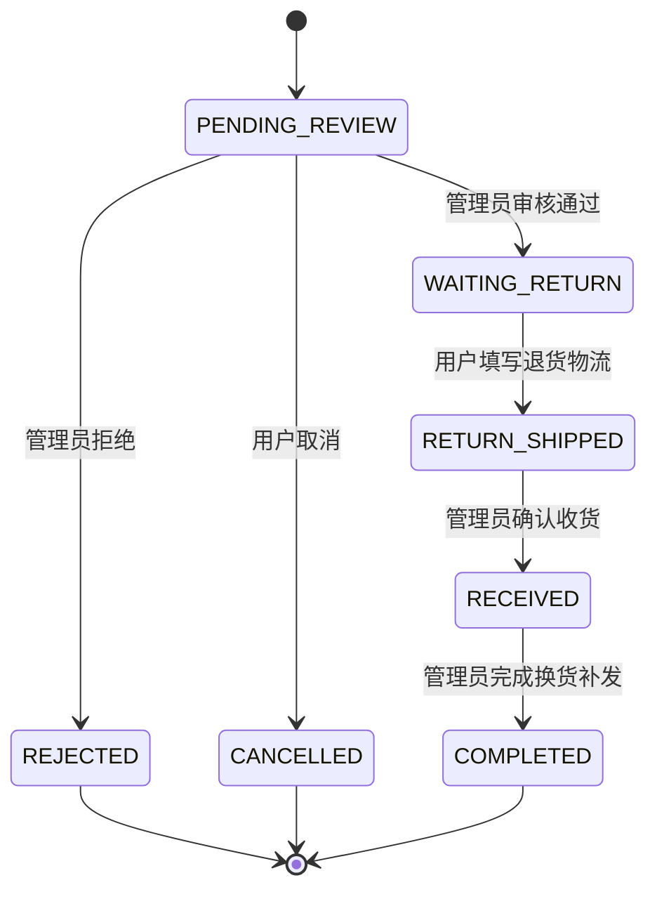

# 03 核心业务流程

## 1. 认证与角色

### 登录

```text
POST /api/v1/auth/login
→ AuthService
→ 校验密码
→ 签发 Access Token
→ 前端保存 Token
→ GET /auth/me
→ 按 is_admin 跳转
```

```text
普通用户 → /shop
管理员   → /dashboard
```

### 权限

```text
游客      公开商城和商品目录
普通用户  自己的订单、售后、AI 导购
管理员    运营后台
```

后端边界：

```text
CurrentUser   要求登录
CurrentAdmin  要求 is_admin=true
```

普通用户访问 `/admin/*` 返回 403。

## 2. 商品与库存

### 商品

商品是 SPU，价格、规格、库存由 SKU 承担：

```text
Product 1 ── N Sku 1 ── 1 Inventory
```

商品字段包含：

```text
product_no
category_id
name
description
image_url
status
```

### 库存

```text
创建订单：reserved_quantity + N
取消订单：reserved_quantity - N
发货：total_quantity - N，reserved_quantity - N
```

库存流水写入 `inventory_transactions`，用于追溯。

## 3. 普通用户购买

```text
商品详情
→ 选择 SKU
→ 立即购买
→ 填写收货信息
→ POST /orders
→ 创建 Order(CREATED)
→ 创建 OrderItem
→ InventoryService.reserve
→ 返回订单详情
```

没有购物车，没有支付。

当前实现：

```text
frontend/src/pages/shop/ShopProduct.tsx
frontend/src/api/customerOrders.ts
backend/app/api/v1/orders.py
backend/app/services/order.py
```

## 4. 订单状态机



注意：

- `status` 表示订单主状态；
- `fulfillment_status` 表示履约状态；
- 发货后订单主状态可能仍是 `CREATED`，但履约状态为 `SHIPPED`；
- 只有履约 `DELIVERED` / `COMPLETED` 后，用户才能申请换货。

## 5. 管理员履约

### 发货

```text
POST /admin/orders/{order_no}/ship
→ 校验订单状态
→ 写入承运商/运单号
→ fulfillment_status = SHIPPED
→ 库存预占转为实际扣减
```

### 送达

```text
POST /admin/orders/{order_no}/deliver
→ fulfillment_status = DELIVERED
```

### 完成

```text
POST /admin/orders/{order_no}/complete
→ status = COMPLETED
→ fulfillment_status = COMPLETED
```

前端入口：`frontend/src/pages/orders/OrderDetail.tsx`。

## 6. 售后状态机



### 用户申请

```text
订单必须 DELIVERED / COMPLETED
→ POST /orders/{order_no}/after-sales
→ type 只能是 EXCHANGE
→ 状态 PENDING_REVIEW
```

### 管理员审核

```text
POST /admin/after-sales/{no}/approve
→ WAITING_RETURN
```

或：

```text
POST /admin/after-sales/{no}/reject
→ REJECTED
```

### 用户寄回

```text
POST /after-sales/{no}/return-shipment
→ RETURN_SHIPPED
```

### 管理员收货和完成

```text
POST /admin/after-sales/{no}/receive
→ RECEIVED

POST /admin/after-sales/{no}/complete-exchange
→ COMPLETED
```

## 7. 取消订单

```text
用户取消
→ 订单必须 CREATED + UNSHIPPED
→ 释放库存预占
→ CANCELLED
```

## 8. Agent 业务入口

Agent 可以做：

```text
查询商品
查询库存
查询自己的订单
查询自己的售后
准备取消订单
准备申请换货
```

Agent 不能：

```text
直接改订单状态
直接扣库存
直接审核售后
直接退款
```

所有写操作必须 Prepare，再由用户通过 Confirm API 执行。
