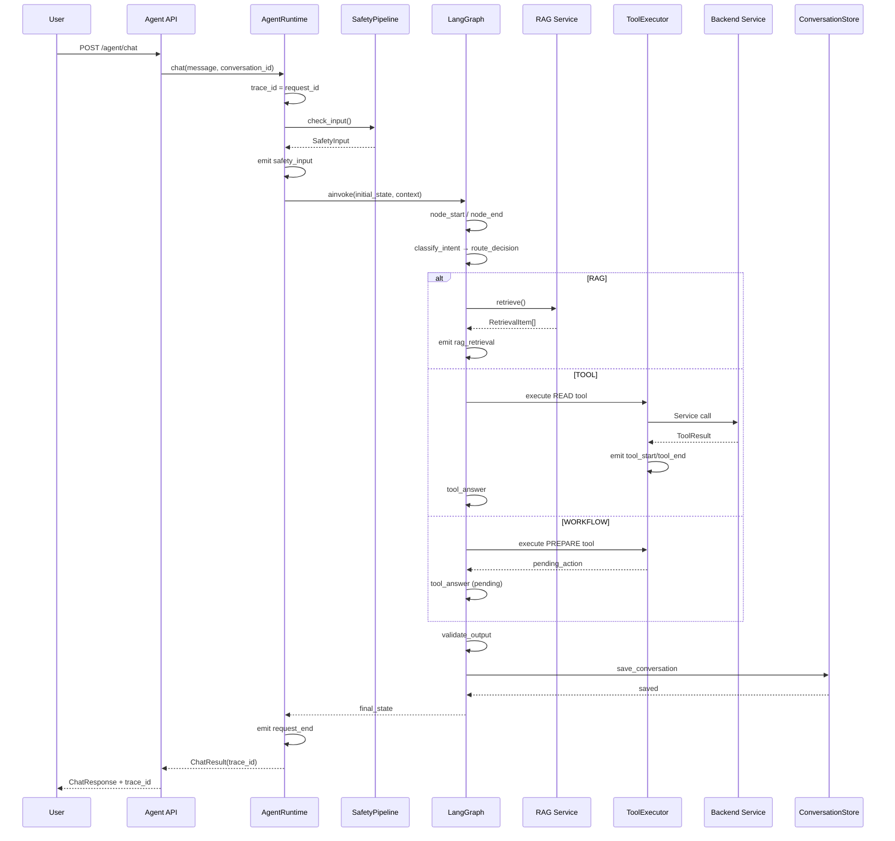
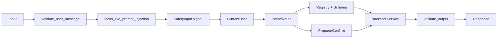

# TASK-020 最终验收报告

> 日期：2026-11-17  
> 范围：TASK-020.1～020.4  
> 状态：已实现并完成回归；未执行 Git commit/push  
> 约束：未新增数据库表、未新增 migration、未修改 Docker/Compose、未修改业务 Service 规则

## 1. 总体结论

TASK-020 已完成：

- 统一 Agent Trace；
- Safety Pipeline 接入；
- RAG / TOOL / WORKFLOW 三路编排；
- 最小 Trace Debug API；
- 21 个新增回归用例；
- 完整 Backend/Agent 回归 357 passed；
- 前端 6 passed、build 通过；
- Ruff、Mypy、Alembic 通过。

当前 Agent 的旧 Prepare/Confirm 安全机制保持不变；Confirm 仍然独立于 LangGraph，未改造成 HITL 审批系统。

## 2. 修改文件清单

### 新增

```text
agent/observability/__init__.py
agent/observability/events.py
agent/observability/redaction.py
agent/observability/trace.py
agent/observability/store.py
agent/observability/instrumentation.py
agent/safety/__init__.py
agent/safety/pipeline.py
agent/tests/test_trace.py
docs/03-delivery/TASK-020/TASK-020-最终验收报告.md
```

### 修改

```text
agent/context.py
agent/graph.py
agent/nodes.py
agent/prompts.py
agent/routing.py
agent/runtime.py
agent/state.py
agent/tests/test_agent_api.py
agent/tools/context.py
agent/tools/executor.py
agent/tools/registry.py
backend/app/api/v1/agent.py
backend/app/schemas/agent.py
```

### 未修改

```text
Backend Service 业务规则
订单/支付/库存/售后状态机
数据库 Schema
Alembic migration
Docker Compose / Dockerfile
前端业务页面
TASK-017/018
```

## 3. 新旧 Agent 架构对比

### 旧架构

```text
AgentRuntime
  → LangGraph
    → load_conversation
    → classify_intent
    → GENERAL / KNOWLEDGE / TOOL / UNSUPPORTED
    → RAG / Tool / Prepare
    → validate_output
    → save_conversation
```

问题：

- 无 trace；
- prompt injection 函数未接入；
- Prepare 被归在 TOOL；
- 无 Workflow 路由；
- 无统一 Tool 风险/Trace；
- 无 Debug 查询；
- 无 Safety 明确分层。

### 新架构

```mermaid
flowchart TD
    API[POST /api/v1/agent/chat] --> RT[AgentRuntime.chat]
    RT --> TRACE[TraceRecorder<br/>request_start / request_end]
    RT --> SAFE[SafetyPipeline.check_input]
    SAFE --> GRAPH[LangGraph]
    GRAPH --> LOAD[load_conversation]
    LOAD --> INTENT[classify_intent]
    INTENT --> ROUTER{Route}

    ROUTER --> GENERAL[GENERAL]
    ROUTER --> RAG[RAG]
    ROUTER --> TOOL[TOOL<br/>READ only]
    ROUTER --> WF[WORKFLOW<br/>PREPARE only]
    ROUTER --> UNSUPPORTED[UNSUPPORTED]

    RAG --> RAGSVC[KnowledgeRetrievalService]
    TOOL --> TREG[ToolRegistry READ]
    WF --> WREG[ToolRegistry PREPARE]
    TREG --> EXEC[ToolExecutor]
    WREG --> EXEC
    EXEC --> SERVICE[Backend Services]

    GENERAL --> ANSWER[Answer]
    RAG --> ANSWER
    EXEC --> ANSWER
    UNSUPPORTED --> ANSWER
    ANSWER --> SAFEOUT[SafetyPipeline.validate_output]
    SAFEOUT --> SAVE[save_conversation]
    SAVE --> RESP[ChatResponse + trace_id]

    RT -. trace events .-> LOGS[structlog]
    RT -. bounded buffer .-> BUFFER[TraceBuffer]
    BUFFER --> DEBUG[GET /agent/runs/{trace_id}]
```

## 4. Trace 完整调用链



### Trace 事件

```text
request_start
safety_input
node_start
node_end
route_decision
rag_retrieval
tool_plan
tool_start
tool_end
tool_error
output_validation
conversation_saved
request_end
request_error
```

### Trace 字段

```text
trace_id
request_id
conversation_id
user_id
node_name
event_type
intent
route
tool_name
arguments_summary
risk_level
execution_status
duration_ms
result_summary
error_code
timestamp
```

## 5. Trace 存储和脱敏

### 存储

没有新增数据库表，也没有新增 Redis 业务结构。

```text
结构化日志：structlog
进程内查询：TraceBuffer
```

`TraceBuffer`：

```text
最多 200 个 trace
每个 trace 最多 200 个事件
进程内、非持久化
Trace 查询失败不影响 Agent
```

限制：

- 多 Worker 时各进程 buffer 独立；
- 进程重启后内存 Trace 丢失；
- 日志仍是长期观测边界；
- 完整 Debug Console 尚未实现。

### 脱敏

统一使用 `agent.observability.redaction.redact_payload`：

- password / passwd / secret / token / authorization；
- api_key / private_key / access_token / refresh_token；
- nonce / signature / cookie / jwt；
- phone / mobile / address / email / id_card；
- confirmation_id / tracking_no / receiver_name；
- `sk-*`、私钥块、JWT、Bearer 值；
- 长字符串截断；
- 字典/列表数量和长度限制。

不记录：

- 系统 Prompt；
- JWT / API Key；
- 密码 / 支付密钥；
- 完整 Tool 原始结果；
- 完整回答文本（只记录长度）；
- 其他用户的 trace。

## 6. Safety Pipeline



已接入：

- 复用 `agent/guardrails.py::validate_user_message()`；
- 接入 `looks_like_prompt_injection()`；
- 记录 `safety_input` Trace；
- 复用 `validate_output()`；
- 复用 Source 合法性校验；
- 复用 Tool Registry/Schema；
- 复用 Redis Confirm；
- 保留 RAG `trust=untrusted`；
- 输出 Secret Pattern 检查。

策略：

```text
Prompt Injection 检测 = 诊断信号
不是权限边界
不直接阻断正常业务
检测异常时降级，不使 Agent 不可用
```

这意味着：

- 误报不会让正常知识问题全部失败；
- 漏报仍由 Backend 权限、Tool 白名单、Confirm 和 Service 状态机兜底；
- LLM 不决定用户身份、权限或业务状态。

## 7. 三路编排

### GENERAL

文件/函数：

```text
agent/routing.py::route_intent()
agent/nodes.py::general_answer_node()
```

保留原有普通对话。

### RAG

文件/函数：

```text
agent/routing.py::route_intent()
agent/nodes.py::retrieve_knowledge_node()
agent/nodes.py::knowledge_answer_node()
backend/app/services/rag/retrieval_service.py::KnowledgeRetrievalService.retrieve()
```

保留：

- CurrentUser；
- `is_admin` ACL；
- Qdrant + MySQL 权威校验；
- Source；
- `trust=untrusted`。

空检索：

```text
select_context() 没有 RAG item
→ NO_KNOWLEDGE_ANSWER
```

本次没有修改：

- 最低相关度阈值；
- 重排；
- 召回参数；
- no-answer 评测策略。

TASK-015 的 No-answer Accuracy = 0 仍未解决，属于后续 RAG 质量优化。

### TOOL

文件/函数：

```text
agent/tools/registry.py::ToolRegistry.openai_tools(kinds={"READ"})
agent/nodes.py::plan_tool_node()
agent/tools/executor.py::ToolExecutor.execute()
```

只允许 READ Tool：

```text
search_products
get_product_detail
get_sku_detail
check_sku_inventory
list_my_orders
get_my_order
list_my_after_sales
get_my_after_sales
```

支付状态通过 `get_my_order` 返回的 `payment_status` 提供，没有新增独立支付 Tool，也未绕过 Order Service。

### WORKFLOW

文件/函数：

```text
agent/routing.py::obvious_workflow_action()
agent/routing.py::route_intent()
agent/nodes.py::plan_workflow_node()
agent/tools/registry.py::openai_tools(kinds={"PREPARE"})
```

只允许 PREPARE Tool：

```text
prepare_cancel_order
prepare_create_after_sales
```

`plan_workflow_node()` 不会拿到 READ Tool；`plan_tool_node()` 不会拿到 PREPARE Tool。

### UNSUPPORTED

保留确定性拒绝：

```text
申请退款
发起支付
修改库存
创建订单
帮我退款
refund order
change stock
```

## 8. Prepare/Confirm 兼容性

Confirm 仍走独立 API：

```text
POST /api/v1/agent/actions/{confirmation_id}/confirm
  → ConfirmationService.confirm()
  → ConfirmationStore.consume()
  → OrderService.cancel_order()
    或 AfterSaleService.apply()
```

没有改变：

- Redis PREPARED 记录；
- nonce；
- TTL；
- user_id/conversation_id 绑定；
- 参数 hash；
- Lua 原子消费；
- 防重放；
- 并发重复执行保护；
- Service 二次校验；
- after-sales `PENDING_REVIEW`。

Workflow 路由只负责选择 PREPARE Tool；真正执行仍在 Confirm API。

## 9. Debug 数据接口

新增：

```text
GET /api/v1/agent/runs/{trace_id}
```

规则：

- 仅 Trace 所属用户或管理员；
- 其他用户返回 404，避免暴露存在性；
- 返回已脱敏的 TraceEvent 列表；
- 不返回 System Prompt、API Key、JWT、完整 Tool 原始结果；
- 当前为进程内 TraceBuffer，不是持久化审计。

响应新增：

```text
ChatResponse.trace_id: str | None
```

这是可选新增字段，已有客户端可忽略；没有删除或重命名现有字段。

## 10. 测试结果

### 后端/Agent

```text
357 passed in 19.84s
```

新增 21 个测试：

- Trace ID 一致性；
- 节点追踪；
- RAG 追踪；
- Tool 追踪；
- Workflow Prepare 追踪；
- 参数校验失败；
- 权限拒绝；
- Trace 写入失败；
- 超时；
- 脱敏；
- 安全降级；
- GENERAL/RAG/TOOL/WORKFLOW/UNSUPPORTED 路由；
- 旧 KNOWLEDGE 别名；
- Debug API 所有者访问；
- 未知 Trace 404；
- 未认证访问；
- 其他用户 Trace 404。

### 前端

```text
Vitest: 6 passed
build:  passed
```

前端没有业务代码修改；`ChatResponse` 新增 `trace_id` 不影响现有类型使用。

### 静态检查

```text
Ruff:  passed
Mypy:  136 source files, no issues
Alembic check: no new operations
```

### 未测试

- 未重新执行完整 Playwright E2E；本轮主要改 Agent 后端，现有 357 后端/Agent 测试已覆盖 Agent API、Tool、Prepare/Confirm、Trace 和 Debug API。
- 未测试多 Worker 下 TraceBuffer 共享（当前设计明确为进程内）。
- 未实现 Debug Console 前端页面。
- 未测试 RAG 低置信度/重排/阈值，因为本轮禁止修改检索策略。
- 未实现 Agent HITL 表、审批任务、审计表或 Checkpoint。

## 11. API 兼容性

### 新增、非破坏

```text
GET /api/v1/agent/runs/{trace_id}
ChatResponse.trace_id: str | None
```

### 保留

```text
POST /api/v1/agent/chat
POST /api/v1/agent/actions/{confirmation_id}/confirm
```

原字段：

```text
conversation_id / message_id / answer / sources / pending_action / created_at
```

全部保留。

## 12. 未解决问题

1. RAG No-answer Accuracy 仍为 0，未修改阈值或评测策略。
2. Prompt Injection 当前是 signal，不是硬阻断；误报/漏报需要后续数据和策略评估。
3. TraceBuffer 为进程内，重启丢失、多 Worker 不共享。
4. 没有 Debug Console 前端页面。
5. 没有 Agent HITL Workflow/Approval/Audit 表。
6. 没有 LangGraph Checkpoint 持久化。
7. Tool 单次超时尚未实现；当前是全请求超时。
8. Tool 的 `risk_level` 仍是 READ=LOW、PREPARE=MEDIUM，没有更细粒度策略。
9. 支付状态通过订单 Tool 返回，不是独立支付查询 Tool。
10. 未新增数据库迁移；HITL 需要单独审批。

## 13. Git 状态

```text
branch: main
HEAD:   c732cc1
commit/push/reset/clean: 未执行
```

当前工作区包含 TASK-019 设计文档和 TASK-020 代码/测试修改，均未提交。

## 14. 最终判定

```text
TASK-020.1 Trace：已实现、已测试
TASK-020.2 Safety：已实现、已测试（signal 模式）
TASK-020.3 三路编排：已实现、已测试（WORKFLOW 仅 Prepare/Confirm）
TASK-020.4 回归与 Debug API：已实现、已测试
TASK-020 总体验收：通过自动化验收，等待人工验收
```

---

## 15. TASK-020.A 最终 E2E 回归与项目冻结

### 15.1 执行结果

```text
Playwright: 10 passed (33.1s)
Backend/Agent pytest: 358 passed
Frontend Vitest: 6 passed
Frontend build: passed
Ruff: passed
Mypy: 136 source files, no issues
Alembic check: no new operations
```

最终 Playwright 测试：

```text
1. Agent general chat responds
2. Agent query, Prepare, and Confirm cancel a seeded order
3. unauthenticated business route redirects to login
4. admin login, refresh, and logout flow
5. regular user cannot access admin product API through the page
6. admin core pages: category and product pages display seeded data
7. admin core pages: inventory, order, and after-sales pages load
8. knowledge version publish and non-empty retrieval
9. Agent RAG answer uses published knowledge source
10. Agent READ tool query returns the seeded order
```

### 15.2 验收项映射

| 验收项 | 结果 | 说明 |
|---|---|---|
| 用户注册 | **SKIPPED** | 没有可隔离且可清理的浏览器注册账号；由后端 Auth 集成测试覆盖注册 API |
| 登录 / Refresh / 退出 | PASS | 真实浏览器 |
| 普通用户权限限制 | PASS | 管理员 API 403/页面错误提示 |
| 分类创建和编辑 | PASS | 浏览器真实提交 |
| 商品查询 / 详情 | PASS | 真实 seed 商品 |
| SKU 展示 | PASS | 商品详情显示 seed SKU |
| SKU 创建 / 编辑 | **SKIPPED** | 当前 E2E 没有创建/编辑 SKU 的稳定测试数据清理方式 |
| 库存查询 | PASS | 真实库存页面 |
| 库存入库操作 | PASS | 真实入库 + 后端流水 |
| 订单详情 | PASS | 真实 seed 订单 |
| 售后页面 | PASS | 页面加载 |
| 知识库上传 | PASS | 新版本真实上传 |
| 知识库发布 | PASS | UI 发布并显示 PUBLISHED |
| 知识库检索 | PASS | 非空 RAG 来源 |
| Agent 普通对话 | PASS | 真实 DeepSeek |
| Agent RAG | PASS | 真实 RAG Source |
| Agent READ Tool | PASS | 真实订单 Tool |
| Workflow Prepare | PASS | Pending Action 生成，订单未被提前取消 |
| Confirm 完整流程 | PASS | Confirm 后订单 CANCELLED |
| 注册 | SKIPPED | 原因见上 |

### 15.3 E2E 过程中修复

只修改 E2E 测试脚本，没有修改业务代码：

```text
frontend/e2e/agent.spec.ts
  - 增加 Agent 普通对话断言
  - 使用 placeholder 精确定位 textarea，避免 hiddenTextarea 冲突

frontend/e2e/core.spec.ts
  - 增加库存入库操作断言
  - 使用 Ant Design InputNumber 的 spinbutton 角色

frontend/e2e/knowledge.spec.ts
  - 发布按钮兼容 Ant Design 中文字符间空格
  - 检索来源断言限定在 dialog 内，避免误匹配页面标题

frontend/e2e/zz-agent-rag.spec.ts
  - 新增 Agent RAG 和 Agent READ Tool 浏览器断言
```

第一次完整运行结果：

```text
9 passed, 1 failed
```

失败原因是知识库发布按钮选择器没有匹配 Ant Design 的“发 布”空格，随后文档未发布，Agent RAG 无来源。修复后：

```text
10 passed
```

这不是业务代码缺陷。

### 15.4 Trace 样例

文件：

[TASK-020.A Trace 样例](TASK-020.A-Trace样例.json)

样例 trace：

```text
GENERAL:  c0a376b53140496eb6b6ba045b73c32e
RAG:      ed3810d4e8cd4b6da62ee913d901d8db
TOOL:     969316f20b07452aa5a1fac4ad4147e7
WORKFLOW: e1ac7b9e423846c1aad02d055d76454f
```

事件数量：

```text
GENERAL:  16
RAG:      19
TOOL:     23
WORKFLOW: 23
```

GENERAL 事件序列：

```text
request_start
safety_input
node_start/node_end
route_decision
general_answer
output_validation
conversation_saved
request_end
```

RAG 事件序列包含：

```text
route_decision
rag_retrieval
output_validation
conversation_saved
```

TOOL / WORKFLOW 事件序列包含：

```text
route_decision
tool_plan
tool_start
tool_end
output_validation
conversation_saved
```

### 15.5 Debug API 权限验证

真实服务端验证：

```text
本人访问自己的 Trace:       200
管理员访问用户 Trace:       200
普通用户访问管理员 Trace:   404
管理员访问管理员 Trace:     200
不存在的 trace:             404
```

结果文件：

[TASK-020.A Trace 样例](TASK-020.A-Trace样例.json)

Debug API：

```text
GET /api/v1/agent/runs/{trace_id}
```

没有返回 System Prompt、API Key、JWT、完整 Tool 原始结果。

### 15.6 TraceBuffer 容量

新增单元测试：

```text
agent/tests/test_trace.py::test_trace_buffer_capacity_is_bounded
```

验证：

```text
最多 2 个 trace
每个 trace 最多 2 个事件
超过后按 LRU 淘汰旧 trace
```

结果：通过。

### 15.7 脱敏验证

已覆盖：

- 密码字段；
- access_token；
- address；
- nested api_key；
- email；
- 长字符串截断；
- 列表截断；
- 不输出 JWT/Key/密码。

结果：通过。

### 15.8 最终缺陷和未测试项

未测试：

- 浏览器注册；
- SKU 创建/编辑；
- 多 Worker TraceBuffer 共享；
- Debug Console 前端；
- RAG 低置信度/阈值；
- HITL；
- LangGraph Checkpoint。

已记录风险：

- TraceBuffer 是进程内内存；
- E2E 测试数据仍保留在开发库（TASK015 随机用户/商品/订单/知识文档），未清理；
- Playwright 首次 RAG 失败属于测试选择器问题，已修复；
- `pytest` 仍会出现既有 ResourceWarning（test_llm/socket 清理），不影响 358 passed。

### 15.9 最终 Git 状态

```text
branch: main
HEAD:   c732cc1
staged: 0
commit/push/reset/clean: 未执行
```

工作区包含 TASK-019/020 文档、TASK-020 代码、TASK-020.A 测试和 Trace 样例，全部未提交。
