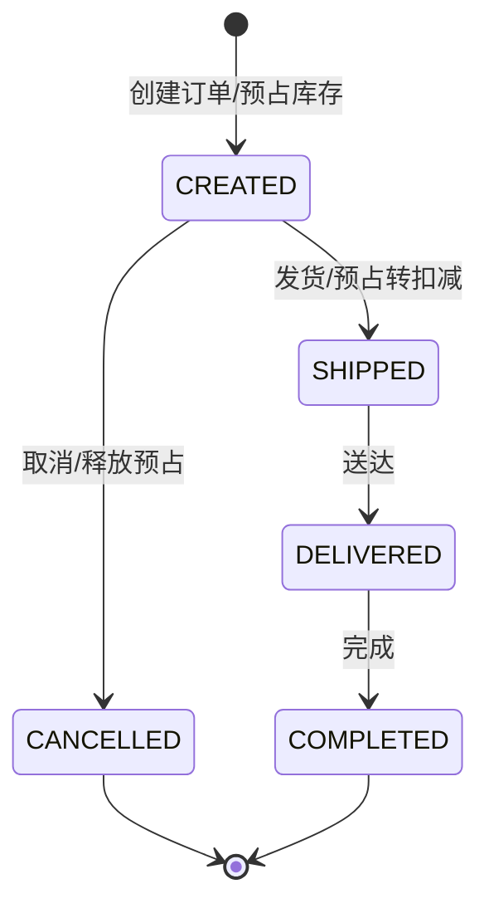

# TASK-023-FINAL.2 支付业务下线与核心业务收敛报告

> 日期: 2026-11-25  
> 范围: 从当前正式功能中移除支付、支付宝和资金退款，保留历史数据兼容  
> 本任务未 commit/push，未覆盖/删除 3307 数据，未执行 migration。

## 1. 下线前后功能范围

### 下线前

```text
商品/分类/SKU/库存
订单
MOCK 支付
支付宝适配器
支付回调/同步
退款/退款查询
售后 REFUND_ONLY/RETURN_REFUND/EXCHANGE
知识库 RAG
Agent Tool/Prepare/Confirm/Safety/Trace
```

### 下线后

```text
商品/分类/SKU/库存
订单 CREATED/CANCELLED/COMPLETED
简化售后: EXCHANGE
知识库 RAG
Agent READ/PREPARE/CONFIRM
Safety/Trace/Debug Console
```

支付和资金退款不再是当前项目正式功能。

## 2. 支付/退款依赖分析

支付链路原依赖：

```text
orders.payment_status/paid_amount/paid_at/refunded_amount
payments 表
refunds 表
PaymentService
RefundService
AlipayClient
/payments 和 /admin/payments /admin/refunds
OrderService 支付回调/超时关单
AfterSaleService 退款审核/退款执行
Agent order tool 的 payment_status/paid_amount
前端订单支付状态/金额
```

处理原则：

- 运行时 API/Service/Tool/UI 全部下线；
- 历史表、列、ORM Model 保留，避免破坏现有 3307 数据；
- 不执行 DROP/ALTER；
- 不修改历史 migration；
- 旧订单仍可读取。

## 3. 订单状态机变化

### 新状态机



### 库存规则

| 阶段 | 库存 |
|---|---|
| 创建 | `reserved_quantity += quantity` |
| 取消 | `reserved_quantity -= quantity` |
| 发货 | `total_quantity -= quantity`，`reserved_quantity -= quantity` |
| 送达 | 不变 |
| 完成 | 不变 |
| 换货收货 | `total_quantity += quantity` |
| 换货补发 | `total_quantity -= quantity` |

订单创建后状态为 **CREATED**，不再出现 PENDING_PAYMENT/PAID 新数据。

## 4. 售后业务调整

保留：

```text
EXCHANGE: 换货
```

下线：

```text
REFUND_ONLY: 无支付基础，不再接受
RETURN_REFUND: 不再执行资金退款，不再接受新申请
```

兼容：

- 历史 REFUND_ONLY/RETURN_REFUND 记录仍可读取；
- 历史 REFUNDING/REFUND_FAILED 状态仍在响应枚举中兼容；
- 新申请只接受 EXCHANGE；
- 审核/收货/换货补发不再访问 Payment/Refund。

售后库存：

```text
审核通过 -> WAITING_RETURN
用户寄回 -> RETURN_SHIPPED
管理员收货 -> 入库 + RECEIVED
完成换货 -> 出库 + COMPLETED
```

## 5. 库存业务影响

- 订单取消仍释放预占；
- 发货时才真正扣减总库存；
- 换货收货回补库存，补发再扣减；
- 没有支付成功扣库存路径；
- 旧 PAID 订单兼容发货，但不再创建新的 PAID 订单。

## 6. Backend 修改清单

删除：

```text
backend/app/api/v1/payments.py
backend/app/api/v1/admin/payments.py
backend/app/api/v1/admin/refunds.py
backend/app/services/payment.py
backend/app/services/alipay.py
backend/app/services/refund.py
backend/app/repositories/payment.py
backend/app/repositories/refund.py
backend/app/schemas/payment.py
```

修改：

```text
backend/app/services/order.py
backend/app/services/after_sale.py
backend/app/api/v1/orders.py
backend/app/api/v1/admin/orders.py
backend/app/api/v1/serializers.py
backend/app/api/router.py
backend/app/schemas/order.py
backend/app/schemas/after_sale.py
backend/app/core/config.py
```

保留：

```text
payments 表
refunds 表
orders 支付字段
after_sales 退款字段
Payment/Refund ORM Model
历史 migration
```

## 7. Frontend 修改清单

- 删除支付 API 类型和 `listPayments`；
- 订单列表移除支付状态列，新增履约状态；
- 订单详情移除支付/已支付/已退款/支付时间；
- 支付说明改为履约/售后说明；
- 售后页面移除金额列和退款文案；
- 状态色移除 UNPAID/PAID/REFUNDING/REFUND_FAILED；
- 新增 CREATED 状态色。

## 8. Agent 修改清单

- 删除订单输出中的 payment_status/paid_amount/refunded_amount/paid_at；
- Prepare Cancel 只接受 CREATED；
- 售后 Tool 只接受 EXCHANGE；
- Prompt 明确支付/退款不在当前范围；
- Tool Registry 未保留支付/退款 Tool；
- READ/Prepare/Confirm 权限边界不变。

## 9. 数据库调整方案

本阶段 **不新增 migration**，原因：

- 3307 当前有历史订单/知识数据；
- payments/refunds 表保留可读；
- 直接 DROP 会破坏历史数据和外键；
- 当前目标只是停止运行时支付能力。

兼容策略：

```text
保留表: payments, refunds
保留列: orders.payment_status/paid_amount/paid_at/refunded_amount
保留列: after_sales 退款字段
新数据: order.status=CREATED
旧数据: PAID/REFUND_* 可读取
```

未来如需物理清理，必须单独立项、备份、独立测试库验证后再执行。

## 10. 测试修改清单

删除：

```text
backend/tests/integration/test_order_flow.py
backend/tests/services/test_alipay.py
backend/tests/security/test_task015_payment_security.py
```

新增：

```text
backend/tests/integration/test_order_lifecycle.py
```

覆盖：

- 创建订单 CREATED；
- 预占库存；
- 取消释放；
- 发货扣减；
- 送达/完成；
- EXCHANGE 售后完整流程；
- REFUND_ONLY 请求被拒绝；
- payments/refunds 路由不存在。

Agent 测试调整：

- 订单状态 PENDING_PAYMENT -> CREATED；
- 售后类型 REFUND_ONLY -> EXCHANGE；
- 取消 Prepare 仍通过。

E2E 调整：

- 订单详情检查“履约状态”；
- Agent 取消“未发货订单”。

## 11. 实际测试结果

```text
Backend/Agent pytest: 357 passed
Frontend typecheck: passed
Frontend lint: passed
Vitest: 6 passed
Vite build: passed
Playwright: 10 passed
```

开发库 3307 前后:

```text
users=55 orders=29 after_sales=6
```

没有因本轮测试改写开发库。

RAG 评测沿用本轮已执行的离线结果:

```text
43 questions
no-answer rejection 12/12
answerable acceptance 30/30
ACL user filtered 1/1
```

## 12. 未完成事项

- 历史 payments/refunds 物理清理：未做，需单独立项；
- 旧订单支付字段展示：已从 UI 移除，数据库仍保留；
- 真实支付/支付宝：永久移出当前范围；
- 生产部署/HTTPS：仍为 TASK-017/018 暂缓；
- 开发库 3307 事故数据恢复：仍需负责人批准。

## 13. 风险和兼容性说明

1. 旧 PAID 订单可以读取，且允许兼容发货；
2. 旧 REFUND 售后记录可以读取，但不能新申请；
3. payments/refunds 表仍存在，不是“已删除支付系统”的物理状态；
4. 订单 `expires_at` 字段保留但不再自动关单；
5. 旧迁移仍包含支付表创建逻辑，不能修改历史 migration；
6. 没有 commit/push，所有改动仍在工作区。
