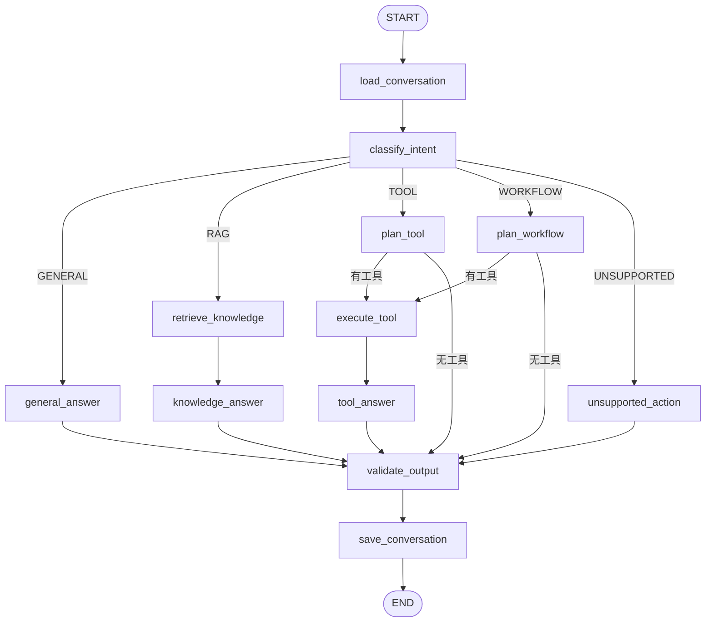
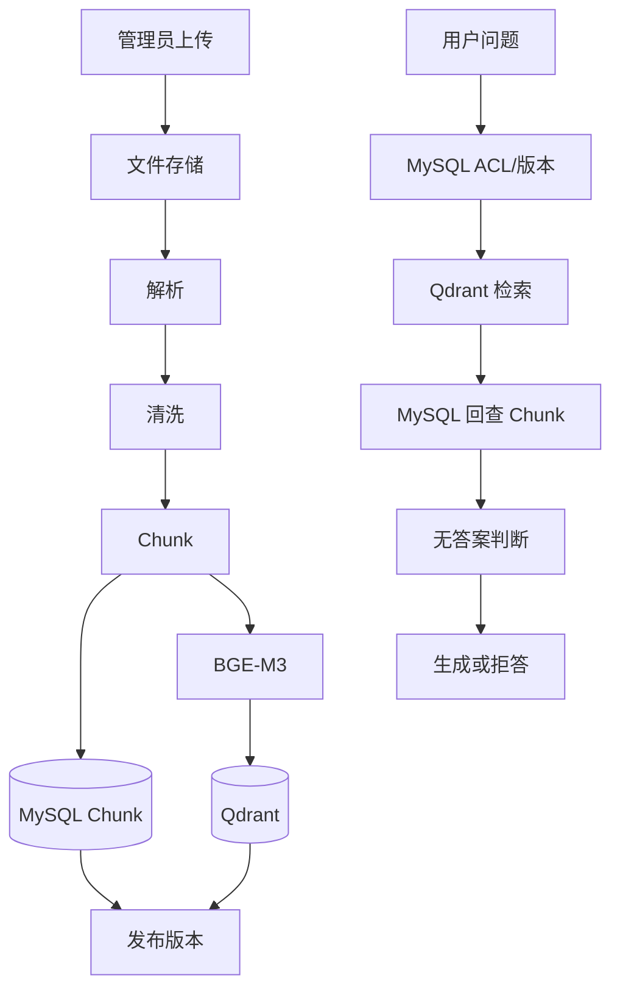

# 04 Agent 与 RAG

## 1. Agent 定位

Agent 是电商业务助手，不是数据库客户端。

```text
LLM 负责理解和选择
后端 Service 负责业务规则
Tool 负责受限访问
Prepare/Confirm 负责写操作确认
ACL/权限负责安全边界
```

## 2. 执行链路

```text
POST /api/v1/agent/chat
→ AgentRuntime
→ Safety 输入检查
→ Rate Limit
→ 会话锁
→ LangGraph
→ 路由 / RAG / Tool / Prepare
→ validate_output
→ save_conversation
→ 返回 answer、sources、pending_action、trace_id
```

## 3. State 与 Context

### AgentState

可序列化：

```text
request_id
trace_id
conversation_id
user_id
user_message
history
intent
retrieved_items
context_text
tool_name / tool_args / tool_result
pending_action
answer / sources
token_usage
```

### AgentRuntimeContext

不可序列化的可信依赖：

```text
User
AsyncSession
Settings
LLM
Retrieval
ConversationStore
ToolExecutor
ConfirmationStore
TraceRecorder
```

目的：Graph State 不携带 ORM Session/User，Context 不进入可序列化状态。

## 4. Graph



## 5. 路由

```text
GENERAL
RAG
TOOL
WORKFLOW
UNSUPPORTED_ACTION
```

确定性规则先拦截明显请求：

```text
退款 / 支付 / 改库存 / 建订单 → UNSUPPORTED
取消订单 / 售后 → WORKFLOW
查询订单 / 商品 / 库存 → TOOL
```

未命中才调用 LLM 分类，且只接受固定标签。

## 6. Tool

当前工具：

```text
READ
  search_products
  get_product_detail
  get_sku_detail
  check_sku_inventory
  list_my_orders
  get_my_order
  list_my_after_sales
  get_my_after_sales

PREPARE
  prepare_cancel_order
  prepare_create_after_sales
```

边界：

- Registry 白名单；
- Pydantic 参数校验；
- Tool 调用 Service，不直接 SQL；
- READ 不执行业务写操作；
- PREPARE 只写 Redis pending。

## 7. Prepare / Confirm

```text
PREPARE Tool
→ ConfirmationStore.create
→ Redis PREPARED
→ 返回 nonce + confirmation_id + expires_at
→ 用户确认
→ POST /agent/actions/{id}/confirm
→ Lua 原子消费
→ Service 二次校验
→ 执行取消/换货
```

Lua 校验：

```text
user_id
conversation_id
nonce
params_hash
状态
TTL
```

## 8. Safety / Trace

输入：

- 长度；
- 控制字符；
- Prompt Injection 信号。

输出：

- 长度；
- 敏感信息；
- Source 必须在已检索 Chunk 中。

Trace：

- 节点、路由、工具、RAG、输出校验；
- 脱敏；
- 进程内 TraceBuffer；
- Admin 可查 `/agent/runs/{trace_id}`。

## 9. RAG



支持：

```text
PDF
DOCX
Markdown
TXT
HTML
```

不支持 OCR。

### 检索安全

```text
MySQL 允许版本
→ Qdrant version_id 过滤
→ MySQL 回查 Chunk
→ 丢弃 stale point
→ Source 由后端构造
```

### 无答案阈值

```text
top_score < 0.60 → LOW_SCORE
0.60 <= top_score < 0.625 且 evidence coverage < 0.50 → LOW_EVIDENCE
其他 → ACCEPTED
```

## 10. 限制

- Graph 一次只选择一个工具；
- 没有多工具循环；
- Trace 不持久化；
- 管理员库存调整 HITL 已实现：Prepare → 管理员审批 → 恢复执行；
- HITL 的 Checkpointer 使用进程内实现，重启后依赖重建中断状态；
- RAG 评测是小样本；
- 没有 Reranker / 混合检索 / OCR。
