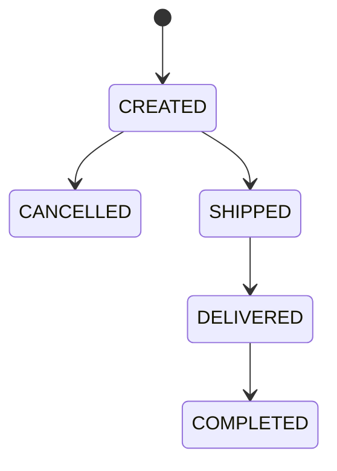

# 09 面试学习规划

> 目标不是背代码，而是做到：能跑通、能讲清楚、能被追问。

建议按 **7 天、每天 2–3 小时**准备；时间紧可压缩成 5 天或 3 天。

---

## 1. 学习目标

完成后应能：

```text
独立启动项目
讲清双端架构
解释订单/库存/售后状态机
解释 Agent 工具边界
解释 RAG ACL 和无答案策略
现场演示完整业务闭环
主动说明项目边界
```

---

## 2. 7 天计划

### 第 1 天：跑通项目，建立整体地图

**目标**

知道项目有哪些页面、角色、数据和服务。

**动手**

1. 启动 MySQL、Redis、Qdrant；
2. 启动后端和前端；
3. 打开 `/shop`，注册/登录普通用户；
4. 登录管理员 `/dashboard`；
5. 浏览商品、订单、售后、知识库、Agent Trace；
6. 画一张自己的架构图。

**阅读**

```text
README.md
docs/README.md
docs/01-project-overview.md
docs/02-architecture.md
```

**产出**

```text
一页纸：
消费者端页面
管理员端页面
角色如何分流
数据存在哪里
```

**自检**

> 普通用户为什么不能进入运营后台？

---

### 第 2 天：商品、SKU、库存、订单

**目标**

理解订单与库存如何保持一致。

**阅读顺序**

```text
backend/app/models/product.py
backend/app/models/sku.py
backend/app/models/inventory.py
backend/app/models/order.py
backend/app/models/order_item.py

backend/app/services/inventory.py
backend/app/services/order.py

backend/app/api/v1/orders.py
backend/app/api/v1/admin/orders.py
```

**动手**

用普通用户下一单，观察：

```text
创建订单 → reserved 增加
取消订单 → reserved 减少
管理员发货 → total 减少，reserved 减少
管理员送达 → fulfillment_status = DELIVERED
```

**必须理解**

```text
Product / Sku / Inventory 的关系
订单状态和履约状态为什么分开
创建订单为什么预占库存
取消和发货分别怎么处理库存
幂等键解决什么问题
```

**自检**

能画出：



---

### 第 3 天：售后与双端前端

**目标**

完整理解“下单 → 发货 → 送达 → 换货 → 审核 → 寄回 → 收货 → 完成”。

**阅读**

```text
backend/app/services/after_sale.py
backend/app/api/v1/after_sales.py

frontend/src/pages/shop/ShopOrderDetail.tsx
frontend/src/pages/shop/ShopAfterSales.tsx
frontend/src/pages/shop/ShopAfterSaleDetail.tsx

frontend/src/pages/orders/OrderDetail.tsx
frontend/src/pages/after-sales/AfterSaleDetail.tsx
```

**动手**

用管理员和普通用户两个浏览器上下文跑：

```text
普通用户下单
管理员发货
管理员送达
普通用户申请换货
管理员审核通过
普通用户填写退货物流
管理员确认收货
管理员完成换货补发
```

**必须理解**

```text
为什么未送达不能申请换货
售后状态机
为什么只支持 EXCHANGE
普通用户和管理员各自能操作什么
```

**自检**

> 为什么售后空页面不是 bug？

---

### 第 4 天：Agent

**目标**

能讲清楚 Agent 为什么不能直接操作数据库。

**阅读顺序**

```text
agent/graph.py
agent/state.py
agent/context.py
agent/routing.py
agent/runtime.py
agent/tools/registry.py
agent/tools/executor.py
agent/tools/confirmation.py
agent/tools/order.py
agent/tools/product.py
agent/safety/
agent/observability/
```

**动手**

打开 `/shop/assistant`，问：

```text
推荐一款手机
这款还有库存吗
查询我的订单
帮我取消未发货订单
换货需要什么条件
```

然后打开 `/agent/debug` 看 Trace。

**必须理解**

```text
State 和 Context 为什么分开
GENERAL/RAG/TOOL/WORKFLOW/UNSUPPORTED 如何路由
READ 和 PREPARE 的区别
Prepare 为什么只写 Redis
Confirm 如何防止重复消费
Tool 如何避免越权
```

**自检**

> 为什么 LLM 不能直接调用 OrderService？

---

### 第 5 天：RAG

**目标**

理解“Qdrant 召回，MySQL 权威”的设计。

**阅读**

```text
backend/app/services/rag/parser.py
backend/app/services/rag/chunker.py
backend/app/services/rag/embedding.py
backend/app/services/rag/document_service.py
backend/app/services/rag/retrieval_service.py
agent/rag_evidence.py
```

**动手**

上传一份知识文档，发布，问一个知识库问题和一道知识库没有的问题。

**必须理解**

```text
文档解析
Chunk 策略
BGE-M3 1024 维
Qdrant Collection
MySQL ACL / 版本
为什么检索后还要回查 MySQL
无答案阈值
```

**自检**

> 为什么 Qdrant 不能作为权限和正文的权威源？

---

### 第 6 天：测试、安全、边界

**阅读**

```text
conftest.py
backend/tests/guard.py
backend/tests/
agent/tests/
frontend/e2e/
docs/06-testing-and-quality.md
```

**运行**

```powershell
.venv\Scripts\python.exe -m pytest -q

cd frontend
npm run typecheck
npm run lint
npm test
npm run build
```

**必须理解**

```text
测试库为什么隔离
普通用户为什么不能访问 /admin
非法订单/售后状态为什么会被 Service 拒绝
哪些功能还没做
哪些说法不能对面试官说
```

**自检**

能主动说出：

```text
没有购物车
没有支付
没有生产部署
Trace 不持久化
单浏览器只能一个身份
```

---

### 第 7 天：面试表达与模拟

**准备四个版本**

```text
30 秒介绍
1 分钟介绍
3 分钟介绍
8 分钟演示
```

**练习高频问题**

1. 为什么做双端？
2. 为什么不用微服务？
3. 为什么用 FastAPI？
4. Agent State 和 Context 为什么分开？
5. 为什么 Prepare/Confirm？
6. Confirm 如何防重放？
7. 订单和库存怎么保持一致？
8. 订单状态和履约状态为什么分开？
9. 为什么没有支付？
10. 售后为什么只支持换货？
11. RAG 如何做 ACL？
12. 为什么 Qdrant 不是权威源？
13. 无答案策略怎么做？
14. Trace 有什么用？
15. 项目最大的限制是什么？

**模拟流程**

```text
1. 30 秒介绍
2. 打开架构图
3. 讲一条业务闭环
4. 讲 Agent 工具边界
5. 讲 RAG
6. 主动说限制
```

---

## 3. 推荐阅读顺序

```text
README
docs/01 项目总览
docs/02 架构
docs/03 业务流程
docs/04 Agent 与 RAG
docs/05 数据与 API
docs/06 测试与质量
docs/07 面试问答
docs/08 演示脚本
```

不要从 `agent/graph.py` 开始硬啃。先理解业务，再看 Agent。

---

## 4. 最重要的 5 个面试故事

### 故事 1：双端角色

```text
一个登录页
后端 is_admin
前端 AdminRoute
普通用户不能进入运营后台
```

### 故事 2：订单与库存

```text
创建预占
取消释放
发货扣减
状态由 Service 推进
```

### 故事 3：Agent 工具边界

```text
READ 只读
PREPARE 只写 pending
Confirm 独立执行
```

### 故事 4：RAG 可信性

```text
Qdrant 召回
MySQL 回查
ACL 前置
无答案拒答
```

### 故事 5：双端售后闭环

```text
用户申请
管理员审核
用户寄回
管理员收货
完成换货
```

---

## 5. 每天最低验收

```text
第 1 天：能画出双端架构
第 2 天：能解释订单和库存
第 3 天：能完整演示售后
第 4 天：能解释 Prepare/Confirm
第 5 天：能解释 RAG ACL
第 6 天：能说出项目边界
第 7 天：能在 3 分钟内讲完项目
```

---

## 6. 3 天压缩版

```text
第 1 天：跑通 + 订单/库存 + 售后
第 2 天：Agent + RAG
第 3 天：测试 + 面试问答 + 演示
```

优先级：

```text
业务闭环 > Agent 工具边界 > RAG > 部署
```

不要花时间在购物车、支付和复杂前端美化上。把“没做什么”讲清楚，比硬加功能更可信。

---

## 7. 面试前检查清单

```text
[ ] 项目能正常启动
[ ] 普通用户能登录商城
[ ] 管理员能登录后台
[ ] 商品/订单/售后数据存在
[ ] 能用两个浏览器上下文演示双端
[ ] 能完整走通售后闭环
[ ] 能打开 Agent Trace
[ ] 能解释 Agent 不能直接写库
[ ] 能解释 RAG ACL
[ ] 能主动说明边界
```
