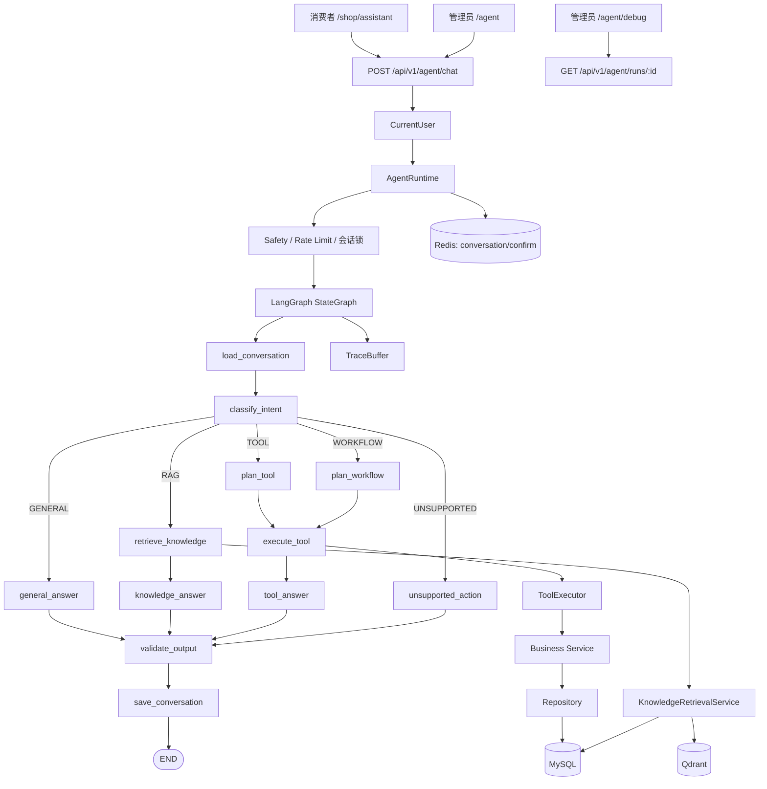

# E-Commerce Agent 架构升级 · 阶段 0 源码分析报告

> 注：这是改造前的阶段 0 快照，文中的 361 个测试是当时基线；当前项目已是 336 个测试、迁移 head `33d629302f1f`，库存调整 HITL、审批中心和审批审计表均已实现，当前状态以 README、01-16 文档和代码为准。

> 状态：只读分析，未修改代码、数据库、配置。
> 基线：当前 `main` 分支，Django/FastAPI 单体项目，55 个 API 路径。
> 目标：模块化单体，不拆微服务。

---

## 1. 当前 Agent 架构图



## 2. 当前完整执行流程

```text
POST /api/v1/agent/chat
→ CurrentUser 认证
→ AgentRuntime.chat
→ Agent 输入 Safety
→ Redis Rate Limit
→ ConversationStore 加锁/加载历史
→ LangGraph.ainvoke
→ load_conversation
→ classify_intent
→ 条件路由
   ├── GENERAL → general_answer
   ├── RAG → retrieve_knowledge → knowledge_answer
   ├── TOOL → plan_tool → execute_tool → tool_answer
   ├── WORKFLOW → plan_workflow → execute_tool → tool_answer
   └── UNSUPPORTED → unsupported_action
→ validate_output
→ save_conversation
→ 返回 answer / sources / pending_action / trace_id
```

现有入口：

```text
POST /api/v1/agent/chat
POST /api/v1/agent/actions/{confirmation_id}/confirm
GET  /api/v1/agent/runs/{trace_id}
```

## 3. 模块与目标架构对应关系

| 目标模块 | 当前实现 | 差距 |
|---|---|---|
| 消费者客服 | `/shop/assistant` + AgentChatPage | 已有，但仅用户自己确认，不是管理员审批 |
| 运营后台 Agent | `/agent` | 已有 |
| Agent 调试观察台 | `/agent/debug` + TraceConsole | 已有基础，无持久化/审批轨迹 |
| FastAPI API | `backend/app/api/v1/agent.py` | 只有 chat/runs/confirm，无审批中心 |
| Agent Runtime | `agent/runtime.py` | 已有；无 thread/checkpointer |
| LangGraph | `agent/graph.py` | 已有；无 interrupt/checkpointer |
| Intent | `agent/routing.py` | 已有但与目标命名不一致 |
| Router | 条件边 + `route_intent` | 有路由，无独立 Router 节点 |
| RAG | `services/rag/` | 已有 |
| Tool | `agent/tools/` | 已有 READ/PREPARE |
| Workflow | `plan_workflow` + PREPARE | 只有准备，没有多步骤流程 |
| HITL | 用户 Prepare/Confirm | 不是管理员审批，无 interrupt |
| Redis | 会话/确认 pending | 无 ApprovalStore 列表/审批状态 |
| Checkpointer | 无 | 缺少 |
| 审批审计 | 无 | 无表、无 API、无 UI |

## 4. 已经实现的能力

### Agent 核心

- LangGraph StateGraph；
- 12 个节点；
- State 与 RuntimeContext 分离；
- `AgentState` 可序列化；
- `AgentRuntimeContext` 保存 User/AsyncSession/LLM/RAG/Trace；
- 输入超时、限流、会话锁；
- 对话历史 Redis；
- Safety 和输出校验；
- TraceBuffer 和脱敏；
- 管理员/用户 Trace 权限校验。

### 路由与工具

当前 Intent：

```text
GENERAL
RAG
KNOWLEDGE（兼容别名）
TOOL
WORKFLOW
UNSUPPORTED_ACTION
```

确定性预判 + LLM 分类。

当前工具：

```text
READ:
  search_products
  get_product_detail
  get_sku_detail
  check_sku_inventory
  list_my_orders
  get_my_order
  list_my_after_sales
  get_my_after_sales

PREPARE:
  prepare_cancel_order
  prepare_create_after_sales
```

工具通过 Service 调用业务，没有发现 Tool 直接 SQL 写库。

### Prepare / Confirm

- Redis `ConfirmationStore`；
- `SET NX EX`；
- nonce、用户、会话、参数 hash；
- Lua 原子消费；
- 用户 `POST /agent/actions/{id}/confirm`；
- 业务 Service 二次校验；
- 当前 TTL 默认 300 秒。

### RAG

- PDF/DOCX/Markdown/HTML/TXT；
- 清洗；
- 结构感知 Chunk；
- BGE-M3 1024 维；
- Qdrant；
- MySQL 版本/ACL/Chunk 回查；
- 无答案判断；
- Source 服务端构造。

## 5. 尚未实现的能力

### HITL

- 没有 **管理员审批** 中心；
- 没有 `pending / approved / rejected / expired / failed` 审批列表；
- 没有审批详情 API；
- 没有审批审计表；
- 没有 `interrupt`；
- 没有 Checkpointer；
- 没有 thread_id；
- 没有 `Command(resume=...)`；
- 没有审批等待期间的锁/TTL 策略；
- 没有审批并发幂等保护；
- 没有审批后重新校验业务状态的执行器。

> 当前 `prepare_*` 是“用户自助确认”，不是“运营管理员审批”。

### Graph / Route

- 没有独立 `Router` 节点；
- 没有 `route` 字段；
- 没有 `parameters` 结构化字段；
- 没有 `approval_required / approval_id / approval_status`；
- 没有 `thread_id`；
- 没有 `user_role`；
- 没有按角色过滤 Tool；
- 没有 inventory/refund 类 Workflow；
- `plan_workflow` 只是 prepare 工具入口，不是多步骤工作流。

### Trace

- 进程内 `TraceBuffer`；
- 重启丢失；
- 没有审批轨迹；
- 没有持久化审计；
- 没有前端审批中心；
- 调试台只有 Trace，没有完整执行时间线。

### 审批 API

当前不存在：

```text
GET  /admin/agent/approvals
GET  /admin/agent/approvals/{id}
POST /admin/agent/approvals/{id}/approve
POST /admin/agent/approvals/{id}/reject
```

### 数据库

当前没有：

```text
agent_approvals
agent_audit
checkpoint 表
```

`langgraph-checkpoint` 依赖已经随 LangGraph 安装，但没有被配置使用。

## 6. 需要修改/新增的文件清单

### 优先修改

```text
agent/state.py
agent/graph.py
agent/runtime.py
agent/routing.py
agent/nodes.py
agent/context.py
agent/tools/executor.py
agent/tools/confirmation.py

backend/app/api/v1/agent.py
backend/app/schemas/agent.py
backend/app/api/router.py

frontend/src/App.tsx
frontend/src/layouts/AdminLayout.tsx
frontend/src/layouts/ShopLayout.tsx
frontend/src/pages/agent/AgentChat.tsx
frontend/src/pages/agent/TraceConsole.tsx
frontend/src/api/agent.ts
frontend/src/types/agent.ts
```

### 新增建议

```text
agent/router.py
agent/intent.py
agent/nodes/approval.py
agent/nodes/response.py
agent/workflows/
agent/persistence/checkpointer.py
agent/tools/inventory.py
agent/tools/approval.py

backend/app/api/v1/admin/agent_approvals.py
backend/app/api/v1/admin/agent_debug.py
backend/app/models/agent_approval.py
backend/app/repositories/agent_approval.py
backend/app/services/agent_approval.py
backend/app/schemas/agent_approval.py
backend/alembic/versions/<new>_agent_approvals.py

frontend/src/pages/admin/AgentApprovals.tsx
frontend/src/pages/admin/AgentApprovalDetail.tsx
```

> 不建议大规模移动现有文件；优先在现有模块内增量改造。

## 7. 风险点

1. **现有用户 Confirm 不能直接改成管理员审批**
   会破坏消费者端已有 Prepare/Confirm 流程和测试。应保留现有用户确认，新增管理员审批路径。

2. **AgentRuntime 当前是短期请求**
   整体超时约 40 秒，会话锁约 60 秒；审批等待可能长达 24 小时，不能把审批等待放在同一个运行时锁内。

3. **Redis Confirm 当前是消费即删除**
   管理员审批需要 list/get/approve/reject/expired，不能简单复用一次性消费结构。

4. **Checkpointer 需要 thread_id**
   当前只有 conversation_id，没有 thread_id；需要后端映射并校验用户归属。

5. **interrupt 前不能有不可逆副作用**
   Prepare 阶段只能预检查、生成计划，不能提前取消订单或写库存。

6. **审批期间业务状态会变化**
   恢复后必须重新校验订单/库存/售后状态，不能相信 Prepare 时的快照。

7. **审批审计不能只依赖 Redis**
   需要 MySQL 审批记录；否则 Redis 过期后无法审计。

8. **AgentState 变更会影响测试和 API**
   需要增量字段和兼容旧字段，不能一次性重写。

9. **Tool 当前不区分角色**
   管理员和普通用户共享 Registry；需要按角色/入口过滤可暴露工具。

10. **Trace 是进程内**
    多实例部署会丢失；调试台只能作为开发观察，不是生产审计。

## 8. 推荐分阶段顺序

### Phase 1：模块边界与兼容层

- 保留现有 API 和用户 Confirm；
- 增加 `route / parameters / approval_*` 增量字段；
- 把 `AgentIntent` 映射到 `rag / tool / workflow`；
- 增加独立 Router 节点，但保持旧行为；
- 加回归测试。

### Phase 2：HITL 后端

- 新增 `ApprovalStore` / `ApprovalService`；
- Redis pending + MySQL 审计；
- 增加管理员审批 API；
- 增加 thread_id 和 Checkpointer；
- 使用 `interrupt` 暂停；
- 使用 `Command(resume=...)` 恢复；
- 保留现有用户 Confirm 作为兼容路径。

### Phase 3：审批中心前端

- 待审批/已批准/已拒绝/已过期/失败列表；
- 审批详情；
- 批准/拒绝；
- 审批结果关联 Trace。

### Phase 4：调试观察台

- Intent / Router / RAG / Tool / Workflow / HITL 轨迹；
- token / latency / error；
- 权限隔离。

### Phase 5：Workflow 扩展

- 库存修改审批；
- 补货工作流；
- 订单取消/退款类 Workflow（当前退款不在范围）。

### Phase 6：集成测试与回归

- 查询、RAG、Workflow、HITL、权限、并发、幂等、过期、恢复；
- 原有商品/库存/订单/售后/认证回归。

## 9. 关键建议

1. **不要重写 Agent**：现有 Graph、State、Context、Tool、RAG 都可以复用。
2. **HITL 分两条路径**：消费者用户确认 vs 管理员审批，不要混为一谈。
3. **先加兼容字段和 Router，再加 interrupt/checkpointer**。
4. **审批计划与业务执行分离**：Prepare 只写计划，Confirm 才写业务。
5. **审批审计落 MySQL**：Redis 只做短期 pending。
6. **所有业务写入仍走 Service**：Tool 只能调用 Service。
7. **先补测试再改行为**：历史基线是 361 个测试，当前基线是 336 个测试。

## 10. 当前结论

当前项目已经具备：

```text
LangGraph + Intent/Router + RAG + READ/PREPARE Tool + 用户 Prepare/Confirm + Trace
```

但还不具备：

```text
管理员 HITL 审批中心 + LangGraph interrupt + Checkpointer + 审批审计表 + 多步骤 Workflow
```

因此建议：

```text
阶段 0：本报告
阶段 1：兼容性模块边界
阶段 2：HITL 后端
阶段 3：审批中心前端
阶段 4：调试台
阶段 5：Workflow 扩展
阶段 6：测试回归
```

本报告完成后暂停，等待确认后再进入代码修改阶段。
