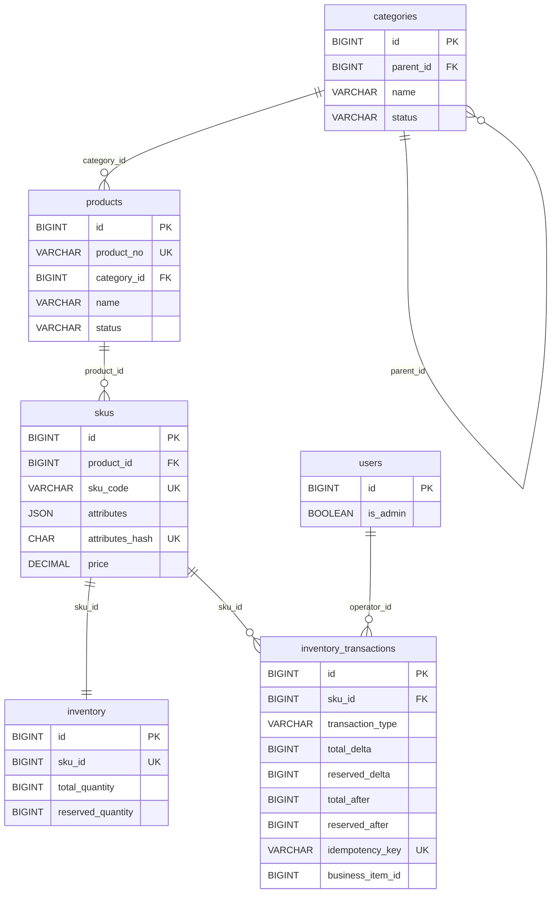

# 商品域技术设计（TASK-003.1）

> 文档状态：已按技术负责人确认的决策定稿，待人工复核
> 适用范围：TASK-003 商品与库存模块
> 技术栈：Python 3.12 / FastAPI / Pydantic v2 / SQLAlchemy 2.0 Async / MySQL 8 / Alembic
> 货币：人民币 CNY（第一版单币种）
> 仓库模型：单仓库（第一版）

---

## 1. 项目背景与设计目标

E-Commerce Agent 在完成用户注册、登录、JWT 认证后，需要建立商品与库存基础域，为后续订单、支付、搜索、RAG 与 AI 导购提供稳定的数据底座。

本设计的目标：

1. 建立标准 SPU + 多 SKU 的商品模型，支持同一商品的不同规格独立定价与独立库存。
2. 建立可维护的分类树，并保证“商品只挂末级分类”的业务约束。
3. 建立可审计、可幂等、可防超卖的库存模型。
4. 为后续订单快照、支付退款、多仓库、搜索与 AI 接入预留清晰的演进路径，但不过度设计。
5. 所有写操作遵循项目现有分层：API 薄层、Service 事务、Repository 持久化。

## 2. 业务范围与非目标

### 2.1 本期范围

- 分类树的新增、查询、改名、排序、停用、删除（受约束）。
- 商品 SPU 的创建、查询、更新、上架、下架、归档。
- SKU 的创建、查询、调价、启停。
- 单仓库库存的初始化、入库、出库、调整、预留、释放。
- 库存流水与幂等控制。
- 管理端鉴权（`is_admin` + `get_current_admin`）。

### 2.2 非目标（第一版明确不做）

- 多仓库、多货主库存。
- 多币种、汇率、税费计算。
- 商品多分类（不建 `product_categories` 关联表）。
- 分类 `level` / `path` / 闭包表。
- 中文全文搜索、向量表、RAG 商品向量化。
- 完整 RBAC / 角色权限体系。
- 商品物理删除、SKU 物理删除、库存流水修改/删除。
- 库存预留超时自动释放（由后续订单模块负责）。
- 管理端操作审计日志（后续迭代）。
- 商品图片、富文本详情、营销价格（后续迭代，字段可扩展）。

## 3. 领域模型

### 3.1 核心概念

| 概念 | 说明 |
|---|---|
| Category | 分类树节点，`parent_id` 自关联；商品只能关联启用的末级分类 |
| Product（SPU） | 标准化商品主体，拥有全局唯一 `product_no`，有 DRAFT/ACTIVE/INACTIVE/ARCHIVED 状态 |
| SKU | 商品的具体规格组合，独立编码、独立定价、独立启停；同一 SPU 下规格组合唯一 |
| Inventory | 每个 SKU 一条库存记录，保存总量与预留量 |
| InventoryTransaction | 库存只追加流水，记录双维度变化量与变更后快照 |

### 3.2 关系

- Category 1 → N Category（`parent_id`）
- Category 1 → N Product（`category_id`）
- Product 1 → N SKU（`product_id`）
- SKU 1 → 1 Inventory（`sku_id` 唯一）
- SKU 1 → N InventoryTransaction（`sku_id`）
- User 1 → N InventoryTransaction（`operator_id`，可空）

### 3.3 关键不变量

1. 每个 Product 必须始终关联一个末级 Category；创建、改分类、上架时该分类必须为 `ENABLED`。分类停用只允许在无 `ACTIVE` 商品时发生，其下 `DRAFT`/`INACTIVE` 商品保留关联但不可上架。
2. 每个 SKU 必须属于一个 Product，且同一 Product 下 `(product_id, attributes_hash)` 唯一。
3. 每个 SKU 必须有且仅有一条 Inventory 记录。
4. `0 <= reserved_quantity <= total_quantity` 恒成立。
5. 库存变化必须伴随一条同事务的 InventoryTransaction。
6. 已产生的 InventoryTransaction 不可修改、不可删除。

## 4. 核心业务规则

> 正文中标注“见待决策 D-xx”的规则属于**临时技术基线**，在产品负责人确认前不代表最终业务决策；确认后以最终决策为准。

### 4.1 分类规则

1. 根分类 `parent_id IS NULL`。
2. 创建分类时父分类必须存在且为 `ENABLED`。
3. 第一版不提供修改 `parent_id` 的 API；`name`、`sort_order`、`status` 可修改；同层分类名称暂不做唯一约束（见 D-01）。
4. 商品在创建、改分类、上架时必须关联启用且末级的分类；分类停用后，其下已有的 `DRAFT`/`INACTIVE` 商品保留关联但不可上架（见第 9 条）。
5. **如果分类已经关联任何 Product（无论商品状态），不允许在其下新增子分类**，保证任何商品不会因新增子节点而脱离末级。
6. 第一版不提供分类物理删除；分类只通过 `ENABLED`/`DISABLED` 状态管理。
7. 停用分类必须同时满足：
   - 不存在启用的子分类（`status = 'ENABLED'`）；
   - 不存在 `ACTIVE` 商品。
8. 分类树防环与末级校验由 Service 负责；MySQL 外键只保证引用完整性。
   - 防环：第一版不提供修改 `parent_id` 的 API，新建节点不可能形成环；Service 保留 `assert_no_cycle(category_id, new_parent_id)` 入口，未来开放父节点修改时用递归 CTE 校验 `new_parent_id` 不是当前节点的后代。
   - 末级：`SELECT 1 FROM categories WHERE parent_id = :category_id LIMIT 1` 有结果即非末级。
   - 并发：创建子分类、停用分类、商品创建/改分类/上架必须使用统一的分类锁（见 14.3）。
9. 分类停用后，其下已有的 `DRAFT`/`INACTIVE` 商品保留关联但不可上架；由于停用要求无 `ACTIVE` 商品，不会出现“可购买的失效关联”。
10. 分类启用（`DISABLED → ENABLED`）：若 `parent_id` 非空，必须按 `category_id` 升序锁定父分类与当前分类；父分类必须存在且 `ENABLED`，否则拒绝。**不得出现 `DISABLED` 父分类下存在 `ENABLED` 子分类的状态。**
11. 第一版不增加 `level`、`path` 或闭包表。

### 4.1.1 分类写操作关键步骤（单事务）

- **创建子分类**：`SELECT parent FOR UPDATE` → 校验父分类存在且 `ENABLED` → 校验父分类无任何 Product → INSERT 子分类 → COMMIT。
- **启用分类**：若 `parent_id` 非空，按 `category_id` 升序锁定父分类与当前分类；根分类只锁当前分类 → 校验父分类存在且 `ENABLED` → UPDATE `status='ENABLED'` → COMMIT。
- **停用分类**：`SELECT category FOR UPDATE` → 校验无 `ENABLED` 子分类 → 校验无 `ACTIVE` 商品 → UPDATE `status='DISABLED'` → COMMIT。
- **不提供删除**：分类只做状态切换，不提供 DELETE API，也不执行物理删除。

### 4.2 商品规则

1. 商品状态：`DRAFT`、`ACTIVE`、`INACTIVE`、`ARCHIVED`。
2. `product_no` 全局唯一，由管理端提供，必须匹配 `^[A-Z0-9][A-Z0-9_-]{2,31}$`；API 入口拒绝不符合规范的值。
3. 新建商品默认 `DRAFT`，此时 `published_at`、`archived_at` 必须为空。
4. 上架必须同时满足：
   - 商品存在且状态为 `DRAFT` 或 `INACTIVE`；
   - 分类存在、启用且为末级；
   - 至少一个启用 SKU；
   - 每个启用 SKU 都有库存记录；
   - 每个启用 SKU 价格 `> 0`。
5. 上架检查与状态更新必须在同一事务内完成，并处理并发修改。
6. 商品创建/改分类必须锁定分类行（`FOR UPDATE`），与新增子分类互斥；改分类仅允许 `DRAFT`/`INACTIVE`（临时规则，见待决策 D-05），且需同时锁定旧、新分类与商品（见 14.3）。
7. 第一版不提供商品物理删除；归档商品不可购买。
8. 归档为终态，第一版不支持恢复（见待决策 D-08）。
9. 状态与时间字段必须满足：`DRAFT` 时 `published_at`/`archived_at` 为空；`ACTIVE`/`INACTIVE` 时 `published_at` 非空、`archived_at` 为空；`ARCHIVED` 时 `archived_at` 非空。数据库 CHECK 强制该约束。
10. 商品可在库存为 0 时上架，但不可购买；可购买判定见 5.4。

### 4.3 SKU 规则

1. `sku_code` 全局唯一。
2. 每个 SKU 只属于一个 SPU。
3. 同一 SPU 下规格组合唯一，由 `(product_id, attributes_hash)` 唯一约束保证。
4. 每个 SKU 独立定价，金额使用 Python `Decimal` 与 MySQL `DECIMAL(12,2)`；第一版创建与调价（无论 SKU 状态）均要求 `price > 0`，`ACTIVE` 商品下的 `ACTIVE` SKU 尤其不得设置为 0，第一版不支持零元商品。
5. 货币统一 CNY。
6. SKU 可独立启用/停用；启停与调价必须与商品上架共用商品锁（见 14.3）。
7. SKU 创建时必须同事务创建零库存记录；这不是实际库存初始化，不写 `INITIAL` 流水（见 15.1）。
8. 第一版不提供 SKU 物理删除；规格创建后不可修改（见待决策 D-04）。
9. SKU 创建仅允许在非 `ARCHIVED` 商品下进行；`ARCHIVED` 商品禁止新增 SKU。
10. SKU 启停/调价在商品 `ACTIVE` 时立即影响可购买判定，且必须与商品上架互斥（见 14.3）；SKU 启用不改变商品状态，也不会自动满足上架条件。

### 4.4 库存规则

1. 单仓库，每个 SKU 一条库存记录。
2. `available_quantity = total_quantity - reserved_quantity`。
3. 数据库 CHECK：`total_quantity >= 0`、`reserved_quantity >= 0`、`reserved_quantity <= total_quantity`。
4. 库存扣减必须使用条件 UPDATE 并检查 `rowcount`，禁止“先查询 → 在 Python 计算 → 普通 UPDATE”。
5. 库存变更与流水写入必须同一事务；不允许只改库存不写流水。
6. 第一版不增加乐观锁 `version` 字段。
7. 多 SKU 操作（未来订单）按 `sku_id` 升序处理，降低死锁风险。
8. `RESERVED_OUTBOUND` 必须校验对应订单明细的预占数量，不能仅凭库存总预占量判断订单是否有权扣减（见 16.2.1）。

## 5. 商品、SKU、分类状态定义

### 5.1 Category 状态

| 值 | 含义 | 允许的操作 |
|---|---|---|
| `ENABLED` | 启用 | 可挂商品、可作为父分类；可被启用为子分类 |
| `DISABLED` | 停用 | 不可新增商品、不可上架商品；有 `ACTIVE` 商品或 `ENABLED` 子分类时禁止停用；父分类为 `DISABLED` 时禁止启用 |

状态迁移：`ENABLED ↔ DISABLED`；`DISABLED → ENABLED` 时必须校验父分类为 `ENABLED`。

> 分类不提供物理删除，只允许 `ENABLED`/`DISABLED` 状态切换。

### 5.2 Product 状态

| 值 | 含义 | 可购买 | `published_at` | `archived_at` | 允许的迁移 |
|---|---|---|---|---|---|
| `DRAFT` | 草稿 | 否 | 必须为空 | 必须为空 | → ACTIVE、→ ARCHIVED |
| `ACTIVE` | 上架 | 是（需满足 5.4） | 必须有值 | 必须为空 | → INACTIVE、→ ARCHIVED |
| `INACTIVE` | 下架 | 否 | 保留最近一次值 | 必须为空 | → ACTIVE、→ ARCHIVED |
| `ARCHIVED` | 归档 | 否 | 保留原值 | 必须有值 | 终态（第一版不可恢复） |

### 5.3 SKU 状态

| 值 | 含义 | 可售 |
|---|---|---|
| `ACTIVE` | 启用 | 商品 ACTIVE 且库存可售时可售 |
| `INACTIVE` | 停用 | 否 |

### 5.4 可购买判定（读侧统一规则）

商品可购买当且仅当（读侧统一规则）：

- `products.status = 'ACTIVE'`；
- 所属分类 `status = 'ENABLED'` 且无子分类（末级）；
- `skus.status = 'ACTIVE'`；
- `inventory.total_quantity - inventory.reserved_quantity > 0`；
- `skus.price > 0`。

说明：

- 商品允许在可用库存为 0 时保持 `ACTIVE`（上架），但此时不可购买。
- SKU 的 `status` 等价于业务语义中的 `is_active`；数据库字段统一命名为 `status`。

## 6. 数据库 ER 图



## 7. 五张核心表字段设计

通用约定：

- 引擎 `InnoDB`，字符集 `utf8mb4`，排序规则 `utf8mb4_unicode_ci`。
- 主键统一 `BIGINT`（有符号，与现有 `users.id` 一致）+ `AUTO_INCREMENT`。
- 时间统一 `DATETIME(6)`，应用层写入 UTC。
- 状态统一 `VARCHAR(16)` + CHECK，便于阅读与扩展，不使用 MySQL ENUM。
- 哈希、编码类字段使用 `CHAR/VARCHAR ... CHARACTER SET ascii COLLATE ascii_bin`，保证大小写敏感与索引效率。

各表字段数（与下文表格一致）：

| 表 | 字段数 |
|---|---|
| `categories` | 7 |
| `products` | **10** |
| `skus` | 9 |
| `inventory` | 6 |
| `inventory_transactions` | 14 |

### 7.1 `categories`

| 字段 | 类型 | NULL | 默认值 | 说明 |
|---|---|---|---|---|
| `id` | BIGINT | NO | AUTO_INCREMENT | 主键 |
| `parent_id` | BIGINT | YES | NULL | 父分类；根为 NULL |
| `name` | VARCHAR(100) | NO | — | 分类名称 |
| `sort_order` | INT | NO | 0 | 同级排序，升序 |
| `status` | VARCHAR(16) | NO | `ENABLED` | `ENABLED` / `DISABLED` |
| `created_at` | DATETIME(6) | NO | CURRENT_TIMESTAMP(6) | 创建时间（UTC） |
| `updated_at` | DATETIME(6) | NO | CURRENT_TIMESTAMP(6) ON UPDATE | 更新时间（UTC） |

```sql
CREATE TABLE categories (
    id BIGINT NOT NULL AUTO_INCREMENT,
    parent_id BIGINT NULL,
    name VARCHAR(100) NOT NULL,
    sort_order INT NOT NULL DEFAULT 0,
    status VARCHAR(16) NOT NULL DEFAULT 'ENABLED',
    created_at DATETIME(6) NOT NULL DEFAULT CURRENT_TIMESTAMP(6),
    updated_at DATETIME(6) NOT NULL DEFAULT CURRENT_TIMESTAMP(6)
        ON UPDATE CURRENT_TIMESTAMP(6),
    PRIMARY KEY (id),
    KEY ix_categories_parent_sort (parent_id, sort_order),
    CONSTRAINT fk_categories_parent
        FOREIGN KEY (parent_id) REFERENCES categories (id)
        ON DELETE RESTRICT ON UPDATE RESTRICT,
    CONSTRAINT ck_categories_status
        CHECK (status IN ('ENABLED', 'DISABLED'))
) ENGINE=InnoDB DEFAULT CHARSET=utf8mb4 COLLATE=utf8mb4_unicode_ci;
```

### 7.2 `products`

| 字段 | 类型 | NULL | 默认值 | 说明 |
|---|---|---|---|---|
| `id` | BIGINT | NO | AUTO_INCREMENT | 主键 |
| `product_no` | VARCHAR(32) ascii_bin | NO | — | 全局唯一业务编号 |
| `category_id` | BIGINT | NO | — | 所属末级分类 |
| `name` | VARCHAR(200) | NO | — | 商品名称 |
| `description` | TEXT | YES | NULL | 商品描述（供详情与 RAG 使用） |
| `status` | VARCHAR(16) | NO | `DRAFT` | 商品状态 |
| `published_at` | DATETIME(6) | YES | NULL | 最近一次上架时间；`DRAFT` 为空，`ACTIVE`/`INACTIVE` 非空，`ARCHIVED` 保留原值 |
| `archived_at` | DATETIME(6) | YES | NULL | 归档时间；`ARCHIVED` 必须非空，其他状态为空 |
| `created_at` | DATETIME(6) | NO | CURRENT_TIMESTAMP(6) | 创建时间（UTC） |
| `updated_at` | DATETIME(6) | NO | CURRENT_TIMESTAMP(6) ON UPDATE | 更新时间（UTC） |

```sql
CREATE TABLE products (
    id BIGINT NOT NULL AUTO_INCREMENT,
    product_no VARCHAR(32) CHARACTER SET ascii COLLATE ascii_bin NOT NULL,
    category_id BIGINT NOT NULL,
    name VARCHAR(200) NOT NULL,
    description TEXT NULL,
    status VARCHAR(16) NOT NULL DEFAULT 'DRAFT',
    published_at DATETIME(6) NULL,
    archived_at DATETIME(6) NULL,
    created_at DATETIME(6) NOT NULL DEFAULT CURRENT_TIMESTAMP(6),
    updated_at DATETIME(6) NOT NULL DEFAULT CURRENT_TIMESTAMP(6)
        ON UPDATE CURRENT_TIMESTAMP(6),
    PRIMARY KEY (id),
    UNIQUE KEY uq_products_product_no (product_no),
    KEY ix_products_category_id (category_id),
    KEY ix_products_status_category (status, category_id),
    CONSTRAINT fk_products_category
        FOREIGN KEY (category_id) REFERENCES categories (id)
        ON DELETE RESTRICT ON UPDATE RESTRICT,
    CONSTRAINT ck_products_status
        CHECK (status IN ('DRAFT', 'ACTIVE', 'INACTIVE', 'ARCHIVED')),
    CONSTRAINT ck_products_lifecycle
        CHECK (
            (status = 'DRAFT'
                AND published_at IS NULL
                AND archived_at IS NULL)
            OR (status = 'ACTIVE'
                AND published_at IS NOT NULL
                AND archived_at IS NULL)
            OR (status = 'INACTIVE'
                AND published_at IS NOT NULL
                AND archived_at IS NULL)
            OR (status = 'ARCHIVED'
                AND archived_at IS NOT NULL)
        )
) ENGINE=InnoDB DEFAULT CHARSET=utf8mb4 COLLATE=utf8mb4_unicode_ci;
```

### 7.3 `skus`

| 字段 | 类型 | NULL | 默认值 | 说明 |
|---|---|---|---|---|
| `id` | BIGINT | NO | AUTO_INCREMENT | 主键 |
| `product_id` | BIGINT | NO | — | 所属 SPU |
| `sku_code` | VARCHAR(64) ascii_bin | NO | — | 全局唯一 SKU 编码 |
| `attributes` | JSON | NO | — | 规格键值对象 |
| `attributes_hash` | CHAR(64) ascii_bin | NO | — | 规范化规格的 SHA-256 |
| `price` | DECIMAL(12,2) | NO | — | 单价（CNY，第一版含税展示价，见 D-11），必须 `> 0` |
| `status` | VARCHAR(16) | NO | `ACTIVE` | `ACTIVE` / `INACTIVE` |
| `created_at` | DATETIME(6) | NO | CURRENT_TIMESTAMP(6) | 创建时间（UTC） |
| `updated_at` | DATETIME(6) | NO | CURRENT_TIMESTAMP(6) ON UPDATE | 更新时间（UTC） |

```sql
CREATE TABLE skus (
    id BIGINT NOT NULL AUTO_INCREMENT,
    product_id BIGINT NOT NULL,
    sku_code VARCHAR(64) CHARACTER SET ascii COLLATE ascii_bin NOT NULL,
    attributes JSON NOT NULL,
    attributes_hash CHAR(64) CHARACTER SET ascii COLLATE ascii_bin NOT NULL,
    price DECIMAL(12,2) NOT NULL,
    status VARCHAR(16) NOT NULL DEFAULT 'ACTIVE',
    created_at DATETIME(6) NOT NULL DEFAULT CURRENT_TIMESTAMP(6),
    updated_at DATETIME(6) NOT NULL DEFAULT CURRENT_TIMESTAMP(6)
        ON UPDATE CURRENT_TIMESTAMP(6),
    PRIMARY KEY (id),
    UNIQUE KEY uq_skus_sku_code (sku_code),
    UNIQUE KEY uq_skus_product_attributes (product_id, attributes_hash),
    KEY ix_skus_product_status (product_id, status),
    CONSTRAINT fk_skus_product
        FOREIGN KEY (product_id) REFERENCES products (id)
        ON DELETE RESTRICT ON UPDATE RESTRICT,
    CONSTRAINT ck_skus_price
        CHECK (price > 0),
    CONSTRAINT ck_skus_status
        CHECK (status IN ('ACTIVE', 'INACTIVE'))
) ENGINE=InnoDB DEFAULT CHARSET=utf8mb4 COLLATE=utf8mb4_unicode_ci;
```

### 7.4 `inventory`

| 字段 | 类型 | NULL | 默认值 | 说明 |
|---|---|---|---|---|
| `id` | BIGINT | NO | AUTO_INCREMENT | 主键 |
| `sku_id` | BIGINT | NO | — | 唯一 SKU 引用 |
| `total_quantity` | BIGINT | NO | 0 | 总库存 |
| `reserved_quantity` | BIGINT | NO | 0 | 已预留库存 |
| `created_at` | DATETIME(6) | NO | CURRENT_TIMESTAMP(6) | 创建时间（UTC） |
| `updated_at` | DATETIME(6) | NO | CURRENT_TIMESTAMP(6) ON UPDATE | 更新时间（UTC） |

```sql
CREATE TABLE inventory (
    id BIGINT NOT NULL AUTO_INCREMENT,
    sku_id BIGINT NOT NULL,
    total_quantity BIGINT NOT NULL DEFAULT 0,
    reserved_quantity BIGINT NOT NULL DEFAULT 0,
    created_at DATETIME(6) NOT NULL DEFAULT CURRENT_TIMESTAMP(6),
    updated_at DATETIME(6) NOT NULL DEFAULT CURRENT_TIMESTAMP(6)
        ON UPDATE CURRENT_TIMESTAMP(6),
    PRIMARY KEY (id),
    UNIQUE KEY uq_inventory_sku_id (sku_id),
    CONSTRAINT fk_inventory_sku
        FOREIGN KEY (sku_id) REFERENCES skus (id)
        ON DELETE RESTRICT ON UPDATE RESTRICT,
    CONSTRAINT ck_inventory_total_non_negative
        CHECK (total_quantity >= 0),
    CONSTRAINT ck_inventory_reserved_non_negative
        CHECK (reserved_quantity >= 0),
    CONSTRAINT ck_inventory_reserved_le_total
        CHECK (reserved_quantity <= total_quantity)
) ENGINE=InnoDB DEFAULT CHARSET=utf8mb4 COLLATE=utf8mb4_unicode_ci;
```

### 7.5 `inventory_transactions`

| 字段 | 类型 | NULL | 默认值 | 说明 |
|---|---|---|---|---|
| `id` | BIGINT | NO | AUTO_INCREMENT | 主键 |
| `sku_id` | BIGINT | NO | — | 关联 SKU |
| `transaction_type` | VARCHAR(16) | NO | — | 流水类型：INITIAL/STOCK_IN/RESERVE/RELEASE/RESERVED_OUTBOUND/DIRECT_OUTBOUND/ADJUSTMENT |
| `total_delta` | BIGINT | NO | — | 对 `total_quantity` 的影响（带符号） |
| `reserved_delta` | BIGINT | NO | — | 对 `reserved_quantity` 的影响（带符号） |
| `total_after` | BIGINT | NO | — | 变更后总库存快照 |
| `reserved_after` | BIGINT | NO | — | 变更后预留库存快照 |
| `idempotency_key` | VARCHAR(128) ascii_bin | NO | — | 幂等键，全局唯一 |
| `business_type` | VARCHAR(32) | NO | `MANUAL` | 业务类型：INITIAL/MANUAL/ORDER/REFUND 等 |
| `business_id` | BIGINT | YES | NULL | 业务单据 ID（订单 ID）；普通库存操作为 NULL |
| `business_item_id` | BIGINT | YES | NULL | 业务明细 ID（订单明细 `order_item_id`）；普通库存操作为 NULL |
| `operator_id` | BIGINT | YES | NULL | 操作人；系统任务可空 |
| `remark` | VARCHAR(255) | YES | NULL | 备注 |
| `created_at` | DATETIME(6) | NO | CURRENT_TIMESTAMP(6) | 创建时间（UTC） |

```sql
CREATE TABLE inventory_transactions (
    id BIGINT NOT NULL AUTO_INCREMENT,
    sku_id BIGINT NOT NULL,
    transaction_type VARCHAR(16) NOT NULL,
    total_delta BIGINT NOT NULL,
    reserved_delta BIGINT NOT NULL,
    total_after BIGINT NOT NULL,
    reserved_after BIGINT NOT NULL,
    idempotency_key VARCHAR(128)
        CHARACTER SET ascii COLLATE ascii_bin NOT NULL,
    business_type VARCHAR(32) NOT NULL DEFAULT 'MANUAL',
    business_id BIGINT NULL,
    business_item_id BIGINT NULL,
    operator_id BIGINT NULL,
    remark VARCHAR(255) NULL,
    created_at DATETIME(6) NOT NULL DEFAULT CURRENT_TIMESTAMP(6),
    PRIMARY KEY (id),
    UNIQUE KEY uq_inventory_transactions_idempotency (idempotency_key),
    KEY ix_inventory_transactions_sku_id (sku_id, id),
    KEY ix_inventory_transactions_business
        (business_type, business_id, business_item_id),
    CONSTRAINT fk_inventory_transactions_sku
        FOREIGN KEY (sku_id) REFERENCES skus (id)
        ON DELETE RESTRICT ON UPDATE RESTRICT,
    CONSTRAINT fk_inventory_transactions_operator
        FOREIGN KEY (operator_id) REFERENCES users (id)
        ON DELETE SET NULL ON UPDATE RESTRICT,
    CONSTRAINT ck_inventory_transactions_transaction_type
        CHECK (transaction_type IN (
            'INITIAL', 'STOCK_IN', 'RESERVE', 'RELEASE',
            'RESERVED_OUTBOUND', 'DIRECT_OUTBOUND', 'ADJUSTMENT'
        )),
    CONSTRAINT ck_inventory_transactions_total_after
        CHECK (total_after >= 0),
    CONSTRAINT ck_inventory_transactions_reserved_after
        CHECK (reserved_after >= 0),
    CONSTRAINT ck_inventory_transactions_reserved_le_total
        CHECK (reserved_after <= total_after),
    CONSTRAINT ck_inventory_transactions_delta_non_zero
        CHECK (total_delta <> 0 OR reserved_delta <> 0)
) ENGINE=InnoDB DEFAULT CHARSET=utf8mb4 COLLATE=utf8mb4_unicode_ci;
```

- `business_type` 约定：`INITIAL` 初始化；`MANUAL` 管理端手工入库/出库/调整；`ORDER` 订单预留/释放/发货出库；`REFUND` 退款入库。后续新增类型只需扩展枚举约定，不改表结构。
- `business_id` 表示订单 ID，`business_item_id` 表示订单明细 ID；第一版**不建立** `order_items` 外键（订单表尚未实现），由订单模块后续迁移补充。
- 订单明细级查询/对账使用 `(business_type, business_id, business_item_id)` 索引。

### 7.6 `users`（本任务唯一扩展）

```sql
ALTER TABLE users
    ADD COLUMN is_admin BOOLEAN NOT NULL DEFAULT FALSE;
```

- 现有用户默认 `FALSE`。
- 注册接口永远写入 `FALSE`，普通用户资料修改接口不允许修改该字段。
- 第一个管理员的创建方式见 20.3。

## 8. 数据类型、NULL 规则与默认值

| 主题 | 规则 |
|---|---|
| 主键 | `BIGINT` 有符号、`AUTO_INCREMENT`、非空 |
| 外键列 | 类型与被引用主键完全一致（`BIGINT`），非空（除 `operator_id`） |
| 数量 | `BIGINT`；库存与流水增量均带符号 |
| 金额 | `DECIMAL(12,2)`，范围约 ±9,999,999,999.99，Python 侧只使用 `Decimal`，禁止 `float` 参与金额计算 |
| 时间 | `DATETIME(6)`；应用层统一写 UTC；连接会话建议 `time_zone='+00:00'`；不使用 MySQL `TIMESTAMP` 避免时区隐式转换 |
| 状态 | `VARCHAR(16)` + `CHECK`；不使用 MySQL `ENUM` |
| 编码/哈希 | `VARCHAR/CHAR` + `ascii_bin`，大小写敏感 |
| JSON | MySQL `JSON`；不使用 `TEXT` 存规格 |
| 可空性 | 业务必填列一律 `NOT NULL`；可选描述、备注、归档时间可空 |
| 默认值 | 仅时间、状态、数量使用默认值；业务标识（`product_no`、`sku_code`、`price`）不允许默认值 |
| 字符集 | 表级 `utf8mb4`；编码列使用 `ascii` |

## 9. 主键、外键、唯一约束、CHECK 约束

### 9.1 主键

| 表 | 主键 |
|---|---|
| `categories` | `id` |
| `products` | `id` |
| `skus` | `id` |
| `inventory` | `id` |
| `inventory_transactions` | `id` |

### 9.2 外键与删除策略

| 外键 | 引用 | ON DELETE | 说明 |
|---|---|---|---|
| `categories.parent_id` | `categories.id` | `RESTRICT` | 分类不物理删除；RESTRICT 仅保证引用完整性 |
| `products.category_id` | `categories.id` | `RESTRICT` | 分类不物理删除；RESTRICT 仅保证引用完整性 |
| `skus.product_id` | `products.id` | `RESTRICT` | 商品不物理删除 |
| `inventory.sku_id` | `skus.id` | `RESTRICT` | 库存不允许因删 SKU 丢失 |
| `inventory_transactions.sku_id` | `skus.id` | `RESTRICT` | 流水必须保留 |
| `inventory_transactions.operator_id` | `users.id` | `SET NULL` | 用户删除后保留流水 |

- `inventory_transactions.business_item_id` 第一版**不加外键**（`order_items` 尚未实现）；订单模块迁移时再补充。
- `business_id` 表示订单 ID，`business_item_id` 表示订单明细 ID；普通库存操作两者均可为 NULL。

### 9.3 唯一约束

| 约束 | 表 | 列 |
|---|---|---|
| `uq_products_product_no` | `products` | `product_no` |
| `uq_skus_sku_code` | `skus` | `sku_code` |
| `uq_skus_product_attributes` | `skus` | `product_id, attributes_hash` |
| `uq_inventory_sku_id` | `inventory` | `sku_id` |
| `uq_inventory_transactions_idempotency` | `inventory_transactions` | `idempotency_key` |

### 9.4 CHECK 约束

| 约束 | 表 | 表达式 |
|---|---|---|
| `ck_categories_status` | `categories` | `status IN ('ENABLED','DISABLED')` |
| `ck_products_status` | `products` | `status IN ('DRAFT','ACTIVE','INACTIVE','ARCHIVED')` |
| `ck_products_lifecycle` | `products` | 见 7.2：状态与 `published_at`/`archived_at` 的完整组合约束 |
| `ck_skus_price` | `skus` | `price > 0` |
| `ck_skus_status` | `skus` | `status IN ('ACTIVE','INACTIVE')` |
| `ck_inventory_total_non_negative` | `inventory` | `total_quantity >= 0` |
| `ck_inventory_reserved_non_negative` | `inventory` | `reserved_quantity >= 0` |
| `ck_inventory_reserved_le_total` | `inventory` | `reserved_quantity <= total_quantity` |
| `ck_inventory_transactions_transaction_type` | `inventory_transactions` | `transaction_type IN (...)` |
| `ck_inventory_transactions_total_after` | `inventory_transactions` | `total_after >= 0` |
| `ck_inventory_transactions_reserved_after` | `inventory_transactions` | `reserved_after >= 0` |
| `ck_inventory_transactions_reserved_le_total` | `inventory_transactions` | `reserved_after <= total_after` |
| `ck_inventory_transactions_delta_non_zero` | `inventory_transactions` | `total_delta <> 0 OR reserved_delta <> 0` |

> MySQL 8.0.16 起才真正执行 CHECK 约束。部署前必须确认 `SELECT VERSION()` ≥ 8.0.16；本项目 Docker 镜像为 `mysql:8.0`，满足要求。

## 10. 索引设计

| 表 | 索引 | 类型 | 用途 |
|---|---|---|---|
| `categories` | `ix_categories_parent_sort (parent_id, sort_order)` | 普通 | 按父节点取子分类并排序 |
| `products` | `uq_products_product_no (product_no)` | 唯一 | 业务编号查询/防重 |
| `products` | `ix_products_category_id (category_id)` | 普通 | 分类下商品 |
| `products` | `ix_products_status_category (status, category_id)` | 普通 | 管理端列表/上架校验 |
| `skus` | `uq_skus_sku_code (sku_code)` | 唯一 | SKU 查询/防重 |
| `skus` | `uq_skus_product_attributes (product_id, attributes_hash)` | 唯一 | 同 SPU 规格唯一 |
| `skus` | `ix_skus_product_status (product_id, status)` | 普通 | 商品下启用 SKU |
| `inventory` | `uq_inventory_sku_id (sku_id)` | 唯一 | 一 SKU 一库存 |
| `inventory_transactions` | `uq_inventory_transactions_idempotency (idempotency_key)` | 唯一 | 幂等 |
| `inventory_transactions` | `ix_inventory_transactions_sku_id (sku_id, id)` | 普通 | 按 SKU 倒序查流水 |
| `inventory_transactions` | `ix_inventory_transactions_business (business_type, business_id, business_item_id)` | 普通 | 按业务单据/明细对账 |

说明：

- `uq_skus_product_attributes` 的最左前缀 `product_id` 已覆盖“按商品查 SKU”，无需重复建索引。
- 第一版不建商品全文索引；后续需要中文搜索时再评估 FULLTEXT（ngram）或外部检索引擎。
- 不使用覆盖索引、函数索引等高级特性，保持与 Alembic/SQLAlchemy 的简单映射。

## 11. SKU 规格规范化算法

### 11.1 输入与约束

- `attributes` 固定为 `dict[str, str]`（Pydantic Schema 即此类型），不接受数字、布尔、数组、嵌套对象。
- key：Unicode NFC 规范化后 `strip()`，长度 1–32。
- value：Unicode NFC 规范化后 `strip()`，长度 0–64；保持字符串，不做任何类型转换。
- 至少一个键值对。
- 规范化后若不同原始 key 折叠为同一 key（如 `Color` 与 ` color `），视为非法输入，返回 422，不静默覆盖。
- **不要依赖普通 JSON `dict` 天然识别重复 key**：解析原始请求时必须使用 `object_pairs_hook` 检测重复 key，发现即返回 422 `SKU_ATTRIBUTES_INVALID`。

### 11.2 规范化步骤

1. **Unicode NFC**：对 key、value 先执行 `unicodedata.normalize("NFC", value)`，避免组合字符产生不同字节序列。
2. **清洗 key**：`strip()` 后仅将 ASCII 大写字母转小写（避免 locale 影响）。
3. **清洗 value**：NFC 后 `strip()`；保持字符串，不做数字/布尔转换。
4. **重复 key 检测**：必须在原始 JSON 解析阶段使用 `object_pairs_hook` 检测重复 key；Pydantic 的 `dict` 校验无法恢复已被解析器覆盖的重复键。规范化后的 key 数量必须等于原始键值对数量，否则返回 422 `SKU_ATTRIBUTES_INVALID`。
5. **生成规范化字典**：构造 `normalized_attributes: dict[str, str]`，按 key 的 Unicode 码点升序排列。
6. **构造稳定 JSON**：
   ```python
   canonical_json = json.dumps(
       normalized_attributes,
       ensure_ascii=False,
       separators=(",", ":"),
       sort_keys=True,
   )
   ```
   `canonical_json` **必须是 JSON 对象**（`{...}`），不是键值对数组；`sort_keys=True` 保证稳定顺序，`ensure_ascii=False` 保留中文。
7. **计算哈希**：
   ```python
   attributes_hash = hashlib.sha256(
       canonical_json.encode("utf-8")
   ).hexdigest()
   ```
8. **后端生成**：`attributes_hash` 只能由后端计算，禁止客户端提交。
9. **防碰撞校验**：创建 SKU 时先按 `(product_id, attributes_hash)` 查询；若存在，则使用**同一套** `canonical_json` 比较已存记录的规范化 `attributes`，一致才判定重复；不一致返回 409 `SKU_ATTRIBUTES_CONFLICT`（哈希碰撞防御）。

### 11.3 存储

- `attributes` 保存规范化后的 JSON 对象 `normalized_attributes`（NFC、key 小写、已排序），不是数组。
- `attributes_hash` 保存对 `canonical_json` 的 UTF-8 字节计算出的 64 位小写 SHA-256。
- 规范化算法一旦上线不得随意修改；如需修改，必须提供迁移与重新计算方案。

### 11.4 反例（禁止）

- 直接对客户端 JSON 做 `json.dumps` 后哈希（键顺序不稳定）。
- 使用 `k=v&k2=v2` 拼接（`&`、`=` 未转义会冲突）。
- 对 value 做数字/布尔类型转换（Schema 已限定 `dict[str, str]`）。
- 让 `canonical_json` 变成数组（如 `list(items)`），而数据库 `attributes` 存对象，造成结构不一致。
- 不做 NFC 规范化，导致视觉相同、字节不同的规格生成不同哈希。
- 依赖普通 JSON `dict` 天然拒绝重复 key（标准解析器会后者覆盖）。
- 只比较哈希不比较原始规范化串。
- 允许客户端提交 `attributes_hash`。

## 12. 商品创建流程

### 12.1 入参

- `product_no`（必填，全局唯一）
- `category_id`（必填）
- `name`（必填）
- `description`（可选）
- `skus`（可选数组；每项包含 `sku_code`、`attributes`、`price`、可选 `status`）

### 12.2 步骤（单事务）

1. 管理员鉴权。
2. `SELECT ... FOR UPDATE` 锁定分类行；校验分类存在、`ENABLED`、无子分类。
3. 校验 `product_no` 格式（`^[A-Z0-9][A-Z0-9_-]{2,31}$`）与唯一性；格式非法返回 422 `INVALID_PRODUCT_NO`，冲突返回 409 `PRODUCT_NO_CONFLICT`。
4. 创建 `products`，`status = DRAFT`。
5. 若携带 SKU：
   - 规范化 `attributes`，计算 `attributes_hash`；
   - 校验 `sku_code` 唯一、`(product_id, attributes_hash)` 唯一；
   - 校验价格 `price > 0`；
   - 创建 SKU；
   - 同事务创建 `inventory(total=0, reserved=0)`；零库存记录不是库存初始化，不写 `INITIAL` 流水（见 15.1）。
6. 提交事务。

> 分类锁与“新增子分类”互斥：若先新增子分类，本流程会因“分类非末级”失败；若先创建商品，后续新增子分类会因“分类已有关联商品”失败（见 14.3）。

### 12.3 失败情况

| 场景 | HTTP | 错误码 |
|---|---|---|
| 分类不存在 | 404 | `CATEGORY_NOT_FOUND` |
| 分类已停用 | 409 | `CATEGORY_DISABLED` |
| 分类不是末级 | 409 | `CATEGORY_NOT_LEAF` |
| `product_no` 格式非法 | 422 | `INVALID_PRODUCT_NO` |
| `product_no` 重复 | 409 | `PRODUCT_NO_CONFLICT` |
| `sku_code` 重复 | 409 | `SKU_CODE_CONFLICT` |
| 规格组合重复 | 409 | `SKU_ATTRIBUTES_CONFLICT` |
| 参数不合法 | 422 | `VALIDATION_ERROR` |

> 说明：第一版允许创建 DRAFT 商品时分类为启用末级；若后续需要“先建草稿后补分类”，需调整该规则（未采纳）。

## 13. SKU 创建流程

### 13.1 前置

- 商品存在且不是 `ARCHIVED`。
- 商品可为任意状态；SKU 创建本身不改变商品状态。

### 13.2 步骤（单事务）

1. 管理员鉴权。
2. `SELECT ... FOR UPDATE` 锁定所属商品行，校验商品存在且未归档；与商品上架、SKU 启停/调价共用同一商品锁（见 14.3）。
3. 校验 `sku_code` 全局唯一。
4. 规范化 `attributes` → `canonical_json` → `attributes_hash`。
5. 按 `(product_id, attributes_hash)` 查询；存在则比较规范化串，相同或不同均返回 409 `SKU_ATTRIBUTES_CONFLICT`（重复规格 / 哈希碰撞防御）。
6. 校验 `price > 0`（第一版）。
7. 创建 SKU（默认 `ACTIVE`）。
8. 同事务创建 `inventory` 零库存记录；零库存记录不是库存初始化，不写 `INITIAL` 流水（见 15.1）。若 `sku_id` 已存在则回滚并返回冲突（不应发生）。
9. 提交事务。

> SKU 创建不改变商品状态；启用 SKU 不会自动补充库存，库存仍需通过初始化/入库流程写入。

### 13.3 失败情况

| 场景 | HTTP | 错误码 |
|---|---|---|
| 商品不存在 | 404 | `PRODUCT_NOT_FOUND` |
| 商品已归档 | 409 | `PRODUCT_ARCHIVED` |
| SKU 编码重复 | 409 | `SKU_CODE_CONFLICT` |
| 规格组合重复 | 409 | `SKU_ATTRIBUTES_CONFLICT` |
| 价格不合法 | 422 | `INVALID_PRICE` |

## 14. 商品上架流程

### 14.1 上架条件（全部满足）

1. 商品存在且状态为 `DRAFT` 或 `INACTIVE`。
2. 分类存在、`ENABLED`、无子分类。
3. 至少一个 `ACTIVE` SKU。
4. 每个 `ACTIVE` SKU 都存在 `inventory` 记录。
5. 每个 `ACTIVE` SKU 的 `price > 0`。
6. 商品未被归档。
7. 商品允许在库存为 0 时上架；此时商品为 `ACTIVE` 但不可购买（见 5.4）。

### 14.2 步骤（单事务，固定加锁顺序）

1. 管理员鉴权。
2. `SELECT ... FOR UPDATE` 锁定分类行（不能只用 `FOR SHARE`，必须与“新增子分类”互斥）。
3. `SELECT ... FOR UPDATE` 锁定商品行。
4. 校验状态与分类条件。
5. 统计 `ACTIVE` SKU 数量；为 0 返回 409。
6. 校验每个 `ACTIVE` SKU 的库存记录与价格。
7. `UPDATE products SET status='ACTIVE', published_at=UTC_TIMESTAMP(6) WHERE id=? AND status IN ('DRAFT','INACTIVE')`。
8. 提交事务；`rowcount = 0` 表示并发状态变化，返回 409 `PRODUCT_STATUS_CONFLICT`。

### 14.3 统一锁协议（所有商品域写操作）

全局锁顺序：`categories → products → skus → inventory`；同类多行按主键升序加锁。

| 操作 | 锁获取顺序 | 事务内校验与动作 |
|---|---|---|
| 创建根分类 | 无需行锁 | 插入 `parent_id IS NULL` 的分类 |
| 分类创建子节点 | 父分类 `FOR UPDATE` | 父分类存在且 `ENABLED`；父分类无任何 Product；插入子分类 |
| 分类停用 | 分类 `FOR UPDATE` | 不存在 `ENABLED` 子分类；不存在 `ACTIVE` 商品；更新 `status` |
| 分类启用 | 父分类、当前分类按 id 升序 `FOR UPDATE`（根分类只锁自身） | 父分类存在且 `ENABLED`；更新 `status` |
| 分类改名/排序 | 分类 `FOR UPDATE` | 更新字段（不涉及关联校验） |
| 商品创建 | 所属分类 `FOR UPDATE` | 分类 `ENABLED` 且末级；插入 `DRAFT` 商品（含 SKU/库存时同事务） |
| 商品改分类 | 旧分类、新分类按 id 升序 `FOR UPDATE` → 商品 `FOR UPDATE` | 仅 `DRAFT`/`INACTIVE`；新分类 `ENABLED` 且末级；更新 `category_id` |
| 商品上架 | 分类 `FOR UPDATE` → 商品 `FOR UPDATE` | 校验上架条件（至少一个 `ACTIVE` SKU、价格 `> 0`、库存行存在）；条件 `UPDATE` 状态；与 SKU 修改共用商品锁 |
| 商品下架/归档 | 商品 `FOR UPDATE` | 状态迁移 |
| SKU 创建 | 商品 `FOR UPDATE` | 商品未归档；插入 SKU + 零库存 |
| 修改 SKU（启停） | 商品 `FOR UPDATE` → SKU `FOR UPDATE` | 更新 `status` |
| 修改 SKU（调价） | 商品 `FOR UPDATE` → SKU `FOR UPDATE` | 更新 `price` |
| 库存变更 | inventory 行由条件 `UPDATE` 锁定；多 SKU 按 `sku_id` 升序 | 校验 `rowcount`；写流水 |

关键点：

1. 分类相关写操作统一使用 `FOR UPDATE`；**不能只用 `FOR SHARE` 或普通 `SELECT`**，否则新增子分类/商品上架会绕过检查。
2. 商品上架检查与最终状态更新必须在同一事务内完成。
3. SKU 创建、启停、调价与商品上架共用“商品 `FOR UPDATE`”锁，防止上架校验后 SKU 状态/价格被并发修改。
4. 多个分类、多个 SKU 必须按主键升序加锁；**禁止任何业务流程以相反顺序获取锁**。
5. 失败统一返回 409（或 404/422），并给出明确错误码。

竞态分析：

- **新增子分类 vs 商品创建/改分类/上架**：两者都锁分类。子分类先提交 → 商品流程看到“非末级”失败；商品先提交 → 新增子分类看到“分类已有商品”失败。
- **分类停用 vs 上架**：两者都锁分类。停用先提交 → 上架看到 `DISABLED` 失败；上架先提交 → 停用看到 `ACTIVE` 商品失败。
- **父分类停用 vs 子分类启用**：父分类停用锁父分类；子分类启用按 id 升序锁父分类与子分类。停用先提交 → 子分类启用看到父分类 `DISABLED` 失败；启用先提交 → 停用看到 `ENABLED` 子分类失败。不会出现 `DISABLED` 父 + `ENABLED` 子。
- **SKU 启停/调价 vs 上架**：两者都先锁商品，串行化后上架看到的是最终 SKU 状态与价格。
- **商品改分类 vs 子分类新增**：改分类锁旧、新分类（升序）；子分类新增锁父分类。二者在相同分类上互斥，检查结果一致。

#### 14.3.1 InnoDB 行锁实现说明

1. 所有 `SELECT ... FOR UPDATE` 都通过主键（`categories.id`、`products.id`、`skus.id`）或唯一索引定位单行，InnoDB 对该行加排他记录锁；事务提交/回滚时释放。
2. MySQL 默认 `REPEATABLE READ`；`FOR UPDATE` 是当前读，能读取到已提交的最新版本，不会被快照读绕过。
3. 分类新增子分类、分类启用、商品创建/改分类/上架都在同一 `categories` 行上 `FOR UPDATE`，因此“上架检查 vs 新增子分类”“父分类停用 vs 子分类启用”天然互斥，不能只依赖普通 `SELECT`。
4. 商品上架、SKU 创建/启停/调价都在同一 `products` 行上 `FOR UPDATE`，保证上架校验与 SKU 变更串行化。
5. 库存扣减不使用 `SELECT` 预读，而是条件 `UPDATE` 直接加行锁并检查 `rowcount`。
6. 多分类操作按 `category_id` 升序；多 SKU 操作按 `sku_id` 升序，避免反向加锁导致死锁。
7. 捕获 MySQL 1213（死锁）/1205（锁等待超时），返回 409/503 或做一次有界重试；不得无限重试。

### 14.4 下架与归档

- 下架：`ACTIVE → INACTIVE`，保留最近一次 `published_at`，不清空。
- 归档：`DRAFT`/`ACTIVE`/`INACTIVE → ARCHIVED`，同时写 `archived_at`；`published_at` 保留原值（`DRAFT` 归档时可为空）。归档后不可购买、不可再上架（第一版）。
- 归档不删除数据；订单快照仍可引用。

## 15. 库存初始化流程

### 15.1 前置与语义

- SKU 存在。
- SKU 创建时自动生成的 `inventory(total=0, reserved=0)` **不是实际库存初始化**，也不写 `INITIAL` 流水。
- 首次实际库存初始化必须 `initial_total > 0`，并生成一条 `INITIAL` 流水。
- **每个 SKU 最多只能执行一次 `INITIAL`**；`INITIAL` 只能由初始化流程写入，其他操作不得复用该类型。
- 初始化只允许在“库存尚未发生过任何流水且总量为 0”时执行。
- 零库存 SKU 允许存在，但不可购买（`available_quantity > 0` 才可售）。

### 15.2 步骤（单事务，与 18.2 同一幂等协议）

1. 管理员鉴权。
2. 快速路径查询 `idempotency_key`；存在则比较指纹：一致返回已有 `INITIAL` 流水与 `operation_snapshot`，不一致返回 409。
3. `SELECT ... FROM inventory WHERE sku_id = :sku_id FOR UPDATE` 锁定库存行；不存在返回 404。
4. 锁后使用 `SELECT ... WHERE idempotency_key = :key FOR UPDATE` 重查；存在则按第 2 步处理（一致幂等成功，不一致 409）。
5. 校验 `total_quantity = 0 AND reserved_quantity = 0`，且不存在该 SKU 的流水；否则返回 409 `INVENTORY_ALREADY_INITIALIZED`。
6. 校验 `initial_total > 0`（第一版不允许 0 初始化）。
7. `UPDATE inventory SET total_quantity = :initial_total WHERE sku_id = :sku_id`；读取更新后快照。
8. 插入 `INITIAL` 流水：`business_type = 'INITIAL'`，`total_delta = +initial_total`、`reserved_delta = 0`、`total_after/reserved_after` 为更新后的快照。
9. 提交事务。

### 15.3 幂等

- 使用与 18.2 完全相同的幂等协议，不单独实现。
- 客户端必须携带 `idempotency_key`。
- 同一幂等键、相同参数重试：返回首次结果（200），不重复加库存。
- 同一幂等键、不同参数：返回 409 `IDEMPOTENCY_KEY_CONFLICT`。
- 并发同键同参：后到请求在获得 `inventory` 行锁后重查幂等键，返回幂等成功；**不得**返回 `INVENTORY_ALREADY_INITIALIZED`。
- 不同 SKU 使用同一幂等键：通过唯一键冲突恢复处理；指纹不一致返回 409。
- 未携带幂等键的重复初始化：返回 409 `INVENTORY_ALREADY_INITIALIZED`。

## 16. 库存入库、出库、调整流程

### 16.1 数量约定

- 所有 `quantity` / `initial_total` 必须为正整数（`> 0`）；0 或负数返回 422 `INVALID_QUANTITY`。
- `ADJUSTMENT` 接口接收带符号的 `quantity_delta`（非 0），服务端按符号选择加/减 SQL；正负调整都必须受 `reserved <= total` 约束。

### 16.2 类型与双维度语义

| `transaction_type` | `total_delta` | `reserved_delta` | 说明 |
|---|---|---|---|
| `INITIAL` | `+N` | `0` | 首次库存初始化，`N > 0`，每个 SKU 最多一次 |
| `STOCK_IN` | `+N` | `0` | 采购入库、退货入库 |
| `RESERVE` | `0` | `+N` | 下单预留 |
| `RELEASE` | `0` | `-N` | 取消/超时释放 |
| `RESERVED_OUTBOUND` | `-N` | `-N` | 已预留订单发货 |
| `DIRECT_OUTBOUND` | `-N` | `0` | 未预留直接出库 |
| `ADJUSTMENT` | `+N` 或 `-N` | `0` | 盘点调整，`N > 0` |

其中 `N` 必须大于 0。

> 双 delta 是账本的核心：任何行都明确写出对两个维度的影响，避免“按类型猜语义”。

#### 16.2.1 Service 严格校验（必须实现）

| `transaction_type` | 必须满足的 delta 组合 | `business_type` 约定 |
|---|---|---|
| `INITIAL` | `total_delta > 0` 且 `reserved_delta = 0`；每个 SKU 仅一次 | `INITIAL` |
| `STOCK_IN` | `total_delta > 0` 且 `reserved_delta = 0` | `MANUAL` / `ORDER` / `REFUND` |
| `RESERVE` | `total_delta = 0` 且 `reserved_delta > 0` | `ORDER` |
| `RELEASE` | `total_delta = 0` 且 `reserved_delta < 0` | `ORDER` |
| `RESERVED_OUTBOUND` | `total_delta < 0` 且 `reserved_delta = total_delta` | `ORDER` |
| `DIRECT_OUTBOUND` | `total_delta < 0` 且 `reserved_delta = 0` | `MANUAL` |
| `ADJUSTMENT` | `total_delta != 0` 且 `reserved_delta = 0` | `MANUAL` |

规则：

1. `N`（delta 绝对值）必须大于 0；任一组合不满足上表，返回 422 `INVALID_TRANSACTION_SEMANTICS`，不写任何数据。
2. 数据库只保留“变更后快照非负、`reserved_after <= total_after`、delta 非零”这些通用 CHECK；**不新增按 `transaction_type` 的复杂 DB CHECK**。库存余额与业务语义由 Service 校验，DB CHECK 只是最后防线。
3. 写入前校验 `total_after = total_before + total_delta`、`reserved_after = reserved_before + reserved_delta`。
4. `INITIAL` 只能用于首次库存初始化；其他操作不得复用 `INITIAL`。
5. `ADJUSTMENT` 不允许改变 `reserved_quantity`。
6. `RESERVED_OUTBOUND` 与 `RELEASE` 必须校验此前对应订单明细（`business_item_id`）成功预留的数量，不能仅凭库存总 `reserved_quantity` 判断订单是否有权扣减。校验方式：按 `business_type='ORDER' + business_id + business_item_id` 汇总该明细的 `RESERVE`/`RELEASE`/`RESERVED_OUTBOUND` 流水，计算净预留；`RELEASE`/`RESERVED_OUTBOUND` 的数量不得超过净预留；若业务要求整行出库，则 `RESERVED_OUTBOUND` 必须等于净预留。
7. 所有类型都必须通过 18.2 的幂等协议执行；`INITIAL` 只允许由初始化流程写入。
8. 订单相关类型（`RESERVE`/`RELEASE`/`RESERVED_OUTBOUND`）必须写入 `business_type='ORDER'`、`business_id=order_id`、`business_item_id=order_item_id`；缺失返回 422 `INVALID_BUSINESS_REFERENCE`。
9. 测试要求：每种类型至少 1 个成功用例 + 1 个非法组合用例；`RESERVED_OUTBOUND` 与 `DIRECT_OUTBOUND` 必须分别覆盖；断言快照与 delta 计算结果一致。

### 16.3 入库（STOCK_IN）

```sql
UPDATE inventory
SET total_quantity = total_quantity + :qty,
    updated_at = CURRENT_TIMESTAMP(6)
WHERE sku_id = :sku_id;
-- rowcount 必须为 1
```

- 同一事务插入 `STOCK_IN` 流水，`total_after/reserved_after` 取更新后的值。

### 16.4 直接出库（DIRECT_OUTBOUND，未预留）

```sql
UPDATE inventory
SET total_quantity = total_quantity - :qty,
    updated_at = CURRENT_TIMESTAMP(6)
WHERE sku_id = :sku_id
  AND total_quantity - reserved_quantity >= :qty;
-- rowcount = 0 => 库存不足
```

### 16.5 预留出库（RESERVED_OUTBOUND，已预留订单发货）

```sql
UPDATE inventory
SET total_quantity = total_quantity - :qty,
    reserved_quantity = reserved_quantity - :qty,
    updated_at = CURRENT_TIMESTAMP(6)
WHERE sku_id = :sku_id
  AND reserved_quantity >= :qty
  AND total_quantity >= :qty;
-- rowcount = 0 => 预留不足/数据异常
```

### 16.6 调整（ADJUSTMENT）

- 正调整：`total_quantity + :qty`。
- 负调整：`WHERE total_quantity - reserved_quantity >= :qty` 后 `total_quantity - :qty`，避免把已预留库存调走。
- 必须记录 `remark` 与 `operator_id`；建议要求 `business_type = 'MANUAL'`。
- 调整不得改变 `reserved_quantity`。

### 16.7 预留与释放

```sql
-- RESERVE
UPDATE inventory
SET reserved_quantity = reserved_quantity + :qty,
    updated_at = CURRENT_TIMESTAMP(6)
WHERE sku_id = :sku_id
  AND total_quantity - reserved_quantity >= :qty;
-- rowcount = 0 => 可售不足

-- RELEASE
UPDATE inventory
SET reserved_quantity = reserved_quantity - :qty,
    updated_at = CURRENT_TIMESTAMP(6)
WHERE sku_id = :sku_id
  AND reserved_quantity >= :qty;
-- rowcount = 0 => 预留不足
```

### 16.8 快照读取

库存更新后，在同一事务内读取：

```sql
SELECT total_quantity, reserved_quantity
FROM inventory
WHERE sku_id = :sku_id;
```

并将结果写入流水的 `total_after/reserved_after`。不得使用更新前的旧值。

## 17. 库存并发控制与防超卖

### 17.1 单 SKU

- 使用条件 UPDATE + `rowcount` 判断，不依赖“先 SELECT 再计算”。
- 幂等协议会先用 `SELECT inventory FOR UPDATE` 获取同一库存行锁，再执行条件 UPDATE；这不改变防超卖语义，只是把“锁后幂等重查”放在同一事务内。
- `UPDATE` 会对目标行加排他锁，直到事务提交；并发请求串行化。
- `rowcount = 0` 表示条件不满足（库存不足/预留不足/行不存在），返回 409 `INSUFFICIENT_STOCK`；不得重试为“成功”。

### 17.2 多 SKU（未来订单）

- 按 `sku_id` 升序逐个执行条件 UPDATE。
- 任一 SKU 失败，整体事务回滚，不保留部分扣减。
- 同一事务内不跨多次提交；不允许“部分成功、部分失败”。

### 17.3 死锁与重试

- 固定加锁顺序：`categories → products → skus → inventory`；多 SKU 内部按 `sku_id` 升序。
- 捕获 MySQL 1213（死锁）/1205（锁等待超时），在应用层做一次有界重试或返回 409/503；不得无限重试。
- 重试必须保证幂等（依赖 `idempotency_key`），避免重复扣减。

### 17.4 为什么不用乐观锁 version

- 条件 UPDATE + 行锁已能保证单行一致性；
- 增加 `version` 会引入额外的读-比-写复杂度，第一版无“离线编辑库存”的场景，收益低；
- 若未来出现“多端并发编辑库存表单”的需求，再评估。

## 18. 库存幂等机制

### 18.1 幂等键

- 管理端接口：客户端生成 UUID v4，放在请求体 `idempotency_key`。
- 订单/退款等内部调用：按“业务单据 + 明细 + 操作”生成，**必须区分到订单明细/SKU**。例如：
  - `order:1001:line:2001:reserve`
  - `order:1001:line:2002:reserve`
  - `order:1001:line:2001:ship`
  - `order:1001:line:2002:ship`
  - `order:1001:line:2001:release`
  - `refund:9:line:5:stock-in`
- 同一订单明细的不同库存操作必须使用不同幂等键（`reserve`/`release`/`ship` 不得共用）。其中 `reserve` 对应 `RESERVE`，`release` 对应 `RELEASE`，`ship` 对应 `RESERVED_OUTBOUND`。
- 同一订单明细允许多次执行同一操作时，追加操作序号或业务操作 ID：
  - `order:1001:line:2001:reserve:2`
- 一个库存流水对应一个幂等键；不同 SKU/订单明细不得共享幂等键。
- 长度 1–128，字符集 ASCII；`inventory_transactions.idempotency_key` 全局唯一。
- **禁止**使用 `order:{order_id}:reserve` 这类订单级键：多 SKU 订单会因唯一约束冲突，且无法区分明细。
- 本版本不引入“父级幂等请求表”；未来若一个请求需要对应多条库存流水，再单独设计父级幂等记录。

### 18.2 处理流程（库存变更与初始化统一）

所有库存写操作（含 `INITIAL`）按以下顺序执行：

1. 开始事务。
2. **快速路径**：普通读 `SELECT ... WHERE idempotency_key = :key`。
   - 若存在：比较请求指纹（`sku_id / transaction_type / total_delta / reserved_delta / business_type / business_id / business_item_id`）；
   - 一致：结束只读事务，返回已有流水的 `operation_snapshot`，不修改库存；
   - 不一致：返回 409 `IDEMPOTENCY_KEY_CONFLICT`。
3. **获取库存行锁**：`SELECT ... FROM inventory WHERE sku_id = :sku_id FOR UPDATE`；不存在返回 404 `INVENTORY_NOT_FOUND`。
4. **锁后重查幂等键**：`SELECT ... WHERE idempotency_key = :key FOR UPDATE`（当前读）。
   - 必须使用 `FOR UPDATE`，**不能使用普通 `SELECT`**：REPEATABLE READ 下事务快照可能早于等待期间其他事务的提交，普通读会漏掉已提交的流水。
   - 若存在：按第 2 步规则比较；一致返回幂等成功（结束事务后返回），不一致返回 409。
5. 若仍不存在：
   - 校验业务前置条件（初始化：`total=0`、`reserved=0`、无流水；普通出入库：delta 组合等）；
   - 执行条件 `UPDATE`（校验 `rowcount`）；
   - 读取更新后快照；
   - 插入流水。
6. 提交事务。
7. 若插入触发唯一键冲突（不同 SKU/请求共享了同一幂等键）或 MySQL 1213 死锁：
   - 回滚当前事务；
   - 在新事务中按幂等键查询并比较；
   - 一致返回幂等成功；不一致返回 409。
8. 并发同键、同 SKU、同参数：后到请求在库存行锁上等待；获得锁后第 4 步能看到先到请求已提交的流水，直接返回幂等成功（结束事务）；**不得**因为先执行条件 UPDATE 而返回 `INSUFFICIENT_STOCK` 或 `INVENTORY_ALREADY_INITIALIZED`。
9. 幂等成功响应：
   - `operation_snapshot`：取已有流水的 `total_after/reserved_after`，表示首次操作完成时的库存快照；
   - `current_inventory`：如需返回实时库存，单独字段返回，不能与历史快照混为一谈。

### 18.3 约束

- 同一操作重试必须保持幂等：同键同参返回首次结果，不重复扣减。
- 同键不同请求参数必须返回 409 `IDEMPOTENCY_KEY_CONFLICT`，不得直接返回旧结果。
- 请求指纹至少包含 `sku_id / transaction_type / total_delta / reserved_delta / business_type / business_id / business_item_id`。
- `operator_id` 属于操作者审计信息，`remark` 属于备注，均**不参与**幂等比较。
- 一个库存流水只对应一个幂等键；不同 SKU/订单明细不得复用。
- 不同 SKU 使用相同幂等键时，依赖全局唯一约束与唯一键冲突恢复处理，指纹不一致返回 409。
- 库存初始化与普通库存操作使用同一套幂等协议（见 18.2），不单独实现。
- 不得在幂等冲突时“直接返回旧结果而不校验参数”。
- 幂等键不可复用；服务端不自动生成后返回给客户端（由调用方提供）。

## 19. 事务边界

| 操作 | 事务边界 | 锁获取顺序 |
|---|---|---|
| 创建根分类 | `CategoryService` 单事务 | 无需行锁 |
| 分类创建子节点 | `CategoryService` 单事务 | 父分类 `FOR UPDATE` |
| 分类停用/改名/排序 | `CategoryService` 单事务 | 分类 `FOR UPDATE` |
| 分类启用 | `CategoryService` 单事务 | 父分类、当前分类按 id 升序 `FOR UPDATE`（根分类只锁自身） |
| 商品创建（含嵌套 SKU） | `ProductService` 单事务 | 所属分类 `FOR UPDATE` → 插入商品/SKU/库存 |
| 商品改分类 | `ProductService` 单事务 | 旧、新分类按 id 升序 `FOR UPDATE` → 商品 `FOR UPDATE` |
| 商品上架 | `ProductService` 单事务 | 分类 `FOR UPDATE` → 商品 `FOR UPDATE` |
| 商品下架/归档 | `ProductService` 单事务 | 商品 `FOR UPDATE` |
| 单独创建 SKU | `SkuService` 单事务 | 商品 `FOR UPDATE` |
| SKU 启停/调价 | `SkuService` 单事务 | 商品 `FOR UPDATE` → SKU `FOR UPDATE` |
| 库存初始化 | `InventoryService` 单事务 | `inventory` 行 `FOR UPDATE` → 锁后重查 `idempotency_key` |
| 入库/出库/调整/预留/释放 | `InventoryService` 单事务 | `inventory` 行 `FOR UPDATE` → 锁后重查 `idempotency_key` → 条件 UPDATE；多 SKU 按 `sku_id` 升序 |
| 未来订单创建 | `OrderService` 单事务 | 同一 `AsyncSession` 内调用 `InventoryService`；多 SKU 按 `sku_id` 升序，不跨 HTTP |

规则：

1. 事务由 Service 开启与提交，Repository 不调用 `commit()`。
2. 单个请求内多个 Service 共享同一个 `AsyncSession`，由最外层 Service 决定提交/回滚。
3. 异常由上下文管理器回滚；不允许吞异常后继续提交。
4. 不使用嵌套 `session.begin()`；如未来需要复用外部事务，Service 需检测 `session.in_transaction()` 并复用。
5. 只读查询使用普通 `SELECT`；需要防并发的写路径使用 `FOR UPDATE` 或条件 UPDATE。
6. 所有写路径必须先按 14.3 获取对应行锁，再做校验与写入；锁顺序错误视为缺陷。

## 20. 管理端权限设计

### 20.1 数据模型

- `users.is_admin` 默认 `FALSE`；注册固定写入 `FALSE`；普通用户资料修改接口不暴露该字段。
- `RegisterRequest` 不包含 `is_admin`；管理端授予只能通过受控运维操作。
- JWT 不携带、也不信任 `is_admin` 声明；`get_current_admin` 每次从数据库读取用户状态。

### 20.2 认证依赖

新增 `get_current_admin()`：

1. 复用 `get_current_user()`（校验 Access Token、加载用户、检查 `is_active`）。
2. 校验 `user.is_admin is True`。
3. 非管理员返回 403 `PERMISSION_DENIED`（`PermissionDeniedException`）。
4. 未认证仍返回 401 + `WWW-Authenticate: Bearer`。

所有管理端写接口统一依赖 `CurrentAdmin`；公共只读接口不依赖。

### 20.3 第一个管理员

- 不提供“注册管理员”的公开 API。
- 通过受控运维操作创建：部署时执行一次性 SQL 或受控脚本
  `UPDATE users SET is_admin = TRUE WHERE email = '<admin-email>';`
- 该操作必须由运维在受信环境执行，并记录变更。

### 20.4 第一版不引入 RBAC

- 不建 `roles` / `permissions` / `user_roles` 表。
- 管理员即最高权限；后续需要细分权限时再扩展。
- Access Token 中不携带 `is_admin`，每次请求从数据库读取，保证权限变更即时生效。

## 21. 删除与归档策略

| 实体 | 策略 |
|---|---|
| Category | 不提供物理删除；只允许 `ENABLED`/`DISABLED` 状态切换；禁用需满足 4.1 约束 |
| Product | 不提供物理删除；使用 `ARCHIVED`，写 `archived_at` |
| SKU | 不提供物理删除；使用 `INACTIVE`；被库存/流水引用时外键 `RESTRICT` |
| Inventory | 不允许删除；随 SKU 存在 |
| InventoryTransaction | 只追加；不提供更新/删除 Repository/API |

补充：

- 所有外键优先 `ON DELETE RESTRICT`，避免级联误删。
- `operator_id` 是唯一使用 `SET NULL` 的外键，保证用户删除后流水仍保留。
- 订单项必须保存快照（见第 22 节），商品/SKU 的后续修改不得影响历史订单。
- 第一版不实现数据库触发器强制流水不可变；依靠“无更新/删除代码路径 + 代码评审”保证，后续可评估触发器或独立审计表。

## 22. 订单商品快照设计

未来 `order_items` 必须保存下单时刻的快照，字段至少包括：

| 字段 | 类型 | 说明 |
|---|---|---|
| `order_id` | BIGINT | 订单主键 |
| `product_id` | BIGINT | 商品 ID（引用） |
| `sku_id` | BIGINT | SKU ID（引用） |
| `product_name` | VARCHAR(200) | 下单时商品名 |
| `sku_code` | VARCHAR(64) | 下单时 SKU 编码 |
| `sku_attributes` | JSON | 下单时规格快照 |
| `unit_price` | DECIMAL(12,2) | 下单时单价 |
| `currency` | CHAR(3) | 币种，第一版固定 `CNY` |
| `quantity` | INT | 数量 |
| `line_amount` | DECIMAL(12,2) | 行金额 |

约束：

- 快照在订单创建时写入，之后不随商品/SKU 修改。
- `order_items` 对 `products`/`skus` 的外键使用 `RESTRICT`（商品不物理删除），同时保留快照作为业务真相。
- `order_items.id` 作为 `inventory_transactions.business_item_id`，`order_id` 作为 `business_id`；`OrderService` 调用 `InventoryService` 时必须显式传入 `order_id` 与 `order_item_id`。
- 第一版不建立 `inventory_transactions.business_item_id → order_items.id` 外键（订单表尚未实现）；订单模块迁移时再补充。
- 退款/退货流程通过 `inventory_transactions` 的 `business_type='REFUND'`、`business_id=refund_id` 关联，不修改历史订单快照。

## 23. API 接口清单

### 23.1 管理端（全部要求 `is_admin`，Bearer Access Token）

> 第一版 `/api/v1/admin/**` 下的**所有**接口（包括 GET 查询）统一要求管理员身份；不存在匿名可访问的管理端查询接口。

| 方法 | 路径 | 说明 |
|---|---|---|
| POST | `/api/v1/admin/categories` | 创建分类 |
| GET | `/api/v1/admin/categories` | 分类列表/树 |
| GET | `/api/v1/admin/categories/{id}` | 分类详情 |
| PATCH | `/api/v1/admin/categories/{id}` | 修改名称/排序/状态（启用需父分类 `ENABLED`；不允许改 `parent_id`；不提供删除） |
| POST | `/api/v1/admin/products` | 创建商品（可嵌套 SKU） |
| GET | `/api/v1/admin/products` | 商品列表（状态/分类/关键字/分页） |
| GET | `/api/v1/admin/products/{id}` | 商品详情（含 SKU、库存摘要） |
| PATCH | `/api/v1/admin/products/{id}` | 修改名称/描述/分类（分类仅 `DRAFT`/`INACTIVE`；状态由专用接口变更） |
| POST | `/api/v1/admin/products/{id}/activate` | 上架 |
| POST | `/api/v1/admin/products/{id}/deactivate` | 下架 |
| POST | `/api/v1/admin/products/{id}/archive` | 归档 |
| POST | `/api/v1/admin/products/{id}/skus` | 新增 SKU |
| GET | `/api/v1/admin/products/{id}/skus` | SKU 列表 |
| PATCH | `/api/v1/admin/skus/{id}` | 调价/启停（规格不可改） |
| GET | `/api/v1/admin/inventory/{sku_id}` | 库存详情（含 available） |
| POST | `/api/v1/admin/inventory/{sku_id}/initialize` | 初始化库存 |
| POST | `/api/v1/admin/inventory/{sku_id}/stock-in` | 入库 |
| POST | `/api/v1/admin/inventory/{sku_id}/stock-out` | 直接出库（DIRECT_OUTBOUND；预留出库由订单服务内部调用） |
| POST | `/api/v1/admin/inventory/{sku_id}/adjust` | 盘点调整 |
| GET | `/api/v1/admin/inventory/{sku_id}/transactions` | 流水分页 |

### 23.2 公共只读（后续任务，先不实现）

| 方法 | 路径 | 说明 |
|---|---|---|
| GET | `/api/v1/products` | 在售商品列表（分页/分类筛选/关键字） |
| GET | `/api/v1/products/{product_no}` | 商品详情（含可售 SKU） |
| GET | `/api/v1/products/{id}/skus` | 可售 SKU 列表（`ACTIVE` 且可售） |

### 23.3 通用约定

- 请求/响应使用 Pydantic v2 Schema。
- 列表分页：`page`（默认 1）、`page_size`（默认 20，最大 100）。
- 错误响应沿用现有结构：`{"success": false, "code": "...", "message": "...", "details": ...}`。
- 401 携带 `WWW-Authenticate: Bearer`；403 表示非管理员；409 表示业务冲突；422 表示参数校验失败。
- 金额字段序列化为字符串或两位小数数值（Pydantic `Decimal` 默认序列化为字符串，需在 Schema 中明确）。
- 所有金额计算使用 `Decimal`，禁止使用 `float`。

### 23.4 关键 Schema 字段

| Schema | 字段 |
|---|---|
| `CategoryCreateRequest` | `parent_id: int \| None`、`name: str`、`sort_order: int = 0` |
| `CategoryUpdateRequest` | `name: str \| None`、`sort_order: int \| None`、`status: ENABLED \| DISABLED \| None`（不含 `parent_id`） |
| `CategoryResponse` | `id`、`parent_id`、`name`、`sort_order`、`status`、`created_at`、`updated_at` |
| `ProductCreateRequest` | `product_no`、`category_id`、`name`、`description?`、`skus?`（`SkuCreateRequest` 数组） |
| `SkuCreateRequest` | `sku_code`、`attributes: dict[str, str]`、`price: Decimal`（`> 0`）、`status?: ACTIVE \| INACTIVE` |
| `ProductUpdateRequest` | `name?`、`description?`、`category_id?`（仅 `DRAFT`/`INACTIVE`，见 D-05；不含 `status`） |
| `ProductResponse` | `id`、`product_no`、`category_id`、`name`、`description`、`status`、`published_at`、`archived_at`、`created_at`、`updated_at`、`skus?` |
| `SkuResponse` | `id`、`product_id`、`sku_code`、`attributes`、`price`、`status`、`created_at`、`updated_at` |
| `SkuUpdateRequest` | `price?: Decimal`（`> 0`）、`status?: ACTIVE \| INACTIVE`（不含 `attributes`） |
| `InventoryResponse` | `sku_id`、`total_quantity`、`reserved_quantity`、`available_quantity` |
| `InventoryInitializeRequest` | `initial_total: int`（`> 0`）、`idempotency_key: str`、`remark?` |
| `StockInRequest` | `quantity: int`（`> 0`）、`idempotency_key: str`、`remark?` |
| `StockOutRequest` | `quantity: int`（`> 0`）、`idempotency_key: str`、`remark?`（直接出库） |
| `AdjustRequest` | `quantity_delta: int`（非 0）、`idempotency_key: str`、`remark?` |
| `TransactionResponse` | `id`、`sku_id`、`transaction_type`、`total_delta`、`reserved_delta`、`total_after`、`reserved_after`、`business_type`、`business_id`、`business_item_id`、`operator_id`、`remark`、`created_at` |

> 幂等成功响应中：`operation_snapshot` 使用已有流水的 `total_after/reserved_after`；若同时返回实时库存，必须使用独立字段（如 `current_inventory`），不得与历史快照混用。

### 23.5 主要错误码

| 错误码 | HTTP | 场景 |
|---|---|---|
| `CATEGORY_NOT_FOUND` | 404 | 分类不存在 |
| `CATEGORY_PARENT_NOT_FOUND` | 404 | 启用分类时父分类不存在 |
| `CATEGORY_PARENT_DISABLED` | 409 | 启用分类时父分类已停用 |
| `CATEGORY_DISABLED` | 409 | 分类已停用 |
| `CATEGORY_NOT_LEAF` | 409 | 分类不是末级 |
| `CATEGORY_HAS_PRODUCTS` | 409 | 新增子分类时父分类已有商品 |
| `PRODUCT_NOT_FOUND` | 404 | 商品不存在 |
| `INVALID_PRODUCT_NO` | 422 | `product_no` 不符合大写编码规范 |
| `PRODUCT_NO_CONFLICT` | 409 | `product_no` 重复 |
| `PRODUCT_ARCHIVED` | 409 | 已归档商品不可操作 |
| `PRODUCT_NOT_PUBLISHABLE` | 409 | 上架条件不满足 |
| `PRODUCT_STATUS_CONFLICT` | 409 | 并发状态变更 |
| `SKU_NOT_FOUND` | 404 | SKU 不存在 |
| `SKU_CODE_CONFLICT` | 409 | `sku_code` 重复 |
| `SKU_ATTRIBUTES_CONFLICT` | 409 | 同 SPU 规格组合重复 |
| `SKU_ATTRIBUTES_INVALID` | 422 | 规格键重复、超长或 NFC 后冲突 |
| `INVALID_PRICE` | 422 | 价格不合法（第一版要求 `> 0`） |
| `INVALID_QUANTITY` | 422 | 数量 ≤ 0 |
| `INVALID_TRANSACTION_SEMANTICS` | 422 | 流水类型与 delta 组合不合法 |
| `INVENTORY_NOT_FOUND` | 404 | 库存记录不存在 |
| `INVENTORY_ALREADY_INITIALIZED` | 409 | 重复初始化 |
| `INSUFFICIENT_STOCK` | 409 | 可售/预留库存不足 |
| `ORDER_ITEM_RESERVATION_MISMATCH` | 409 | 订单明细预留不足或与流水不匹配 |
| `INVALID_BUSINESS_REFERENCE` | 422 | 订单库存操作缺少订单/明细 ID |
| `IDEMPOTENCY_KEY_CONFLICT` | 409 | 同一幂等键参数不一致 |
| `CATEGORY_HAS_ENABLED_CHILDREN` | 409 | 停用分类时仍有启用子分类 |
| `CATEGORY_HAS_ACTIVE_PRODUCTS` | 409 | 停用分类时仍有 ACTIVE 商品 |
| `PERMISSION_DENIED` | 403 | 非管理员 |

## 24. Repository、Service、API 分层职责

| 层 | 职责 | 禁止 |
|---|---|---|
| API（`app/api/v1/admin/...`） | 路由、鉴权依赖、请求 Schema 校验、调用 Service、返回 Schema | 写业务规则、直接查库、提交事务 |
| Schema（`app/schemas/...`） | 请求/响应模型、字段校验、金额 `Decimal` 类型 | 业务判断、访问数据库 |
| Service（`app/services/...`） | 业务规则、事务边界、并发控制、幂等、错误码 | 依赖 FastAPI、返回 ORM 对象给 API（除内部复用） |
| Repository（`app/repositories/...`） | 单表/聚合查询、`flush`、行锁查询 | `commit()`、业务判断、跨表编排 |
| Model（`app/models/...`） | 表结构映射、关系、约束声明 | 业务逻辑、IO |

建议的模块划分（TASK-003 实现时创建）：

```text
app/models/category.py
app/models/product.py
app/models/sku.py
app/models/inventory.py
app/models/inventory_transaction.py

app/repositories/category.py
app/repositories/product.py
app/repositories/sku.py
app/repositories/inventory.py
app/repositories/inventory_transaction.py

app/services/category.py
app/services/product.py
app/services/sku.py
app/services/inventory.py

app/schemas/category.py
app/schemas/product.py
app/schemas/sku.py
app/schemas/inventory.py

app/api/v1/admin/categories.py
app/api/v1/admin/products.py
app/api/v1/admin/skus.py
app/api/v1/admin/inventory.py
```

关键约束：

1. `get_current_admin()` 放在 `app/api/dependencies.py`，与现有 `get_current_user()` 同文件。
2. Service 通过构造函数接收 `AsyncSession`，与现有 `AuthService` 风格一致。
3. 统一使用现有异常体系（`ResourceNotFoundException`、`ConflictException`、`PermissionDeniedException`、`BusinessException`）。
4. 不新增架构层；不把库存逻辑放进 Repository。

## 25. 未来多仓库、RAG、AI Agent 扩展方案

### 25.1 多仓库

第一版单仓库，扩展路径：

1. 新增 `warehouses` 表（id、code、name、status）。
2. `inventory` 增加 `warehouse_id BIGINT NOT NULL DEFAULT 1`，唯一键由 `(sku_id)` 改为 `(warehouse_id, sku_id)`。
3. `inventory_transactions` 增加 `warehouse_id`，索引与业务查询同步调整。
4. 历史数据迁移：默认仓库 ID = 1；迁移脚本需回填。
5. API 增加 warehouse 维度；`available = SUM(total - reserved)` 跨仓聚合。

本期不做，但当前设计不阻止该演进：只需加列、改唯一键、回填。

### 25.2 搜索

- 第一版：`products(status, category_id)`、`skus(product_id)` 支撑列表与详情。
- 后续：MySQL FULLTEXT（ngram）或外部检索引擎（如 OpenSearch）；通过 `products.updated_at` 做增量同步。
- 不在商品表内嵌搜索引擎专用字段。

### 25.3 RAG

- `products.description` + `skus.attributes` 已提供结构化文本。
- 后续新增 `product_embeddings` 表（`product_id`、`model_name`、`model_version`、`vector`、`updated_at`），由离线任务生成。
- 不在本期建向量表，不引入 Qdrant 依赖。
- 依赖稳定主键与 `updated_at`，当前设计已满足。

### 25.4 AI Agent

- Agent 只能通过受控业务 Service/API 读取商品与库存，禁止直连数据库。
- 读接口需支持：按分类/关键字/价格区间筛选、分页、稳定 ID、可售状态与价格。
- 未来可封装“商品查询/比较/推荐”工具函数，内部复用同一 Service。
- 写操作（库存变更）不暴露给 Agent；管理动作必须人工审批。

### 25.5 订单与支付

- 订单创建时写快照（第 22 节），库存通过 `InventoryService` 在同一事务内预留。
- `OrderService` 必须向 `InventoryService` 提供 `order_id`、`order_item_id`；`RESERVE`/`RELEASE`/`RESERVED_OUTBOUND` 流水写入 `business_id=order_id`、`business_item_id=order_item_id`、`business_type='ORDER'`。
- `RESERVED_OUTBOUND` 与 `RELEASE` 必须校验该 `order_id + order_item_id` 此前成功预留的数量（按流水汇总），不能仅凭 `inventory.reserved_quantity` 判断。
- 支付成功 → 订单状态流转 → 发货时 `RESERVED_OUTBOUND (-N, -N)`；取消/超时 → `RELEASE (0, -N)`。
- 退款 → `STOCK_IN (+N, 0)`（`business_type='REFUND'`），可选是否恢复可售由业务决定。
- 所有订单侧库存调用必须携带**按订单明细区分**的幂等键，例如 `order:1001:line:2001:reserve`、`order:1001:line:2001:ship`、`order:1001:line:2001:release`；同一明细可重复操作时追加 `operation_seq`。

## 26. TASK-003 后续任务拆解

| 任务 | 内容 | 依赖 |
|---|---|---|
| TASK-003.2 | 数据模型与 Alembic 迁移：5 张表 + `users.is_admin`；模型/迁移一致性测试 | 本文档 |
| TASK-003.3 | 分类模块：Repository/Service/Admin API/测试（含防环、末级、禁用约束；不提供物理删除） | 003.2 |
| TASK-003.4 | 商品 + SKU 模块：创建（含嵌套）、查询、更新、SKU 创建（库存行自动创建）、测试 | 003.2/003.3 |
| TASK-003.5 | 库存模块：初始化、入库、出库、调整、预留/释放、流水、幂等与并发测试；提供订单明细级预留校验（`business_item_id`） | 003.4 |
| TASK-003.6 | 上架/下架/归档流程 + 公共只读 API + 端到端测试 | 003.4/003.5 |
| TASK-003.7 | 质量收口：Ruff/mypy/全量测试、索引与约束核对、文档更新 | 全部 |

建议顺序：003.2 → 003.3 → 003.4 → 003.5 → 003.6 → 003.7；003.2 中先落 `is_admin` 与管理端依赖，避免后续返工。

## 27. 已知限制与技术取舍

1. **单仓库**：`inventory.sku_id` 唯一；多仓需迁移唯一键（已给出扩展路径）。
2. **单币种 CNY**：SKU 不设 `currency` 字段；订单快照写 `CNY`。多币种需增加字段与汇率体系。
3. **无全文搜索/向量检索**：第一版只做结构化查询；RAG 后置。
4. **无 RBAC**：只有 `is_admin` 布尔；细分权限后置。
5. **无物理删除**：分类、商品、SKU、库存均不物理删除；分类用状态切换，商品用归档，SKU 用停用。
6. **SKU 规格不可修改**：变更规格需新建 SKU；避免历史订单/库存语义漂移。
7. **分类不可改父节点**：第一版不提供该 API，防环逻辑仅在创建时校验父节点有效性；未来开放时需补递归校验。
8. **流水不可变性靠应用层**：不提供更新/删除路径；未加 DB 触发器。
9. **CHECK 依赖 MySQL 8.0.16+**：低版本不执行，部署需校验版本。
10. **管理员初始化靠运维**：无公开 API，避免提权漏洞。
11. **无库存预留超时释放**：由未来订单模块负责，本设计只提供 `RESERVE/RELEASE` 原语。
12. **幂等参数比较不含 `operator_id`/`remark`**：操作者与备注不计入业务指纹。
13. **`product_no` 格式**：`^[A-Z0-9][A-Z0-9_-]{2,31}$`，由 Schema/Service 强制；数据库不额外使用正则 CHECK（见 D-06）。
14. **第一版不支持免费 SKU**：SKU 创建与调价均要求 `price > 0`；数据库 CHECK 同样为 `price > 0`。
15. **初始库存必须 > 0**：`initialize` 要求 `initial_total > 0`；每个 SKU 最多一次 `INITIAL`；SKU 创建的零库存记录不是实际初始化，不写 `INITIAL` 流水。

---

## 附录 A. 决策项与建议（D-01 ~ D-11）

> 说明：技术实现细节由技术负责人确定；涉及业务规则的项保留“待产品负责人确认”。
> D-01、D-04、D-05、D-06、D-08、D-11 在等待产品确认期间，正文采用的规则属于**临时技术基线**，不代表产品负责人已批准；确认后以最终决策为准。

| ID | 决策项 | 技术负责人建议 | 状态 | 影响 |
|---|---|---|---|---|
| D-01 | 同层分类是否允许同名 | 允许同名；不加强制唯一约束 | 待产品负责人确认 | 运营体验/数据整洁 |
| D-02 | 是否允许免费 SKU | 不允许；`price > 0`（创建/调价/DB CHECK） | 技术决策已确定 | 促销/赠品需另设方案 |
| D-03 | 分类禁用是否限制启用子分类 | 限制；存在 `ENABLED` 子分类禁止禁用 | 技术决策已确定 | 分类树一致性 |
| D-04 | SKU 规格创建后是否允许修改 | 不允许；变更规格需新建 SKU | 待产品负责人确认 | 历史订单/库存语义 |
| D-05 | 商品上架后是否允许修改分类 | 仅 `DRAFT`/`INACTIVE` 可改；`ACTIVE` 需先下架 | 待产品负责人确认 | 运营流程 |
| D-06 | `product_no` 生成规则 | 管理端提供、全局唯一、大写编码 `^[A-Z0-9][A-Z0-9_-]{2,31}$`；不自动生成 | 待产品负责人确认 | 导入/对接 |
| D-07 | `INITIAL` 是否只允许执行一次 | 是；每个 SKU 最多一次，数量 `> 0` | 技术决策已确定 | 初始化流程 |
| D-08 | `ARCHIVED` 是否终态 | 是；终态不可恢复 | 待产品负责人确认 | 数据生命周期 |
| D-09 | 首个管理员的授权方式 | 受控运维 SQL/脚本，无公开 API | 技术决策已确定（运维流程需确认） | 安全/运维 |
| D-10 | 库存流水是否禁止修改和删除 | 禁止；不提供 API/Repository，DB 触发器后续评估 | 技术决策已确定（触发器待评估） | 审计强度 |
| D-11 | 商品价格是否含税 | 第一版为含税展示价，不实现税费计算 | 待产品/财务确认 | 财务/发票 |

## 附录 B. 关键事务与锁顺序速查

```text
全局锁顺序：categories → products → skus → inventory
同类多行：按主键升序
多 SKU：按 sku_id 升序

分类创建子节点：
  BEGIN
  SELECT parent category FOR UPDATE
  校验父分类 ENABLED 且无任何 Product
  INSERT child
  COMMIT

分类启用：
  BEGIN
  SELECT parent category FOR UPDATE      -- 根分类跳过
  SELECT current category FOR UPDATE     -- 按 category_id 升序
  校验父分类存在且 ENABLED
  UPDATE category SET status='ENABLED'
  COMMIT

上架：
  BEGIN
  SELECT category FOR UPDATE
  SELECT product FOR UPDATE
  校验分类/状态/SKU/库存/价格
  UPDATE product SET status='ACTIVE', published_at=UTC_TIMESTAMP(6)
  COMMIT

SKU 启停/调价：
  BEGIN
  SELECT product FOR UPDATE
  SELECT sku FOR UPDATE
  UPDATE sku ...
  COMMIT

库存变更/初始化（统一幂等协议）：
  BEGIN
  SELECT ledger by idempotency_key                 -- 快速路径（普通读）
  SELECT inventory FOR UPDATE                      -- 库存行锁
  SELECT ledger by idempotency_key FOR UPDATE      -- 锁后重查（当前读）
  UPDATE inventory ...（或 INITIAL 的 UPDATE）
  校验 rowcount
  SELECT total_quantity, reserved_quantity（快照）
  INSERT inventory_transactions
  COMMIT
```

## 附录 C. TASK-003 实施范围（冻结）

> 本附录是 TASK-003.1 的最终范围说明。正文中订单/预留相关设计保留为 TASK-004 参考，不在 TASK-003 实现。

### C.1 TASK-003 实现

- 分类：创建根/子分类、列表/树/详情、改名/排序、启用/停用；末级、父分类启用、停用约束；不提供物理删除。
- 商品：SPU 创建（可嵌套 SKU）、列表/详情/更新、上架/下架/归档；`product_no` 校验、价格 `> 0`。
- SKU：创建、列表、启停、调价；`attributes` 规范化与 hash 唯一。
- 库存：初始化、入库、直接出库、盘点调整、流水分页；幂等；条件 UPDATE + `rowcount`。
- 管理端：`users.is_admin` + `get_current_admin`；所有 `/api/v1/admin/**`（含 GET）要求管理员。
- 测试：分类约束、商品上架、库存扣减并发、幂等重复请求。

### C.2 延期到 TASK-004

- `RESERVE` / `RELEASE` / `RESERVED_OUTBOUND` 的运行时流程；
- 订单明细级预留校验与 `business_item_id` 使用；
- 订单快照、订单状态机；
- 订单相关幂等键（`order:...:reserve|ship|release`）。

> `inventory_transactions.business_item_id` 字段保留为可空字段；TASK-003 不写入、不校验。

### C.3 其他延期

- 多仓库、多币种、分类 `level/path`、`product_no` 自动生成、税费、DB 触发器、复杂锁重试、RBAC、RAG/Agent（后续 TASK）。
